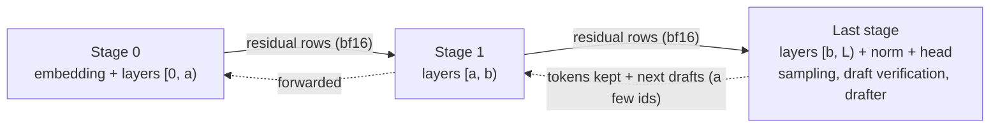

# hive-ram

**Pool the memory of 2–4 ordinary computers, linked by a Thunderbolt / USB4 cable, to run a quantized LLM that
does not fit in any one of them.**

hive-ram cuts a model into contiguous **layer ranges** (pipeline parallelism), puts each range on the machine whose
memory can hold it, and sends only the residual stream between machines, over plain TCP on the cable. The ranges do
not have to be equal: a 128 GB machine can take most of the layers and a 64 GB machine the rest.

hive-ram is not a new inference engine. It sits on top of existing engines:

- **llama.cpp RPC**, which already splits a model by layers. It works today; hive-ram only provides the link setup
  and the measurements.
- **tfpp**, our pipeline layer for [TensorFold](https://github.com/ashhart/TensorFold) (Python + CUDA), with one
  variant per model family: Qwen3.8-Flash-Next (`tfpp`), GLM-5.3-Flash (`tfpp-glm`) and DeepSeek-V4.1-Flash
  (`tfpp-ds41`).
- **vLLM pipeline parallelism** for MiniMax-M3.1-Flash (EXL3, 108.6 GiB), which fits the two machines only as a whole:
  hive-ram supplies the cable-only network, the TensorFold kernel build and patch, and the launch and test scripts
  ([guide](docs/engines/minimax-vllm.md), [recipe](docs/recipes/MiniMax-M3.1-Flash-SAGE-EXL3-2x-N1X-vLLM.md)). Verified
  on hardware: 18 tok/s plain, up to 57 tok/s with a DFlash2 drafter, a 131,072-token window with 4 streams.

[繁體中文說明 (README.zh-TW.md)](README.zh-TW.md) · [Documentation index](docs/README.md)

> **Status: research code.** Everything was built and measured on two NVIDIA N1X laptops (128 GB and 64 GB of
> unified memory, Windows 11 + WSL2) joined by one USB4 cable. Some parts are verified on that hardware. Other parts
> are written and have only been checked statically or with CPU tests. The
> [status table](#engines-and-verification-status) says which is which: read it before you plan a weekend around this.

## Contents

- [How it works](#how-it-works)
- [Why a pipeline over USB4, and not tensor parallelism](#why-a-pipeline-over-usb4-and-not-tensor-parallelism)
- [Measured results](#measured-results)
- [Engines and verification status](#engines-and-verification-status)
- [What you need](#what-you-need)
- [Quick start](#quick-start)
- [Repository layout](#repository-layout)
- [Limitations and gotchas](#limitations-and-gotchas)
- [Roadmap](#roadmap)
- [Licence](#licence)

## How it works

Each machine runs one **stage**: a contiguous range of decoder layers. Only one model's worth of weights exists across
the whole chain, so the stages together need about as much memory as one big machine would.



- **One round** is one trip along the chain. Every stage runs its layers on the same rows (the pending token plus any
  draft tokens). The last stage samples, verifies the drafts and proposes the next ones. Its decision travels back up
  the chain, so every stage commits exactly the same rows to its caches.
- **What crosses the cable per row**: Qwen3.8-Flash-Next 20 KB (4 × 2,560 bf16); GLM-5.3-Flash 32 KiB
  (4 × 4,096 bf16), plus 8 KiB per DFlash2 tap row; DeepSeek-V4.1-Flash 40 KiB (4 × 5,120 bf16), plus small extra
  rows (top-k, candidate pool, compressed KV) when a cut falls inside a group of layers that share KV.
- **Which stage leads**: in the Flash-Next harness, rank 0 embeds the prompt and drives the chain. In tfpp-glm and
  tfpp-ds41 the **last** stage is the leader: it holds the head, the drafter, the scheduler and the HTTP API.
- **KeepWarm**: a stage waiting for the network keeps its GPU busy with a tiny spin kernel on a side stream (one
  block, about 1 ms at a time). Without it, the GPU lowers its clocks during every wait, and the split ran about 25%
  slower than one machine. With it, the split runs as fast as one machine (see below).

The physical path, with WSL2 in its default NAT mode on Windows:

```
 node A (Windows 11)                                    node B (Windows 11)
 WSL2: stage k ──TCP──► USB4 P2P adapter 10.77.0.1 ═══cable═══► 10.77.0.2 ──► relay (user process) ──► WSL2: stage k+1
       (outbound from WSL works as is)                           (inbound into WSL needs the relay: Windows'
                                                                  built-in portproxy managed only 0.42 Gbit/s)
```

## Why a pipeline over USB4, and not tensor parallelism

Upstream TensorFold spreads a model across machines only by tensor (or expert) parallelism (TP). Its own docs say that
spreading one model's layers over several smaller machines needs a pipeline mode, which it does not have. Over a
laptop-to-laptop USB4 cable, TP is the wrong trade:

| | Tensor parallel (what upstream offers across machines) | Pipeline of layer ranges (hive-ram) |
|---|---|---|
| Messages per generated token | 2 all-gathers per layer: about 90 collectives per GLM-5.3-Flash step | 1 hop per stage boundary per round |
| Cost on our link (~0.5 ms round trip through the relay) | ~22–45 ms of pure communication per step (estimate). The same collectives cost ~1 ms on a RoCE fabric | ~2.3–2.5 ms per round for a 2-stage chain, Python included (measured) |
| Memory split | Every rank holds an equal share, so the smallest machine sets the limit. TensorFold 0.6.x runs GLM on CUDA with exactly 2 ranks | Any contiguous layer ranges, sized to each machine's free memory |
| Transport | NCCL: random ports and direct connections between peers. WSL's NAT plus a one-port relay cannot carry that (WSL mirrored networking is untested) | One TCP connection per hop, through a user-mode relay |
| Single-stream speed | All GPUs read weights at the same time | One GPU works at a time: about one machine's speed, **no speed-up** |

**What you get, and what you don't.** A pipeline gives you *capacity*: a model too big for any one of your machines
runs at roughly the speed of one machine reading all of its weights. It does not make a single stream faster.
tfpp-glm v2.0 (verified on one GPU, not yet across machines) batches several streams into each round; keeping all
machines busy at once needs overlapping rounds (v2.1, not written yet).

## Measured results

All numbers come from two NVIDIA N1X laptops: a **128 GB node** and a **64 GB node**, each running WSL2 (Ubuntu,
NAT mode), linked by one Thunderbolt 3 cable between their USB4 ports that negotiated 20 Gbps. Estimates are marked as such.

### The link (one TCP connection; `linktest.py` and PowerShell)

| Path | Throughput | Round trip p50 (64 B) |
|---|---|---|
| Windows → Windows over USB4 | 7.1 Gbit/s | – |
| WSL (node A) → Windows (node B) | 4.8 Gbit/s | 0.15 ms |
| Into WSL through Windows' portproxy (iphlpsvc) | 0.42 Gbit/s | 0.38 ms (p99 20 ms) |
| Same machine: Windows → WSL's address | 16.1 Gbit/s | – |
| Same machine: through our user-mode relay | 10.1 Gbit/s | – |
| **WSL → USB4 → relay → WSL (what the engines use)** | **5.2 Gbit/s (615 MiB/s)** | **0.49 ms (p99 1.4 ms)** |

### Qwen3.8-Flash-Next with tfpp on TensorFold 0.6.1 (verified on hardware)

Checkpoint `Vontra/Qwen3.8-Flash-Next-MLX-4bit-MTP` (48 layers). The 128 GB node ran the embedding and layers 0–31;
the 64 GB node ran layers 32–47 and the head. Greedy decoding, 200 tokens, three prompts (a short Chinese essay, a
Python function with tests, a three-point explanation).

| | One node, TensorFold | 2 nodes, tfpp, no KeepWarm | **2 nodes, tfpp, KeepWarm** |
|---|---|---|---|
| Output tokens | reference | identical, 3/3 (serial, serial + graphs, MTP 6 + graphs); same MTP acceptance | **identical, 3/3** |
| Serial decode | 32.3–32.8 tok/s (eager) | 24.5–25.1 (eager), 25.1–25.5 (graphs) tok/s | **33.0–33.8 tok/s** |
| MTP depth 6 + CUDA graphs: essay / code / explanation | 31.4 / 77.1 / 38.2 tok/s | 23.3 / 60.3 / 29.4 tok/s | **31.0 / 79.3 / 38.6 tok/s** |
| Time per round | – | 19.0 ms (128 GB node) + 15.5 ms (64 GB node) + ~2 ms link and Python + 1.7 ms leader commit | 17.4 ms (128 GB node) + 8.8 ms (64 GB node) + ~2.5 ms link |

- **Why KeepWarm matters.** The same layers 32–47 plus head take 8.7–9.0 ms per step on either node when run back to
  back. After 20–40 ms of idle they take 15–16.5 ms: the idle GPU had lowered its clocks. Spinning the CPU during the
  wait does not help (15.9 ms). One spinning GPU block on a side stream does (9.9 ms). In a pipeline every stage
  waits for the others about half the time, so every stage was being slowed down. llama.cpp RPC probably loses
  speed the same way.
- **Three ranks on two machines.** The 128 GB node ran two ranks (layers 0–15 and 16–31, linked locally) and the
  64 GB node ran layers 32–47. Output was identical (3/3) with the same acceptance, which proves the multi-rank code
  path. Speed was 24.1 / 62.9 / 30.2 tok/s. That is low because two processes shared one GPU, so it says nothing
  about three real machines.

### Qwen3.8-Flash-Next with llama.cpp RPC (verified on hardware)

unsloth's GGUF `UD-Q4_K_XL` (103.7 GiB), temperature 0.

| | 2 nodes, RPC (≈80 GB on the 128 GB node, ≈20 GB on the 64 GB node) | 1 node (128 GB), PLE table left on SSD |
|---|---|---|
| Decode, one stream (530-token essay, 700-token code) | **22.2 tok/s** | 22.8–23.6 tok/s |
| Prompt of 9,014 tokens | 760 tok/s (~12 s) | 691 tok/s |
| Load time | 1 min 30 s | 24 s |
| `llama-server` resident memory | 32 GB | 4.7 GB |
| Spot check (math, code, Chinese, reasoning) | 4/4 correct | 4/4 correct |

A lesson for Flash-Next: its per-layer token-embedding (PLE) table takes 26.8 GiB of the Q4 file, but each token reads
only 16 rows of 90 bytes. With `--lazy-mode on` the table stays on the SSD, and the Q4 model fits on one 128 GB node.
So Flash-Next Q4 does not need a cluster. Q6_K (156.6 GiB, of which 105.9 GiB must sit in GPU memory) would. On one
node, TensorFold (32.3–32.8 tok/s serial, up to 77 tok/s on code with MTP drafts, from the table above) is faster than
llama.cpp (22.8–23.6 tok/s), mostly thanks to MTP drafting and kernel efficiency. llama.cpp could not load
Flash-Next's MTP or DFlash2 GGUFs at the time we tested.

### GLM-5.3-Flash with tfpp-glm v1 (verified on a truncated model)

Base: TensorFold v0.6.0 plus MiaAI-Lab's 107-patch GLM recipe. Checkpoint `Mia-AiLab/GLM-5.3-Flash-EXL3-4bpw-TensorFold`.
Correctness runs used the model **truncated to its first 8 layers**, context 262,144, DFlash2 drafts and 19 bench
prompts. Each run compared every round's tokens, keep counts, drafts and logits hashes against one process.

| Test | What it checks | Result |
|---|---|---|
| T0a (pure) | The split compute against the package's own `_compute` | bit-identical |
| T0b | CUDA graphs against eager | bit-identical |
| T1 | Two stages, cut [0,4)+[4,8) and cut [0,5)+[5,8), against one process | bit-identical at both cuts |
| T1-kept | Kept prompts under 0.5 GiB memory pressure | same replies at both cuts |
| T1-fault | Injected exception: that request aborts and the next one is identical. Killed follower: the leader exits with 75 | as specified |
| Across machines | 128 GB node [0,4) → USB4 → 64 GB node [4,8) + head + DFlash2, against one process on the 64 GB node | **19/19 bit-identical** |
| 26 layers, across machines | Cut at 19 against cut at 20 (no single GPU holds a one-process reference at this size) | **19/19 bit-identical** |
| HTTP | The leader's OpenAI-style API | answered |

Speed on the 8-layer model (tracing on; an 8-layer GLM produces gibberish, so only speed and equality count):

| | Overall | Per decoded token |
|---|---|---|
| One process (64 GB node) | 65.1 tok/s | 11.7 ms |
| **Two stages across machines** | **53.6 tok/s** | **14.0 ms** |
| Two stages on one GPU (two processes compete; not representative) | 30.9 tok/s | 25.5 ms |

Time per round across machines (tracing off). The 26-layer run put layers [0,19) or [0,20) on the 128 GB node
(57.3 / 60.8 GiB) and the rest plus head and DFlash2 on the 64 GB node (26.5 GiB):

| Rows per round | 8 layers | 26 layers | Per extra layer | Fixed part |
|---|---|---|---|---|
| R=1 (one token) | 14.0 ms | 32.3 ms (31 tok/s) | 1.02 ms | 5.9 ms (head, sampling, one hop, Python) |
| R=2 (one draft) | 21.0 ms | 44.6 ms | 1.31 ms | 10.5 ms (DFlash2 draft 4.2 ms included) |

- 1.02 ms per layer is the memory-bandwidth limit: a decode step reads about 0.3 GB per layer (8 experts, the shared
  expert, 4-bit attention) at about 263 GB/s.
- The cross-machine hop adds about 2.3 ms per round, in line with Flash-Next's ~2.5 ms.

**Projection for the full 45-layer model on three nodes (estimate, not measured):** about 54 ms per token without
drafts (~18.6 tok/s). With DFlash2 at the acceptance seen on a dual DGX Spark (58%, about 2.6 tokens per round): about
25–30 tok/s for prose and 35–40 tok/s for code. For comparison, a **dual DGX Spark (GB10) pair running tensor
parallel over RoCE** with MIA's recipe measured 45.9 / 68.5 tok/s for one stream (prose / code) and 82.9 / 113.5 tok/s
with 4 streams. A single stream on a pipeline keeps one GPU busy at a time, so it reaches about 55–65% of that pair by
design. Approaching its total throughput needs several streams and overlapping rounds (tfpp-glm v2.1, not written;
v2.0 is modelled at about 1.5–1.7× one stream).

**DeepSeek-V4.1-Flash projection (estimate, nothing run):** about 45–50 ms per round on three nodes, i.e. roughly
25–37 tok/s for prose and 40–55 tok/s for code. For the same model on a dual DGX Spark pair: 61.4 tok/s prose / 89.3 tok/s code (MiaAI-Lab's published figure for its recipe on a GB10 pair, which runs the BertholomusAI fork's Zig branch deepseek-v41-zig; not measured by us).

## Engines and verification status

| Engine | Model | Built on | Status |
|---|---|---|---|
| llama.cpp RPC | Qwen3.8-Flash-Next, unsloth GGUF `UD-Q4_K_XL` | upstream llama.cpp (built at `9febe63` with `GGML_RPC=ON`) | **VERIFIED ON HARDWARE**: llama.cpp RPC Flash-Next Q4, 2 nodes, 22.2 tok/s |
| `tfpp` | Qwen3.8-Flash-Next, MLX 4-bit + MTP | TensorFold 0.6.1 | **VERIFIED ON HARDWARE**: the 2-machine split is token-identical to a single node and as fast (KeepWarm); a 3-rank chain ran on 2 machines. ¹ |
| `tfpp-glm` v1 (`PARALLEL=1`) | GLM-5.3-Flash, EXL3 4bpw (+ optional DFlash2) | TensorFold v0.6.0 + MiaAI-Lab's 107 patches | **VERIFIED ON HARDWARE (truncated model)**: bit-exact against one process on the 8-layer model (pure, eager and graphs, 2 cut points, kept-prompt pressure, fault abort and kill, cross-machine 19/19); 26 layers across machines bit-identical at two cuts; the HTTP path answered. ² |
| `tfpp-glm`, full model | GLM-5.3-Flash, all 45 layers | same | **NOT RUN.** The full 45-layer model needs about 160 GiB of stages and does NOT fit 128 + 64 GB. It needs a third node (planned chain 128 GB → 64 GB → 128 GB). |
| `tfpp-glm` v2 (`PARALLEL` 2–8) | same, several streams | same | **VERIFIED ON ONE GPU (2026-10-24), 8-layer truncated model:** batched-row invariance (T0e); pure and eager against graphs on three lockstep schedules; 2-stage chains at 2 cut points x 3 schedules bit-identical, every stage applying the leader's messages; replies equal to P=1 serial under free timing at 1, 2 and 4 streams. **Not yet run across machines.** |
| `tfpp-ds41` | DeepSeek-V4.1-Flash-1017, EXL3 EAQ 2.9 bpw | BertholomusAI's TensorFold fork (`deepseek-v41-tp2`) | **NOT RUN ON HARDWARE.** Static review only, plus its CPU tests (which pass); nothing has run on a GPU. |
| vLLM PP=2 + TensorFold kernels | MiniMax-M3.1-Flash, complete 60 layers, EXL3 SAGE 2.15 bpw (108.6 GiB) | vLLM `minimax-m31-flash` image + vllm-exl3 (the pack author's, AGPL-3.0) + TensorFold v0.6.6 kernels | **VERIFIED ON HARDWARE (2026-10-26)**: both machines, full model: 17.8 tok/s without a draft; with the DFlash2 drafter 14–44 tok/s for one stream at a 131,072-token window (structured text fastest) and 31–36 tok/s in total for 1–3 streams; 24/24 on a verifiable task set; a needle test at 96K tokens passed. The glue plugin that calls the kernels is not published (AGPL), so the repository alone does not reproduce these numbers. ³ |

¹ The hardware runs used the first, unversioned wire protocol. The code has since moved to protocol
`tfpp-flashnext/2` (link handshake, whole-chain check at start, checked frames, error frames). That version passes the
CPU tests but has not been re-run on hardware.
² Fixes made after the hardware runs (listed in
[`tfpp/tfpp/glm/IMPLEMENTATION_NOTES.md`](tfpp/tfpp/glm/IMPLEMENTATION_NOTES.md)) have passed CPU tests only.
³ Speeds are at temperature 0; the 57 tok/s figure is single stream at 8K context. Output is not byte-identical between two runs of even the
plain server, so lossless drafting is argued from the verification step and from task accuracy, not from byte equality
([details](docs/engines/minimax-vllm.md#quality)).

Bit-exact here means equal to **one process of the same engine at world size 1**. It does not mean equal to a
tensor-parallel (TP=2) deployment: TP adds partial sums in a different order, so its bits differ.

Per-engine guides, with every flag and the tests behind each status: [llama.cpp RPC](docs/engines/llamacpp-rpc.md),
[tfpp (Flash-Next)](docs/engines/tfpp-flashnext.md), [tfpp-glm](docs/engines/tfpp-glm.md),
[tfpp-ds41](docs/engines/tfpp-ds41.md), [MiniMax on vLLM](docs/engines/minimax-vllm.md). All measurements with their conditions: [docs/benchmarks.md](docs/benchmarks.md).

## What you need

- **Machines**: 2–4 computers with an NVIDIA GPU and enough combined memory for the model. Tested only on NVIDIA N1X
  laptops (GPU `sm_121`; 128 GB and 64 GB of unified memory). Measured per node: 263–285 GB/s memory
  read bandwidth and 93 bf16 TFLOPS. Other GPUs and native Linux nodes are untested.
- **OS**: Windows 11 with WSL2 (Ubuntu, aarch64, default NAT networking) was the tested setup. Everything that
  computes runs inside WSL; the Windows side only sets up the link and runs the relay.
- **Cable**: one Thunderbolt 4 / USB4 cable plugged **directly** between two USB-C ports, not through a dock. A node
  in the middle of a three-node chain needs two USB4 ports and two cables, one subnet per cable.
- **Memory you can actually use**: plan on about 92 GiB for weights and caches on a 128 GB node, and 30–40 GiB on a
  64 GB node that runs nothing else on its GPU. Leave at least 4–6 GB to Windows. The GPU memory CUDA reported inside
  WSL followed WSL's memory limit (`.wslconfig`): 104,475 MiB with a 108 GB limit, 46 GiB with a 48 GB limit
  (observed, not proven).
- **Disk**: each stage needs only the shards of its own layers, inside the WSL disk (not `/mnt/c`). Remember that the
  WSL virtual disk grows on `C:`.
- **Software** (inside WSL): Python 3.14 (the only version run on hardware), CUDA 13 builds of PyTorch, and pip's CUDA
  13.0 toolchain. Each engine gets its own venv; see its `toolchain.sh` or `env.sh`.

How much a layer weighs, to plan your cuts:

| Model | Per layer | Fixed extras | Total |
|---|---|---|---|
| GLM-5.3-Flash EXL3 4bpw (45 layers) | 3.67–3.70 GiB (MoE layers), 0.54 GiB (dense layers 0–2) | embedding 1.18, head 1.18, DFlash2 about 0.9 resident (plus caches and work buffers on every stage) | 163.6 GiB on disk; about 160 GiB of stages |
| DeepSeek-V4.1-Flash EXL3 EAQ 2.9 bpw (40 layers) | 4.86 GiB (3.28 GiB for layers 18–22) | embedding 1.23, head 0.46, DSpark drafter 6.75 | 196.1 GiB, plus two Engram tables of 94.6 GiB each read from SSD |

## Quick start

Clone this repository to `~/hive-ram` inside WSL on every node. The systemd unit for tfpp-glm assumes that path;
see the notes below for tfpp-ds41. All commands in WSL are run from `~/hive-ram` unless shown otherwise.

Run the CPU tests first (no GPU, no TensorFold needed; pytest and numpy are):

```bash
python3 -m venv ~/.venvs/hive-ram-test && . ~/.venvs/hive-ram-test/bin/activate && pip install -e ~/hive-ram"[test]"
cd ~/hive-ram/tfpp
python -m pytest -q tests scripts/tests tfpp/glm/tests tfpp/ds41/tests
```

### Step 0: link two machines (all engines)

The full walk-through, including three-node chains and WSL settings, is [docs/hardware-setup.md](docs/hardware-setup.md);
when something does not work, see [docs/troubleshooting.md](docs/troubleshooting.md).

On **each** Windows machine, in an **administrator** PowerShell, with the cable already plugged in:

```powershell
# node 1 gets 10.77.0.1 and opens 50052 (llama.cpp RPC) and 5201 (link test, tfpp) to its peer only
powershell -ExecutionPolicy Bypass -File setup_usb4_link.ps1 -Node 1
# node 2 gets 10.77.0.2
powershell -ExecutionPolicy Bypass -File setup_usb4_link.ps1 -Node 2
```

This sets a static address on the USB4 adapter only (network category Private) and adds firewall rules that admit
ICMP and the given TCP ports **only from the peer's address**. Other links: `-Address`, `-PeerAddress`,
`-AllowTcpPorts`, `-InterfaceAlias` (the script header shows a three-node example). Undo with `undo_usb4_link.ps1`.
In steps 0, A and B, node 1 is the machine that receives connections and runs the back layers (the 64 GB node in our
runs); node 2 runs the front layers and drives the chain (the 128 GB node). tfpp-glm and tfpp-ds41 take their
addresses from `node.env` instead.

On the **receiving** node's Windows side (no admin), start the relay into WSL and keep the window open:

```powershell
powershell -ExecutionPolicy Bypass -File relay_user.ps1      # listens on 10.77.0.1, ports 50052 and 5201
# other address / ports:  -ListenAddress 10.77.0.2 -Ports 5301      WSL address by hand:  -WslIp <address>
```

Restart the relay whenever WSL restarts, because WSL's NAT address changes. If an older setup left `netsh portproxy`
entries on those ports, run `start_n1x_relay.ps1` once as administrator: it removes them and then starts the relay.

Test the real path, WSL to WSL:

```bash
python3 linktest.py server           # node 1, inside WSL (serves one client, then exits)
python3 linktest.py client 10.77.0.1 # node 2, inside WSL
```

Expect about 5 Gbit/s and a p50 round trip of about 0.5 ms. Tens of milliseconds at p99 means traffic is going
through portproxy instead of the relay.

### A. llama.cpp RPC (no hive-ram code)

Build llama.cpp in WSL on both nodes with CUDA and RPC. We built commit `9febe63` with CUDA 13.1:

```bash
cmake -B build -DGGML_CUDA=ON -DGGML_RPC=ON -DCMAKE_CUDA_ARCHITECTURES=121 \
      -DCUDAToolkit_ROOT=/usr/local/cuda-13.1   # without it our first build linked an older system CUDA
cmake --build build -j
```

Node 1 (behind `relay_user.ps1`, which forwards 50052) runs the RPC server for the back layers. Recent builds name it
`ggml-rpc-server`, older ones `rpc-server`; check `--help` for your build. Do not enable its local cache (`-c`):
writing the cache file also fills WSL's memory.

```bash
build/bin/ggml-rpc-server -H 0.0.0.0 -p 50052
```

Node 2 holds the GGUF files and runs the server and the front layers. This is the command of the measured run:

```bash
build/bin/llama-server -m <dir>/<model>-UD-Q4_K_XL-00001-of-00004.gguf --rpc 10.77.0.1:50052 \
  -ngl 999 --fit on --fit-target 6144,4096 -c 32768 -np 1 -fa on -lm dio -cram 2048 \
  --host 127.0.0.1 --port 18080
```

- `-lm dio` reads the weights with direct I/O, so the page cache does not eat the memory the model needs.
- For Flash-Next, try one node first: `-lm dio --lazy-mode on -ngl all --fit off`. `--lazy-mode auto` switches itself
  off because ggml-cuda treats the N1X as an integrated GPU, and `-lm mmap` without lazy mode made WSL read ahead
  16 MB for each 90-byte row. Running the server under a cgroup (for example `systemd-run ... -p MemoryHigh=8G`) also
  keeps the page cache in check.

### B. tfpp: Qwen3.8-Flash-Next on TensorFold 0.6.1

One-time venv on each node: see the header of `tfpp/scripts/flashnext/env.sh` (TensorFold `v0.6.1`, a CUDA 13 build of
torch 2.14.1, pip's CUDA 13.0). Note that `env.sh` was rebuilt from the measured setup and has not itself been run on
hardware. Each node needs `config.json`, the tokenizer and the shards of its layers; the last rank also needs the head
and MTP shards. Copying the whole checkpoint to both nodes is simplest.

```bash
cd ~/hive-ram/tfpp && . scripts/flashnext/env.sh
# node 1 (10.77.0.1, behind relay_user.ps1): the last rank
python tfpp_run.py --role last --model <dir> --layers 32:48 --listen 5201 --depth 6 --graphs
# node 2: the leader (rank 0); it waits for the chain, runs three prompts and writes the tokens
python tfpp_run.py --role leader --model <dir> --layers 0:32 --peer 10.77.0.1:5201 --depth 6 --graphs --out pp.json
# reference on one node (the whole model must fit), then compare token by token
python tfpp_run.py --role local --model <dir> --depth 6 --graphs --out ref.json
python compare.py ref.json pp.json
```

- Give every rank the same `--depth` and `--capacity`. A middle rank takes `--layers`, `--listen` and `--peer`. Ranks
  may start in any order.
- Optional settings: `TFPP_SECRET` (the same value on every node: both ends of each link must prove they know it),
  `TFPP_WARM_MS` (KeepWarm spin length, default 1.0; 0 turns it off), `TFPP_TIMING=1` (time per phase),
  `TFPP_IO_TIMEOUT` (default 600 s).
- `rank_bench.py` times one rank's step alone, with or without idle gaps, to see GPU clock effects.
- `tfpp_run.py` is a measurement and verification harness. It runs a fixed prompt set and has no HTTP server.

### C. tfpp-glm: GLM-5.3-Flash on the MIA package

**1. The venv and the base package** (each node, inside WSL; the full list is in `tfpp/scripts/glm/toolchain.sh`):

```bash
python3.14 -m venv ~/tf-venv-mia && . ~/tf-venv-mia/bin/activate
pip install --index-url https://download.pytorch.org/whl/cu130 "torch==2.13.0"
pip install "triton==3.7.1" ninja "cuda-toolkit[nvcc,cccl]==13.0.*" numpy safetensors \
    "tokenizers>=0.20" "jinja2>=3.1" "huggingface-hub>=0.24"
# leader only: pip install "torchvision==0.28.0" Pillow "av==18.1.0" "xgrammar==0.2.8" "transformers>=5.3,<6"
rsync -a --delete "$MIA_TREE"/tensorfold/ \
    "$(python -c 'import sysconfig; print(sysconfig.get_paths()["purelib"])')/tensorfold/"
cd ~/hive-ram/tfpp && python -m tfpp.glm.pins --check      # must report the tree digest 739ce991...
```

`$MIA_TREE` is TensorFold `v0.6.0` with the 107 patches of MiaAI-Lab's public recipe
`GLM-5.3-Flash-EXL3-2x-DGX-Sparks-TensorFold` (commit `b5808ac`, "v1.11-pre") applied in file-name order. Applying these
patches to the v0.6.0 tag reproduces the pinned digest offline ([`THIRD_PARTY.md`](THIRD_PARTY.md)). A stage refuses to start on any other tree.

**2. Weights.** Use `Mia-AiLab/GLM-5.3-Flash-EXL3-4bpw-TensorFold` (83 shards, 163.6 GiB). Each stage needs
`config.json`, the tokenizer, the index and its own shards; `node.env.example` lists the shard numbers for its cuts.
The DFlash2 drafter `incoai/GLM-5.3-Flash-DFlash2@bf582e4e` is **optional and licensed CC BY-NC-ND 4.0
(non-commercial, no derivatives)**: set `NO_DRAFTS=1` to run without it (serial decoding).

**3. One-GPU equivalence tests**, with a model truncated to 8 layers (our hardware runs used the 64 GB node; either node fits):

```bash
cd ~/hive-ram/tfpp
export MODEL_DIR=$HOME/models/glm53 DRAFTER_DIR=$HOME/models/glm53-dflash2   # DRAFTER_DIR empty: --no-drafts
L=8 CONTEXT=2048 scripts/glm/run_truncated.sh all       # T0a, T0b, T1 (two cuts), T1-kept, T1-fault
L=8 CONTEXT=2048 scripts/glm/run_truncated.sh T1-http
```

Pass criterion: `python -m tfpp.glm.compare ref.jsonl got.jsonl` reports IDENTICAL throughout.

**4. Across machines.** On each node copy `tfpp/scripts/glm/node.env.example` to `node.env` and keep that node's
block (role, layers, model folder, `DOWN` / `LISTEN` addresses). `cluster.env` holds the settings every stage must
share. At start, the stages compare a digest of those settings and refuse to run if they differ. On the Windows side
of every node that receives a hop, first admit the stage port from the peer (administrator PowerShell), then start
the relay. Two nodes, receiving on 10.77.0.1 as in our runs (three nodes: the -Address/-PeerAddress/-AllowTcpPorts
lines of docs/hardware-setup.md):

```powershell
powershell -ExecutionPolicy Bypass -File setup_usb4_link.ps1 -Node 1 -AllowTcpPorts 50052,5201,5301
powershell -ExecutionPolicy Bypass -File tfpp\scripts\glm\relay_hop.ps1 -ListenAddress 10.77.0.1 -Ports 5301
```

Then, inside WSL on each node, in any order:

```bash
cd ~/hive-ram/tfpp/scripts/glm
./start_stage.sh --dry-run    # checks only: venv, package digest, shards, memory, ports; prints the command
./start_stage.sh              # background; the leader waits until it serves and passes a smoke test
```

The leader serves an OpenAI-style API (`HTTP_HOST` / `HTTP_PORT` in `cluster.env`, default port 8888):

```bash
curl -s http://127.0.0.1:8888/v1/models
curl -s http://127.0.0.1:8888/v1/chat/completions -H 'Content-Type: application/json' \
  -d '{"model": "GLM-5.3-Flash-EXL3", "messages": [{"role": "user", "content": "Hello"}], "max_tokens": 64}'
```

- Stop with `./stop_stage.sh` **on the leader**; QUIT travels down the chain. A stage that loses its link exits with
  75, and then the whole chain must be restarted.
- `HTTP_HOST=0.0.0.0` serves the API **without authentication** on every interface. Use `127.0.0.1` unless the port
  is firewalled.
- Other GPU servers on the same node: list their ports in `GPU_GUARD_PORTS` and `start_stage.sh` will not start beside
  them. `VERIFY_SHARDS=1` checks this stage's shards against their Hub sha256 first.
- With less memory than the full model needs, the shortened cross-machine runs use the leader's `TRUNCATE`,
  `TAP_LAYERS`, `BENCH` and `TRACE` keys (see `node.env.example`).
- Multi-stream v2 (`PARALLEL=4` and friends in the leader's `node.env`, tests in `scripts/glm/run_v2.sh`) has run on one GPU only and has not been
  run on hardware.

### D. tfpp-ds41: DeepSeek-V4.1-Flash on the BertholomusAI fork (not run on hardware yet)

Nothing here has run on a GPU. Treat it as the first hardware bring-up, not as a recipe. The order the scripts expect
(details in [`tfpp/tfpp/ds41/IMPLEMENTATION_NOTES.md`](tfpp/tfpp/ds41/IMPLEMENTATION_NOTES.md)):

```bash
# 1. venv ~/tf-venv-dsv41 and the fork's LF sources: steps at the top of tfpp/scripts/ds41/toolchain.sh
#    (git archive of github.com/bertholomus/TensorFold, branch deepseek-v41-tp2, commit af26d42b1)
cd ~/hive-ram/tfpp
python -m tfpp.ds41.pins --check <fork-src>/tensorfold   # must report c64d3e0a...
python -m tfpp.ds41.prebuild                              # builds the four extensions, checks what they link
# 2. the 11-layer test model S11 (59.9 GiB): print the download script, run it yourself, then build S11 on each node
scripts/ds41/download_list.sh > get_s11.sh   # checks free disk first; edit the script's REV line, then run it
SRC=$HOME/models/ds41-src scripts/ds41/make_testmodel.sh
# 3. one GPU, in this order; each step must be IDENTICAL before the next
export MODEL_DIR=$HOME/models/ds41-s11
scripts/ds41/run_shortened.sh T-ref
scripts/ds41/run_shortened.sh T0a        # then T0b, T0c, T1-oracle, T1-exact, T1-long, T1-multi, T1-fault, T1-http
# 4. two nodes: node.env test blocks (T1-c6, T1-c3, T1-3); on the receiving node `setup_usb4_link.ps1 -Node 1
#    -AllowTcpPorts 5321` (admin) and relay_hop.ps1 -Ports 5321; start_stage.sh on each node
```


## Repository layout

```
hive-ram/
├── README.md, README.zh-TW.md
├── LICENSE, NOTICE, THIRD_PARTY_NOTICES.md
├── THIRD_PARTY.md              how to fetch the third-party trees at their pins and check their digests
├── SECURITY.md                 threat model: what the links and APIs do and do not protect
├── docs/                       guides and design notes (index: docs/README.md)
├── setup_usb4_link.ps1         Windows, admin: static address + peer-only firewall rules for one USB4 link
├── undo_usb4_link.ps1          Windows, admin: removes what setup_usb4_link.ps1 added
├── relay_user.ps1              Windows, no admin: user-mode TCP relay from the link address into WSL
├── start_n1x_relay.ps1         Windows, admin: removes old portproxy entries, then runs relay_user.ps1
├── linktest.py                 throughput and round-trip test over the real path (standard library only)
└── tfpp/
    ├── scripts/minimax/        MiniMax: n1x_tun.py (cable-only IP link), serve and launch scripts, TensorFold patch, eval/
    ├── tfpp_run.py             Flash-Next: one GPU, or one rank of a pipeline (measurement harness)
    ├── compare.py              Flash-Next: token-by-token comparison of two runs
    ├── rank_bench.py           Flash-Next: one rank's step time, with idle gaps (GPU clock effects)
    ├── tfpp/                   Flash-Next pipeline: load, part, driver, wire, proto, warm (KeepWarm)
    │   ├── glm/                tfpp-glm v1 and v2 (v2*.py), IMPLEMENTATION_NOTES.md, schedules/, tests/
    │   └── ds41/               tfpp-ds41, IMPLEMENTATION_NOTES.md, tests/
    ├── scripts/
    │   ├── flashnext/env.sh    Flash-Next environment
    │   ├── glm/                toolchain, cluster.env, node.env.example, start/stop_stage.sh, relay_hop.ps1,
    │   │                       run_truncated.sh, run_v2.sh, systemd unit
    │   ├── ds41/               the same for tfpp-ds41, plus download_list.sh, make_testmodel.sh, run_shortened.sh
    │   └── tests/              CPU tests of the link tools and scripts
    └── tests/                  CPU tests of the Flash-Next pipeline
```

Not in this repository: TensorFold, the MIA patch set and the BertholomusAI fork (fetch them yourself at the pinned
versions, see [`THIRD_PARTY.md`](THIRD_PARTY.md); tfpp-glm and tfpp-ds41 check their digests at start), and any model
weights.

## Limitations and gotchas

**What it can't do yet**
- **Capacity, not speed.** One stream is about as fast as one machine reading all the weights. tfpp-glm v1 and the
  Flash-Next harness serve one request at a time.
- **The full GLM-5.3-Flash model has never run.** It does not fit 128 + 64 GB. DeepSeek-V4.1-Flash has never run at
  all. Its weights (196.1 GiB) are tight even on three nodes, and a stage that owns both Engram layers needs about
  273 GiB of disk (its weights plus both Engram tables), more than our nodes have free.
- **Tested on one kind of machine only**: N1X laptops (`sm_121`) under WSL2 NAT, Python 3.14. The code accepts any
  number of stages, but at most two machines (three ranks) have been used.
- **Pinned upstream trees.** Each tfpp variant patches named functions of one exact TensorFold tree at run time.
  tfpp-glm and tfpp-ds41 refuse to start on any other tree (digest check). Flash-Next tfpp only checks that the one
  loader line it replaces is still there, so run it on TensorFold `v0.6.1` exactly. A new upstream version needs a
  review, not just a pip upgrade.
- **Fail-stop.** If any stage fails, the whole chain stops (exit code 75). Restart every stage.

**Security**
- The stage links have no encryption. tfpp-glm, tfpp-ds41 and llama.cpp RPC have no authentication; the Flash-Next
  link can require a shared `TFPP_SECRET`. llama.cpp's RPC server lets any client read and write its buffers.
- Keep every port on the point-to-point cable: bind to the link address and admit only the peer (what
  `setup_usb4_link.ps1` does). The address inside WSL that the relay forwards to is reachable by every process on
  that Windows host.
- tfpp-glm's API has no authentication. tfpp-ds41's leader can require a key (`TF_API_KEY_FILE` in its `node.env`).
- The threat model and the hardening steps are in [`SECURITY.md`](SECURITY.md).

**Windows and WSL gotchas we hit**
- The USB4 network adapter showed up on one laptop but stayed "disconnected", and never appeared on the other. A
  reboot of that laptop fixed it; firmware and update differences turned out not to be the cause. Plug the cable
  straight between the machines, not through a dock.
- Driver and OS updates can install themselves and reboot a node in the middle of a run. Pause automatic updates
  while you experiment. A firmware update also changed how a 64 GB laptop splits memory between Windows and the GPU
  (Windows saw 32 GB afterwards), so re-check free memory after updates.
- WSL's page cache counts against Windows' memory commit. After a large download, one node had 77 GB of page cache
  left, which pushed Windows to 1.2 GB of free commit and grew the page file until `C:` was full. Drop caches after
  big copies (`echo 1 | sudo tee /proc/sys/vm/drop_caches`). The tfpp-glm loader uses `O_DIRECT` and asks the kernel
  to drop each shard from the cache before loading.
- Other GPU programs on a node take the same unified memory. Stop them before loading a stage.
- Laptops draw 45–80 W and run hot under hours of full load: keep them on power and watch temperatures.

## Roadmap

1. **A third node** (128 GB) to run the full 45-layer GLM-5.3-Flash across three machines. The plan is the chain
   128 GB → 64 GB → 128 GB; the example `tfpp/scripts/glm/node.env.example` ships the variant 64 GB → 128 GB → 128 GB
   (cuts [0,7) / [7,26) / [26,45)). The order is settled at bring-up, with each node's real free memory.
2. **tfpp-glm v2 on hardware**: several streams through the chain (`PARALLEL` 2–8), first on one GPU, then on two and
   three nodes. Then v2.1: overlapping stages (grouped pipelining) for higher total throughput.
3. **tfpp-ds41 bring-up**: the 11-layer test model on one GPU, then two nodes; the full model after that, given
   enough memory and SSD space for the Engram tables.
4. Re-run on hardware the fixes made since the measured runs, and add a script that fetches and verifies the
   third-party trees at their pinned versions.
5. Experiments: NCCL tensor parallelism over USB4 with WSL mirrored networking (to measure, not because we expect it
   to win), and ports to TensorFold's native (Zig) engines once the Python paths are proven.

Details and the order of the hardware steps: [docs/roadmap.md](docs/roadmap.md).

## Licence

- hive-ram's own code and docs: **Apache License 2.0**, copyright hive-ram contributors. See [`LICENSE`](LICENSE) and
  [`NOTICE`](NOTICE). Parts of tfpp adapt TensorFold source, and tfpp-glm and tfpp-ds41 also follow and patch the
  MIA-patched package and the BertholomusAI fork at run time; `NOTICE` lists what is adapted.
- tfpp builds on **TensorFold** (Apache-2.0; code before 0.6.0 was MIT), **MiaAI-Lab's GLM recipe patches**,
  **BertholomusAI's TensorFold fork** (Apache-2.0) and **ExLlamaV3**'s EXL3 format (MIT). llama.cpp / ggml (MIT) is
  used as a separate program over RPC, not copied. None of these trees ship here. Credits and licence texts are in
  [`THIRD_PARTY_NOTICES.md`](THIRD_PARTY_NOTICES.md). No AGPL code is added, imported or copied. (The MiniMax recipe
  runs the pack author's AGPL-3.0 vllm-exl3 plugin from their own image, as a separate program you install; hive-ram
  ships nothing that imports it.)
- **No model weights ship here.** Each checkpoint keeps its own licence: check the model card before you download
  and before any non-personal use. In particular, the optional DFlash2 drafter for GLM
  (`incoai/GLM-5.3-Flash-DFlash2`) is **CC BY-NC-ND 4.0: non-commercial use, no derivatives**. Do not redistribute it
  or converted versions of it. To run without it, use `NO_DRAFTS=1`, or the checkpoint's own MTP head at
  `PARALLEL=1` (`serve.py` without `--drafter`; not wired into `start_stage.sh` and not run on hardware; MIA's recipe
  calls this mode `DRAFTER=mtp`, single-stream only and roughly 5–10% slower). This project does not cover commercial
  use of DFlash2: if yours is commercial, leave it out.
- NVIDIA, N1X, DGX Spark, GB10, Thunderbolt, USB4, DeepSeek, Qwen and GLM are trademarks of their owners
  and are used here only to describe hardware and models.

## Acknowledgements

TensorFold and its contributors; MiaAI-Lab (Mia-AiLab on Hugging Face) for the GLM-5.3-Flash recipe and the EXL3
quantizations; BertholomusAI for the DeepSeek-V4.1 TensorFold fork; turboderp's ExLlamaV3; the llama.cpp / ggml
project; and unsloth for the GGUF quantizations.
