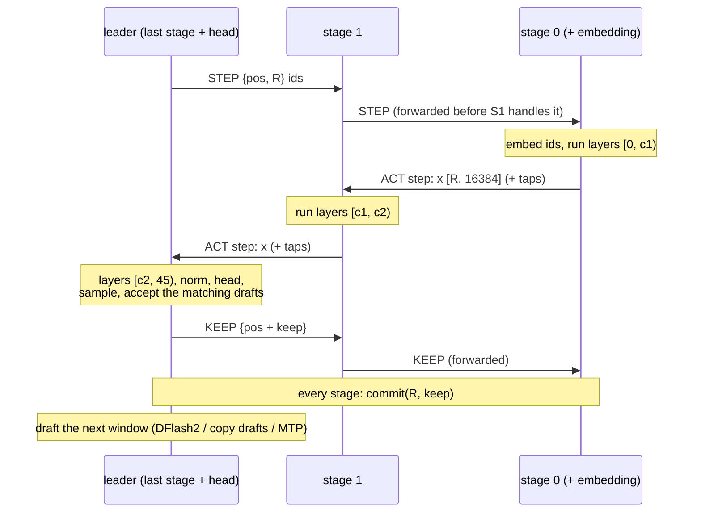

# Architecture

hive-ram runs one large quantized model on 2 to 4 ordinary computers by giving each machine a **contiguous range of
decoder layers** (pipeline parallelism). The machines are linked point to point by a Thunderbolt / USB4 cable and talk
plain TCP over it. The ranges do not have to be equal: a machine with more memory takes more layers.

This page explains how a split works, what crosses the cut, how the stages stay in step, why one stage leads, the GPU
idle-clock problem we found and fixed (KeepWarm), CUDA graphs per stage, chains of more than two stages, and how to
plan memory. The wire format is in [protocol.md](protocol.md); the equivalence tests are in [testing.md](testing.md).

## Verification status

Read every claim on this page against this list. It is the complete list of what has run on real hardware.

| Status | Component |
|---|---|
| **VERIFIED ON HARDWARE** | Flash-Next tfpp 2-machine split token-identical to single node and as fast (KeepWarm), 3-rank chain on 2 machines |
| **VERIFIED ON HARDWARE** | tfpp-glm v1 bit-exact vs one process on the truncated 8-layer model (pure/eager/graphs, 2 cut points, kept-prompt pressure, fault abort/kill, cross-machine 19/19), 26-layer cross-machine two cuts bit-identical, HTTP path answered |
| **VERIFIED ON HARDWARE** | llama.cpp RPC Flash-Next Q4 2-node 22.2 tok/s |
| **DOES NOT FIT** | Full 45-layer GLM (~160 GiB) does NOT fit 128+64 GB: needs a third node (planned chain 128->64->128) |
| **NOT RUN ON HARDWARE** | tfpp-glm v2 (PARALLEL 2-8) |
| **NOT RUN ON HARDWARE** | tfpp-ds41 (static review only, plus its CPU tests; nothing has run on a GPU) |

Changes made after the hardware runs have CPU tests only and have not been re-run on hardware: the Flash-Next wire's
version 2 (link handshake, HELLO chain check, checked frames, error frames) and tfpp-glm's post-run fixes (listed in
`tfpp/tfpp/glm/IMPLEMENTATION_NOTES.md`, section "After the hardware runs").

## 1. The idea

```
            USB4 cable (TCP, ~5 Gbit/s, ~0.5 ms)          USB4 cable
 +---------------------------+        +----------------------+        +-------------------------------+
 | node A (128 GB)           |        | node C (64 GB)       |        | node B (128 GB)               |
 | stage 0: layers [0, 19)   | -----> | stage 1: [19, 26)    | -----> | leader: layers [26, 45)       |
 | + token embedding         |  x     |                      |  x     | + norm, head, sampling,       |
 |                           | <----- |                      | <----- |   drafters, HTTP API          |
 +---------------------------+  ctl   +----------------------+  ctl   +-------------------------------+
        x   = residual streams of the rows being computed (bf16), once per round, stage 0 -> leader
        ctl = small control frames (token ids, how many rows to keep), leader -> stage 0
```

The example is tfpp-glm's planned three-node chain for GLM-5.3-Flash (not yet run: see the status table). Every stage
runs the unmodified engine code of its base package on its own layers, keeps its own caches for those layers, and
receives only the activations at the cut. The chain as a whole computes exactly what one process with all layers
computes, which the tests check bit for bit ([testing.md](testing.md)).

### Why layer ranges and not tensor parallelism

TensorFold's only cross-machine mode is tensor parallelism (`--tp 2` over NCCL; on a dual DGX Spark it runs over
RoCE RDMA). Tensor parallelism over USB4 does not suit these machines:

- It synchronises twice per layer: about 90 all-gathers per GLM-5.3-Flash token. At an estimated 0.25-0.5 ms each
  over this link that alone costs about 22-45 ms per token (see [related work](related-work.md#tensor-parallelism-over-usb4)).
- It splits every layer in equal halves, so the smallest machine sets the limit; TensorFold 0.6.x runs GLM on CUDA with exactly
  2 ranks, and upstream 1.1.x's native TP=N still splits evenly (see [related work](related-work.md)).
- Under WSL2's NAT networking, NCCL's socket transport needs connections in both directions that NAT blocks.

A layer pipeline crosses each cut once per round in each direction, carries a few KiB per row, and takes any number of
uneven stages. Upstream TensorFold (read at v1.1.2) has no engine that runs a layer pipeline across machines; hive-ram
adds that mode on top of the engines without modifying them.

## 2. Engines

| Engine | Base (third-party, fetched separately) | Model | What a stage runs | Leader | Status |
|---|---|---|---|---|---|
| llama.cpp RPC | llama.cpp with `GGML_RPC=ON` | Qwen3.8-Flash-Next GGUF (UD-Q4_K_XL) | `ggml-rpc-server` holds a layer range; `llama-server --rpc` drives | the `llama-server` node | verified, 22.2 tok/s |
| tfpp (Flash-Next) | TensorFold 0.6.1 | Qwen3.8-Flash-Next, MLX 4-bit + MTP head (48 layers) | TensorFold's own forward cut at a layer boundary | rank 0 (first stage) | verified |
| tfpp-glm | the MIA package: TensorFold v0.6.0 + 107 patches of MiaAI-Lab's public GLM-5.3-Flash recipe (v1.11-pre) | GLM-5.3-Flash EXL3 4 bpw (45 layers + MTP) | the package's world=1 code on a layer range | the **last** stage | v1 verified on truncated models; v2 not run |
| tfpp-ds41 | bertholomus/TensorFold fork, branch `deepseek-v41-tp2` | DeepSeek-V4.1-Flash EXL3 | the fork's world=1 `--parallel` path on a layer range | the **last** stage | not run |

Code: `tfpp/tfpp/*.py` (Flash-Next), `tfpp/tfpp/glm/`, `tfpp/tfpp/ds41/`. The Flash-Next and GLM variants load only
their range by compiling a copy of the base loader's source with a few string anchors replaced (each must occur exactly
once, or the stage refuses to start), so every tensor is still built by the unchanged upstream code; tfpp-ds41 calls
the fork's own block loader and recompiles four functions the same way.

## 3. The cut: what crosses it

Every stage holds its own KV caches, recurrent states, sparse-attention indexes and positions for its own layers. None
of that travels. Each stage advances its position by the same `commit` the others make (section 5), so all stages agree
on every position without sending one.

What travels from one stage to the next, per row of the window being computed:

| Engine | Crosses the cut (data direction) | Bytes per row | Notes |
|---|---|---|---|
| tfpp (Flash-Next) | the residual streams, `streams x hidden` = 4 x 2560 bf16 | 20 KiB | at the cut the pending MoE branch is first written back into the streams (`finish` does the same before the head), so the next stage starts its first layer with nothing pending, as Flash-Next's own n-gram layer does mid-model |
| tfpp-glm | `b.x`, the 4 hyper-connection streams, 4 x 4096 bf16 | 32 KiB | each GLM layer writes its streams back in place, so `x` is the only state between layers |
| tfpp-glm, with DFlash2 | plus each DFlash2 tap computed upstream (the stream mean after layers 5, 14, 24, 33, 42) | 8 KiB per tap | a tap is carried from the stage that computes it to the leader; a stage only carries taps whose layer lies before its own end |
| tfpp-ds41 (not run) | `h` and `pre` | 40,960 B for `h` | inside a shared-KV layer group also the indexer top-k, the candidate pool and the compressed rows the upstream kv-source wrote this round; the downstream stage keeps its own copy of the upstream kv-source |

What travels the other way is small: token ids of the window and the number of rows to keep (tfpp-glm, tfpp-ds41), or
the kept tokens and next drafts (Flash-Next, whose leader is the first stage).

Traffic per hop:

| Window | tfpp-glm, no taps | tfpp-glm, 1 tap | tfpp-glm, 3 taps |
|---|---|---|---|
| decode, R rows | R x 32 KiB | R x 40 KiB | R x 56 KiB |
| prompt chunk, 2,048 rows | 64 MiB | 80 MiB | 112 MiB |

At the measured 5.2 Gbit/s (615 MiB/s) of the WSL -> relay -> WSL path, a 2,048-row chunk with three taps takes about
0.19 s per hop; a decode window of a few rows is latency-bound (about 0.5 ms per hop), not bandwidth-bound.

## 4. A round, step by step

A **round** computes one verify window: the pending token plus the drafts proposed for it. Prompt chunks flow along the
same path and commit whole.

### tfpp-glm (leader = last stage)



The leader sends `KEEP` before its own commit, so the followers commit while it does. A follower forwards every control
frame upstream before handling it, so stage 0 starts its layers as early as possible.

### tfpp for Flash-Next (leader = first stage)

```
leader (rank 0)            middle rank(s)                 last rank
embed + layers [0, c1)
  -- step {tokens, depth, remaining, conf} + streams -->
                           layers [c1, c2)
                             -- step + streams -->
                                                          layers [c2, 48) + head
                                                          sample, keep = 1 + matching drafts
                                                          commit(R, keep), MTP drafts the next window
                             <-- {keep, sampled, drafts, done} --
                           commit(R, keep), pass the reply on
  <-- {keep, sampled, drafts, done} --
commit(R, keep)
```

Prompt chunks: the leader sends a chunk, commits it and computes the next one without waiting for a reply, so the
chunks overlap along the chain; only the final chunk is answered (first token and first drafts).

## 5. Commit and rollback

Decoding verifies drafts in a window of R rows: `[pending] + drafts`. The stage holding the head samples every row;
`keep` is 1 plus the length of the longest prefix of drafts that equal the sampled tokens (stopping at an end token).
Then **every stage calls the base package's own `commit(R, keep)` with the same arguments**: the first `keep` rows of
the window become part of every cache and state, the rest are discarded. Nothing is re-sent: the rejected rows were
computed on every stage already, and every stage drops them alike.

How tfpp-glm's base handles each kind of state on commit (the package's code, run unchanged on each stage):

| State (per layer, on the stage that owns the layer) | Written during the window | On `commit(R, keep)` |
|---|---|---|
| KDA (linear attention) recurrent state | the state after R rows into the other half of a double buffer, plus per-row inputs | when `keep < R`, the state after `keep` rows is recomputed from the kept rows' inputs; all KDA layers flip together |
| KDA convolution window | the projected rows | shifted by `keep` rows |
| DSA latent KV rows and indexer keys | rows `pos .. pos+R-1` | nothing to undo: the position advances by `keep` and the next window overwrites the rest |
| leader only: MTP cache, DFlash2 context | drafter rows past the committed end | only kept rows advance the drafter's context |

Prompt chunks commit all their rows (`commit(R, R)`). The followers check each step: `STEP` must arrive at the
follower's own position, `KEEP` must keep between 1 and R rows, `END` must find no window uncommitted.

**Kept prompts.** The GLM engine keeps snapshots of earlier conversations' prompt states so that a resent prefix
resumes instead of prefilling again. The leader decides which snapshots to take, save, load or drop and tells the
followers (`SNAP`, `SAVE`, `LOAD`, `DROP`), so every stage holds the same snapshots for its own layers. `END` lists the
snapshot ids the leader still holds, and followers drop any orphan.

**Aborts.** If a request fails on the leader in the middle of a window (a grammar or sampling error, for example), the
leader reads the activation frames still in flight, sends `END` with `abort`, and every follower drops its uncommitted
window; the chain goes on with the next request. A broken link, a protocol error, or a failure after `KEEP` went out
stops the whole chain instead (fail-stop, exit code 75: [protocol.md](protocol.md#8-failure-semantics)).

## 6. Why the leader is the last stage

The stage that holds the head is the only one that sees logits, so sampling, draft verification, drafting, grammar
constraints, stop conditions and kept-prompt decisions all happen there. tfpp-glm and tfpp-ds41 make that stage the
**leader**:

- **The engine's own request path runs unchanged in one process.** The GLM leader is the MIA package's rank 0 running
  `GlmEngine` with no communicator: HTTP API, scheduler, DFlash2, copy drafts, MTP, grammar, thinking, tool calls, stop
  votes and kept prompts are the package's code. Only a handful of seams reach the followers (`forward`, `prefill`,
  `commit`, snapshot functions, `_drop`, `_run`).
- **Followers are layer executors.** They never sample, draft or compile a grammar; they apply the leader's control ops
  in order on their own layers.
- **No decisions travel back.** Control frames are token ids and a keep count. The per-round hop count is the same as
  with a first-stage leader (one hop per cut in each direction).
- **The drafter's inputs are already there.** DFlash2 reads taps and the token embedding; MTP reads the final hidden
  state. The leader keeps a copy of the embedding (1.18 GiB) for that.

The Flash-Next tfpp, written first, uses rank 0 as the leader and has the last rank sample, keep and draft, returning
`{keep, sampled, drafts, done}` each round. That works because tfpp's Flash-Next driver is a small greedy loop of its
own (no HTTP, no grammar); it is not a path for a full serving engine.

## 7. KeepWarm: the idle-GPU downclock

The first two-machine Flash-Next run was token-identical but slow: 24.5-25.1 tok/s serial against 32.3-32.8 tok/s on one
node. Timing each stage (`TFPP_TIMING=1`) showed the 64 GB node's 16 layers taking 15.5 ms per round, which looked like
a slower GPU. It was not:

| Measurement (layers 32-47 + head, one decode row) | 64 GB node | 128 GB node |
|---|---|---|
| back to back | 8.7 ms | 9.0 ms |
| after an idle gap of 20-40 ms before each step | 15-16.5 ms | 15-16.5 ms |
| idle gap with the CPU spinning | 15.9 ms | |
| idle gap with one spinning GPU block on a side stream | 9.9 ms | |
| read bandwidth (typical / large tensor) | 263 / 236 GB/s | 285 / 258 GB/s |
| bf16 matmul | 93 TFLOPS | 93 TFLOPS |

The GPU lowers its clocks within a few tens of milliseconds of idling, and a busy CPU does not prevent it. In a
pipeline every stage idles while the others compute, so every stage pays the penalty on every round. llama.cpp RPC
splits are probably exposed to the same effect (not measured).

**The fix** (`tfpp/tfpp/warm.py`, `KeepWarm`): while a stage waits on the link during a live request, a background
thread keeps launching a ~1 ms spinning kernel (`torch.cuda._sleep`, a single block) on a side stream, and stops as soon
as the data arrives. Between requests a follower waits without it, so an idle chain lets the GPUs rest. Tune or disable
it with `TFPP_WARM_MS` (spin length in ms, default 1.0; 0 turns it off). To reproduce the measurement on your GPU:

```
cd tfpp
python rank_bench.py MODEL_DIR 32:48 last 1 --modes sleep@0,sleep@30,cpuspin@30,gpuwarm@30
```

Results (Flash-Next MLX 4-bit + MTP, layers [0, 32) on the 128 GB node, [32, 48) + head on the 64 GB node, greedy,
200 tokens, three prompts):

| | one node (TensorFold) | 2 machines, before KeepWarm | 2 machines, with KeepWarm |
|---|---|---|---|
| serial decode | 32.3-32.8 tok/s (eager) | 24.5-25.1 (eager), 25.1-25.5 (graphs) | **33.0-33.8 tok/s** |
| MTP depth 6 + graphs: prose / code / explanation | 31.4 / 77.1 / 38.2 | 23.3 / 60.3 / 29.4 | **31.0 / 79.3 / 38.6** |
| output tokens | reference | 3/3 identical, same MTP acceptance | 3/3 identical |
| time per round (serial + graphs) | | 19.0 + 15.5 ms + ~2 ms link and Python + ~1.7 ms leader commit | 17.4 + 8.8 ms + ~2.5 ms link |

With KeepWarm a two-machine split runs at single-node speed. The speed of a single stream is set by how many weight bytes
each token reads, not by the link. For comparison, llama.cpp RPC over the same link ran the Flash-Next UD-Q4_K_XL GGUF
at 22.2 tok/s.

tfpp-glm and tfpp-ds41 reuse the same `KeepWarm` around every wait on the link during a request.

## 8. CUDA graphs per stage

Each stage captures its own CUDA graphs for its own layers; a graph never spans the link.

**Flash-Next** (`tfpp/tfpp/part.py`, `PartGraphs`): a subclass of TensorFold's `Graphs` that captures the stage's share
of the forward for every decode window size from 1 to depth + 1 rows at both DeltaNet parities, keyed by (rows, parity,
context bucket); the last rank also captures the MTP head's steps. The warm-up captures the first context bucket
(contexts up to 8,192 tokens, or the capacity if smaller); a request that grows past it captures the next bucket on
first use, on every rank, a one-time stall. Graphs are turned off (eager, still correct) when the experts read their
plan on the host (NVFP4), or when the installed TensorFold captures in global mode, which KeepWarm's thread would break
(the code requires a thread-local capture).

**tfpp-glm** (`tfpp/tfpp/glm/part.py`): the package's `forward._compute` is replaced module-wide by `_compute_pp`, the
same function cut at the stage's range, so eager windows, prompt chunks and every graph capture use it. Activation I/O
stays outside the graphs: a follower receives the window's `x` into the static buffer, replays the graph, then sends
`x` on. Prompt chunks are always eager and do their I/O inside `_compute_pp`. While a graph is captured, the warm-up
runs of a non-first stage start from a zeroed `x` (it has received nothing yet); the captured run itself contains no
zeroing. Every stage runs each window at the same position and row count, so all stages choose the same graph or the
same eager path; at startup the leader compares every stage's graph counts and kernel paths (`BUILT`,
[protocol.md](protocol.md#startup-handshake)).

Verified on hardware for tfpp-glm v1: graphs and eager windows give bit-identical traces (T0b in
[testing.md](testing.md)).

## 9. Chains of N stages

The ranges must be contiguous from layer 0 to the last layer; every engine checks this at startup before any weight
loads (a gap, an overlap or two stages holding the whole model would give plausible wrong tokens).

| | tfpp (Flash-Next) | tfpp-glm |
|---|---|---|
| roles | `leader` (layers `0:c1`), `middle` ..., `last` (ends at the last layer) | followers `0:c1`, ..., leader (ends at 45) |
| who listens | middle and last ranks (`--listen PORT`, `--bind ADDR`) | every stage past layer 0 listens for the stage before it (`--listen HOST:PORT`) |
| who connects | leader and middle ranks connect to the next rank (`--peer HOST:PORT`) | every follower connects towards the leader (`--down HOST:PORT`) |
| start order | any: a middle rank links to the rank after it first, then listens | any: a follower retries until the next stage answers its LINK |
| stop | the leader sends `quit` down the chain | stop the leader only; `QUIT` travels to stage 0 |

**More than two stages per machine** is allowed for testing. The Flash-Next 3-rank chain ran with two ranks on the
128 GB node (layers [0, 16) and [16, 32), linked locally) and one on the 64 GB node ([32, 48)), MTP depth 6 + graphs:
3/3 token-identical with the same acceptance, at 24.1 / 62.9 / 30.2 tok/s. It is slower because two processes share
one GPU (context switches between processes under Windows' driver model); it says nothing about three separate
machines. tfpp-glm's one-GPU tests run whole chains on one GPU with `--budget-gib` per stage for the same reason.

**Links between more than two machines.** Each cable is its own point-to-point subnet, and a middle machine needs two
USB4 ports. tfpp-glm's example (`tfpp/scripts/glm/node.env.example`, `setup_usb4_link.ps1`): `10.77.0.1 <-> 10.77.0.2`
on one cable, `10.78.0.1 <-> 10.78.0.2` on the other, stage ports 5301 and 5302. Under WSL2's NAT networking, each
receiving node runs a small userland relay on its Windows side (`relay_user.ps1`, or `tfpp/scripts/glm/relay_hop.ps1`)
that listens on the USB4 address and forwards into WSL. Measured paths:

| Path (one TCP connection) | Throughput | Latency p50 (64 B) |
|---|---|---|
| Windows to Windows over the cable (negotiated 20 Gbit/s) | 7.1 Gbit/s | |
| WSL to the other node's Windows | 4.8 Gbit/s | 0.15 ms |
| through Windows' built-in portproxy into WSL | 0.42 Gbit/s | 0.38 ms (p99 20 ms) |
| WSL -> userland relay -> WSL across two nodes (used) | **5.2 Gbit/s (615 MiB/s)** | 0.49 ms (p99 1.4 ms) |

**Prompt pipelining.** In tfpp-glm v1 a `PREFILL` names the whole prompt; stage 0 computes chunk k + 1 while stage 1
computes chunk k, so chunks overlap along the chain.

**Taps along the chain.** With DFlash2, a stage receives the taps computed before its first layer and sends on every
tap computed before its last layer; the leader receives all of them. The routing is computed from the cut points
(`proto.tap_routes`).

## 10. Memory planning

### The per-stage budget

For each stage r holding layers `[a_r, b_r)` on a machine with `M_r` bytes usable by the GPU:

```
M_r >= W(a_r, b_r) + E_r + G_r(window, streams) + KEPT_r + reserve_r + staging_r

W(a, b)  = sum of the loaded bytes of layers a .. b-1
E_r      = role extras: stage 0 the token embedding; the leader the final norm and head (plus a 4-bit copy of the
           head for drafting), a second copy of the embedding when it drafts, the DFlash2 drafter, the MTP layer
           (when on), the vision tower and its workspace (when on)
G_r      = the stage's caches and buffers: per-token KV of its attention layers x window x streams, per-stream
           recurrent state of its linear-attention layers, decode windows, the prompt-chunk buffers (2,048 rows)
KEPT_r   = kept prompt snapshots (the leader's budget, scaled to each stage's share of the layers)
reserve  = --reserve-gib (default 3; 2.5 on the 64 GB node in the examples)
staging  = pinned link buffers: per link end, align(rows x 4 x 4096 x 2) + taps x align(rows x 4096 x 2)
           (80 MiB for 2,048 rows and one tap, 112 MiB with three)
```

You choose `[a_r, b_r)`; tfpp-glm computes `G_r` itself at startup. Each stage measures what its GPU has left after
loading its weights (`CAP`), the leader sizes every stage's caches with the package's own geometry restricted to that
stage's layers, picks one context window every stage can hold, and refuses with a per-stage table if one cannot
(`AGREE`). After the engines are built it checks again with the memory really left (`READY`). Details:
[protocol.md](protocol.md#startup-handshake).

With nodes of equal speed, where you cut does not change single-stream speed: the stages run one after another, so the
round time is the sum of all layers' time wherever they sit. Cut for memory.

### GLM-5.3-Flash EXL3 4 bpw numbers

From the safetensors headers of `Mia-AiLab/GLM-5.3-Flash-EXL3-4bpw-TensorFold` at revision `76c0b517` (83 shards,
163.58 GiB): 45 layers, 34 linear-attention (KDA) and 11 sparse-attention (DSA: layers 3, 7, ..., 43); layers 0-2
dense, the rest MoE (288 experts, top 8, width 2,048); hidden 4,096 with 4 residual streams; one MTP layer (45);
vocabulary 154,880; a vision tower.

| Part | File bytes (GiB) | Notes |
|---|---|---|
| layers 0-2 (KDA + dense MLP) | 0.539 each | |
| KDA + MoE layer (31 of them) | 3.692 each | routed experts 3.38 GiB of it |
| DSA + MoE layer (11 of them) | 3.668 each | |
| MTP layer 45 | 3.729 | leader, optional, single stream only |
| token embedding (bf16) | 1.182 | stage 0, and the leader when it drafts |
| head (bf16) + final norm | 1.182 | leader; plus a ~0.33 GiB 4-bit draft copy made at load |
| vision tower | 1.05 | leader, when vision is on |
| **layers 0-44** | **156.42** | non-expert projections in bf16 |
| DFlash2 drafter (optional, CC BY-NC-ND 4.0) | 2.18 file, ~0.9 resident | leader |

The MIA package loads the dense projections as 4-bit (`TF_GLM_DENSE=q4` in `cluster.env`), so layers take less once
loaded. Measured on hardware (the 26-layer test): stage 0 holding layers [0, 19) + embedding loaded **57.3 GiB**, and
[0, 20) **60.8 GiB**, about 3.5 GiB per MoE layer. The leader holding [19, 26) or [20, 26) + head + DFlash2 needed
26.5 GiB with 10.4 GiB of its budget left over. An estimate for all 45 layers as loaded is about 146.6 GiB.

Caches: a DSA layer's latent KV plus indexer keys take 1,600 B per token in bf16; with `TF_GLM_KV=fp8` (the default in
`cluster.env`) the KV pool is about 0.46 times that. A KDA layer's recurrent state is about 8 MiB per stream, whatever
the context length.

### Why the full GLM needs a third node

| Item | GiB |
|---|---|
| 45 layers as loaded (`DENSE=q4`, estimate) | ~146.6 |
| embedding on stage 0 | 1.18 |
| head + 4-bit draft copy on the leader | ~1.5 |
| embedding copy on the leader (drafting) | 1.18 |
| DFlash2 resident | ~0.9 |
| **weights** | **~151** |
| plus every stage's buffers, caches at a working window, kept prompts and reserve | **about 160 in total** |

What the laptops can give the GPU under WSL2 (Windows keeps 4-6 GB; unified memory, so the GPU shares system RAM):

| Machine | Usable for the model |
|---|---|
| 128 GB laptop | ~92-95 GiB |
| 64 GB laptop | ~29-38 GiB (depends on the firmware's memory settings and on stopping other GPU workloads) |
| 128 + 64 | ~121-133 GiB: **does not fit** ~160 GiB |
| 128 + 64 + 128 | ~213-228 GiB: fits |

The planned chain is 128 GB -> 64 GB -> 128 GB with cuts 19 / 7 / 19 (stage 0 `[0, 19)`, stage 1 `[19, 26)`, leader
`[26, 45)` + head + drafters + vision). tfpp-glm v2's capacity arithmetic, checked on a CPU against the package's
geometry, estimates **69.8 / 33.6 / 84.0 GiB** for these stages at 4 streams and a 256K context, within ~92 / ~38 /
~92 GiB. These are estimates; the chain has not run. `tfpp/scripts/glm/node.env.example` shows another layout the code
accepts, with the 64 GB node first: `[0, 7)` / `[7, 26)` / `[26, 45)`.

### Rules of thumb

- **Every GLM stage needs at least one DSA and one KDA layer** (any 4 or more consecutive layers qualify); the
  startup refuses a stage without them before loading weights.
- **Give the leader fewer layers.** It carries the head, a second embedding, the drafters, vision, kept prompts and the
  largest decode buffers.
- **Watch the page cache under WSL2.** WSL2's page cache counts as Windows commit. A large download or copy can leave
  tens of GB cached; loading a 57 GiB stage on top of that exhausted the commit limit and grew the pagefile until the
  system drive filled. tfpp-glm's loader reads with O_DIRECT and asks the kernel to drop the shards' cached pages
  (`posix_fadvise(DONTNEED)`, no root needed) before each load; after big copies, also check Windows' free memory.
- **Tables looked up by token id need not be in GPU memory.** Flash-Next's per-layer n-gram table (26.8 GiB in the
  UD-Q4_K_XL GGUF) is read 16 rows of 90 bytes per token; with llama.cpp's lazy mapping (`-lm dio --lazy-mode on
  -ngl all --fit off`) the 4-bit model fits one 128 GB node and decodes at 22.8-23.6 tok/s, as fast as the two-node
  RPC split (22.2). TensorFold's `--ple-on-ssd` (tfpp_run's default for MLX checkpoints) does the same. DeepSeek-V4.1's
  Engram tables (two of 94.56 GiB) are also looked up by token id; tfpp-ds41 opens each only on the stage that owns its
  layer.
- **Stop other GPU workloads first.** Startup measures free memory once; a workload that grows later runs a stage out
  of memory mid-request. tfpp-glm's `start_stage.sh` refuses to start while a port listed in `GPU_GUARD_PORTS`
  (node.env) is in use, unless `ALLOW_GPU_SHARING=1`.

## 11. Speed

A single stream's round time is the sum of every stage's compute plus one control hop and one data hop per cut, plus
Python overhead.

**tfpp-glm v1, measured on truncated models** (with tracing on for the 8-layer runs; an 8-layer model produces nonsense
text by construction, so only speed and equality count):

| 8 layers, decode | overall | per token |
|---|---|---|
| one process | 65.1 tok/s | 11.7 ms |
| **two machines, one cut** | **53.6 tok/s** | **14.0 ms** |
| two processes on one GPU (not representative) | 30.9 tok/s | 25.5 ms |

The cut adds about 2.3 ms per round (link and Python), in line with Flash-Next's ~2.5 ms.

| Round time, two machines (tracing off) | 8 layers | 26 layers | per extra layer | fixed part |
|---|---|---|---|---|
| R = 1 (serial) | 14.0 ms | 32.3 ms (31 tok/s) | 1.02 ms | 5.9 ms (head, sampling, one hop, Python) |
| R = 2 (one draft) | 21.0 ms | 44.6 ms | 1.31 ms | 10.5 ms (incl. 4.2 ms DFlash2 drafting) |

1.02 ms per layer is the memory-bandwidth limit: a decode row reads about 0.3 GB per layer (8 experts, the shared
expert, 4-bit attention) at about 263 GB/s. Each extra row in the verify window adds about 0.29 ms per layer, because
each row reads its own 8 experts.

**Projection for the full model (not measured):** 45 layers over three nodes with two hops: about 54 ms per serial
token (~18.6 tok/s). If DFlash2 accepts drafts as it does on a dual DGX Spark (58 %, about 2.6 tokens per round with a
~3.8-row window), a round takes about 96 ms: about 25-30 tok/s on prose and 35-40 tok/s on code.

**Comparison: dual DGX Spark (GB10), tensor parallel over RoCE, measured:** GLM-5.3-Flash 45.9 / 68.5 tok/s single
stream (prose / code), 82.9 / 113.5 tok/s at 4 streams; DeepSeek-V4.1-Flash 61.4 tok/s prose / 89.3 tok/s code (MiaAI-Lab's published figure for its recipe on a GB10 pair, which runs the BertholomusAI fork's Zig branch deepseek-v41-zig; not measured by us). Tensor parallelism has both
GPUs read half the weights at the same time; a single-stream pipeline has one GPU working at a time, so one stream on a
pipeline runs at roughly 55-65 % of a two-way tensor-parallel pair. More streams are where a pipeline catches up:
tfpp-glm v2 (`--parallel 2..8`, verified on one GPU, not across machines) batches several streams' rows into each round so that every
expert's weights are read once for all of them. v2.0 still has one round in flight at a time; its model predicts about
1.5-1.7 times one stream's aggregate throughput, to be measured. Overlapping rounds across stages (v2.1) is not built.

## 12. tfpp-ds41 (not run on hardware)

The same design for DeepSeek-V4.1-Flash on the bertholomus fork (world=1 `--parallel` path, four functions recompiled
from anchors, the rest by subclassing):

- The cut carries `h` and `pre`; DeepSeek-V4.1's layers share compressed KV within groups, so a cut inside a group also
  carries the indexer top-k, the candidate pool and the compressed rows the group's kv-source layer wrote this round,
  and the downstream stage keeps its own copy of that kv-source. Cuts at the group boundaries (layers 2, 8, 14, 20)
  need none of this.
- Engram tables are opened only by the stage owning their layer (1 and 14); lookups are hashed from token ids, so no
  table content travels.
- The leader holds the head, DSpark (taps after layers 37-39), the scheduler, the HTTP front and a full embedding copy
  (~1.23 GiB) for the drafter.
- Equivalence tests use a shortened 11-layer model built from selected original layers (`S11`, 59.9 GiB of shards) with
  deterministic pseudo-random Engram tables ([testing.md](testing.md#tfpp-ds41-not-run-on-hardware)).
- Disk: a stage holding both Engram layers needs about 273 GiB for its weights and tables; plan a third node or an
  external SSD.

## 13. Known limits

- One request at a time per chain in tfpp-glm v1 (`--parallel 1`); v2 runs several, verified on one GPU only.
- No stage rejoins a running chain: any broken link stops every stage (exit code 75) and the chain restarts whole.
- The links have no encryption, and tfpp-glm's have no authentication; keep them on the point-to-point cable with the
  firewall admitting only the peer (`setup_usb4_link.ps1` does this). The Flash-Next tfpp link can require a shared
  secret (`TFPP_SECRET`).
- World=1 is not bit-identical to the same model under two-way tensor parallelism: TP adds the two halves' fp32 partial
  sums in rank order. The reference for every equivalence test is a one-process world=1 run.
- Speed numbers for the full GLM and for v2 are projections until a three-node chain runs.
