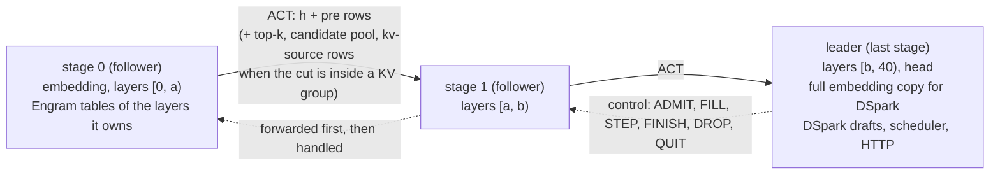

# tfpp-ds41: DeepSeek-V4.1-Flash as a layer pipeline (not run on hardware)

tfpp-ds41 applies the tfpp-glm design to DeepSeek-V4.1-Flash-1017 (EXL3 EAQ 2.9 bpw) on BertholomusAI's TensorFold
fork (`github.com/bertholomus/TensorFold`, branch `deepseek-v41-tp2`, commit `af26d42b1`). Every stage runs the fork's
own world-size-1 `--parallel` path; four fork functions are recompiled from exact source anchors and the rest is
subclassed, so the fork itself is not edited. The **last** stage is the leader: head, DSpark drafts, scheduler and the
fork's OpenAI-style HTTP server.

> **Status: NOT RUN ON HARDWARE.**
>
> - Written, statically reviewed in three rounds, CPU tests only. **Nothing has run on a GPU**: no stage, no chain, no
>   kernel check, no HTTP request.
> - CPU tests: `tfpp/tfpp/ds41/tests/test_ds41_static.py` (39 tests). Three read the fork tree and skip without it (it
>   is not part of this repository), and two skip on a Windows account without symlink rights; the rest pass.
> - The fork itself has never run its world-size-1 full-width kernels or world-size-1 round graphs on hardware. The
>   first one-GPU reference run (`T-ref` below) is also the fork's first run in that mode, so expect to meet the
>   fork's own problems first.
> - The full model needs three nodes and more disk than our nodes had free (see [disk](#disk-the-real-constraint)).
>   The plan is to prove the chain on an 11-layer test model first.
>
> "Bit-exact" below means equal to **one unmodified fork process at world size 1** (`python -m tfpp.ds41.ref`). A
> pipeline is never bit-identical to a tensor-parallel (TP=2) deployment.

## Contents

- [How it works](#how-it-works)
- [Where a chain may be cut](#where-a-chain-may-be-cut)
- [Install (each node)](#install-each-node)
- [Weights and licences](#weights-and-licences)
- [Disk: the real constraint](#disk-the-real-constraint)
- [Memory: layer sizes and three-node fits](#memory-layer-sizes-and-three-node-fits)
- [The test model S11](#the-test-model-s11)
- [Configuration: cluster.env and node.env](#configuration-clusterenv-and-nodeenv)
- [One GPU: run_shortened.sh](#one-gpu-run_shortenedsh)
- [Two nodes](#two-nodes)
- [Start, use, stop (any chain)](#start-use-stop-any-chain)
- [Diagnostics](#diagnostics)
- [Estimates (not measured)](#estimates-not-measured)
- [Known limits and untested parts](#known-limits-and-untested-parts)

## How it works



- **Same skeleton as tfpp-glm.** Activations flow towards the leader, control frames flow from the leader hop by hop
  to stage 0, one full-duplex TCP connection per hop (the earlier stage connects, the later stage listens). The link
  code (`tfpp.glm.wire`), the frame codec and KeepWarm are reused; the link protocol string is its own
  (`tfpp-ds41/1`), so a GLM stage and a DeepSeek stage refuse each other.
- **What crosses a cut, per row:** the hidden state `h`, 4 hyper-connection streams × 5,120 bf16 = **40,960 B**, plus
  `pre` (16 B). DeepSeek-V4.1 shares compressed KV between layers, so a cut *inside* a sharing group also carries
  the indexer top-k, the candidate pool and the compressed rows that the group's kv-source layer wrote this round;
  the stage after the cut keeps its own replica of that kv-source. Cuts at group boundaries carry only `h` and `pre`.
- **Engram.** Layers 1 and 14 read Engram n-gram tables (94.56 GiB each in the original checkpoint). Only the stage
  that owns such a layer opens its table, from its own SSD; the lookup keys are hashed from token ids, so no table
  content and no extra activation crosses the link. HELLO refuses a stage whose `ENGRAM_DIR` holds tables of layers it
  does not own, or misses one it owns.
- **The leader** holds the last layers, the head, the DSpark drafter (blocks `mtp.0-2`, targets after layers 37–39;
  6.75 GiB) and a full embedding copy (1.23 GiB) because the drafter needs it.
- **Startup** is the tfpp-glm handshake on its own link: `HELLO → GO → CAP → AGREE → READY`. HELLO compares the
  stages' layer ranges, settings vector, environment digest (every `TF_DS_*`, `TF_EXL3_*`, `TENSORFOLD_*`,
  `TFPP_DS41_*`, `TF_TP_*`, `TF_SEED` value and the numerics knobs, minus per-node ones), versions, the fork tree
  digest, the code digest, the checkpoint's config / index digests and revision, the Engram tables' identity and the
  token map. GO hands the followers the context, `--parallel`, drafts, chunk size and graph mode; AGREE fixes the
  pool from the strictest stage; READY re-checks free memory after the build.
- **Fail-stop.** Any error or lost link ends the chain: the stages exit with code `75` and every stage must be
  restarted (the systemd unit uses `Restart=no`).
- **Code:** `tfpp/tfpp/ds41/`, scripts in `tfpp/scripts/ds41/` (the relay is the unchanged
  `tfpp/scripts/glm/relay_hop.ps1`). The seam list, every departure from the design and every untested item are in
  `tfpp/tfpp/ds41/IMPLEMENTATION_NOTES.md`.

## Where a chain may be cut

The model has 40 layers. KV-source layers are 2, 8, 14 and 20, which form sharing groups [2–7], [8–13], [14–19] and
[20–39]; index layers are 2, 8, 14, 20, 24, 28, 32 and 36; layer 20 builds the candidate pool that layers 24–36 use;
Engram layers are 1 and 14; DSpark taps the states after layers 37, 38 and 39. `python -m tfpp.ds41.plan rules` prints
the class of every cut from a `config.json`; for the real checkpoint it reduces to:

| Cut before layer | Class | Carried besides `h` and `pre` |
|---|---|---|
| 1, 2, 8, 14, 20 | group boundary (1 and 14: right before an Engram layer) | nothing |
| 3–7, 9–13, 15–19 | inside a group with compression ratio 2 | the source's top-k; a replica of the source's compressed planes |
| 21–36 | inside group 20 (ratio 1, after the replay layer) | top-k where the next layer is not an index layer, the candidate pool, layer 20's compressed rows and indexer keys |
| 37 | inside group 20 | top-k, layer 20's compressed rows |
| 38, 39 | refused while drafting | they would split DSpark's taps |

```bash
cd ~/hive-ram/tfpp
python -m tfpp.ds41.plan rules --config tfpp/ds41/tests/data/ds41_config.json
python -m tfpp.ds41.plan chain --config tfpp/ds41/tests/data/ds41_config.json --ranges 0:17,17:25,25:40
```

`plan chain` prints, per stage, the KV planes it keeps, the Engram layers it owns and what goes in and out of it, or
`refused: ...` with the reason.

Sizes from the design notes: a decode row is 40,976 B at a group boundary; inside a group add about 356 B for the
compressed KV row, 2 KB for a top-k, 8 KB for a candidate list. A 6-row verify window is about 0.3 MB, roughly
0.5 ms at the measured ~5 Gbit/s. During prompt fill with `TF_DS_REPLAY=1`, layers 20–39 compute only the last rows
of a chunk while layer 20 itself sees all of them, so a cut right before 20 sends the whole prompt's `h` across
(40 KiB per token), and a cut after 20 sends only the last rows plus layer 20's KV rows.

## Install (each node)

Inside WSL2 (Ubuntu, aarch64), following the header of `tfpp/scripts/ds41/toolchain.sh`. This venv is separate from
Flash-Next's and tfpp-glm's (`toolchain.sh` refuses `tf-venv-061` and `tf-venv-mia`):

```bash
python3.14 -m venv ~/tf-venv-dsv41 && . ~/tf-venv-dsv41/bin/activate
pip install --index-url https://download.pytorch.org/whl/cu130 "torch==2.13.0"
pip install "triton==3.7.1" ninja "cuda-toolkit[nvcc,cccl]==13.0.*" numpy safetensors \
    "tokenizers>=0.20" "jinja2>=3.1" "huggingface-hub>=0.24"

# the fork's sources, as git stores them (LF): never copy a Windows work tree, it is CRLF and its digest differs
git clone -b deepseek-v41-tp2 https://github.com/bertholomus/TensorFold.git ~/src/tf-dsv41-fork
mkdir -p ~/tf-dsv41
git -C ~/src/tf-dsv41-fork -c core.autocrlf=false archive af26d42b1 src tools/dsv41 | tar -x -C ~/tf-dsv41

export TFPP_DIR=$HOME/hive-ram/tfpp               # see the note on paths below
export TFPP_DS41_TF_ROOT=$HOME/tf-dsv41/src       # the folder holding tensorfold/
. $TFPP_DIR/scripts/ds41/toolchain.sh
python -m tfpp.ds41.pins --check $HOME/tf-dsv41/src/tensorfold    # must report c64d3e0a...
python -m tfpp.ds41.prebuild                                       # builds the four extensions, checks them
```

- **Paths.** `toolchain.sh` finds the checkout it lies in (or takes `TFPP_DIR`); `node.env.example` and
  `tfpp-ds41@.service` assume the repository at `~/hive-ram` and the fork's sources at `~/tf-dsv41`: edit them to yours.
- `pins --check` compares a digest of the fork tree against the pinned value; a stage refuses to start on any other
  tree, and also checks the AST hashes of the 90 fork functions it depends on (`--diff TREE` lists what differs).
- `prebuild` clears stale build locks, builds the fork's four CUDA extensions, refuses any that link a CUDA 12
  runtime (`readelf`) and checks that Triton supports what the fork's kernels use. Python headers are taken from
  `~/pyinc` when the distribution has no `python3.14-dev` package (as for tfpp-glm). Kernel caches live under
  `~/.cache/tfpp-ds41/<tree digest>/<toolchain>/`.
- `start_stage.sh` refuses a GPU other than compute capability 12.1, a torch not built for CUDA 13, and a Triton
  other than 3.7.x (`TFPP_DS41_ALLOW_TRITON=1` overrides the last one, at your risk).
- The leader of a full deployment (vision, v2) would also need Pillow; v1 has no vision.

## Weights and licences

| What | Where | Notes |
|---|---|---|
| Model | Hugging Face `Mia-AiLab/DeepSeek-V4.1-Flash-1017-EXL3-EAQ-v1-2.9-bpw`, a revision starting `45ee5d0f` | 39 shards, 196.1 GiB (210.6 GB). The scripts insist on the full 40-hex commit; look it up on the model page. |
| Engram tables | shards 47 and 48 of `deepseek-ai/DeepSeek-V4.1-Flash-1017` (`layers.1.engram.embed`, `layers.14.engram.embed`, FP8) | 94.56 GiB each. Only for the full model; the test model uses generated tables. |
| Licences | — | Not stated in any source we have for this exact checkpoint. The fork's ATTRIBUTION.md lists a related quantization (Mia-AiLab/DeepSeek-V4.1-Flash-EXL3-2.9bpw) and deepseek-ai/DeepSeek-V4.1-Flash as MIT. Check both model cards (including DeepSeek-V4.1-Flash-1017) before downloading. No weights ship in this repository. |

- Nothing downloads at run time: `cluster.env` sets `HF_HUB_OFFLINE=1`.
- Download with `hf download --local-dir ...` and keep the hidden `.cache/huggingface` folder next to the files. The
  stages compare the revision recorded there, and `VERIFY_SHARDS=1` checks each shard's sha256 against it. When you
  copy a folder to another node over the link, copy that hidden folder too.
- A drafting leader that holds no layer 0 needs only the embedding from shard 1 (6.5 GB). Extract it and leave shard 1
  out of that node's `MODEL_DIR`:
  `python -m tfpp.ds41.testmodel extract <shard-1> embed.weight $MODEL_DIR/embed.weight.safetensors`
  (a folder holding both the shard and the extracted file is refused).
- Nothing AGPL is used: MiaAI-Lab's vLLM kit for this model is AGPL-3.0, and tfpp-ds41 neither imports nor copies it.

## Disk: the real constraint

| Item | Size | Where it must live |
|---|---|---|
| Model weights, all 39 shards | 196.1 GiB | each stage needs only its own shards (`start_stage.sh --dry-run` lists missing ones) |
| Engram table, layer 1 | 94.56 GiB | on the SSD of the stage that owns layer 1 |
| Engram table, layer 14 | 94.56 GiB | on the SSD of the stage that owns layer 14 |
| A stage owning both Engram layers (e.g. stage 0 of `[0,17)`) | about 85 GiB of shards + 189.1 GiB of tables ≈ **273 GiB** | its WSL ext4 disk |
| Test model S11 | 59.9 GiB of shards (64.3 GB) + two generated tables of 2.03 GB | each of the two test nodes |

- The Engram tables must sit on **WSL's ext4 disk**, not on `/mnt/c`: the fork reads rows with `O_DIRECT` and Linux
  AIO (falling back to a `pread` thread pool), and `start_stage.sh` refuses any other file system.
- WSL's ext4 disk is a `.vhdx` file that grows on Windows' `C:` drive. A download into WSL therefore needs free space
  on `C:` as well; `download_list.sh` checks both (or pass `--vhdx-ok` when you know the vhdx is already large enough).
- 273 GiB on one node was more than either of our nodes had free. Options: a cut before layer 14 (a clean group
  boundary) so that two stages each own one table; a third node with a large SSD; or an external SSD formatted ext4
  and mounted inside WSL (untested).
- Each token reads 24 rows (about 6.3 KB) per Engram layer, as 4 KiB random reads; a 2,048-row prompt chunk is on the
  order of 100,000 reads. Random-read IOPS of ext4 inside a vhdx under WSL2 has not been measured.

## Memory: layer sizes and three-node fits

From the safetensors headers of the EXL3 EAQ 2.9 bpw checkpoint (GiB):

| Part | GiB |
|---|---|
| Layers 0–17 and 23–39 | 4.86–4.96 each (layer 1: 4.956, layer 14: 4.940, layers 2 and 8: 4.870) |
| Layers 18–22 (lower-bit experts in this quantization) | 3.28 each |
| All 40 layers | 186.77 |
| DSpark (`mtp.0-2`) / embedding / head / vision + aligner | 6.746 / 1.233 / 0.463 / 0.904 |

A whole-group placement does not fit: layers 0–19 alone are about 96 GiB, more than a 128 GB node can give, so a
three-node chain must cut inside a sharing group (which is why the kv-source replicas exist). Design estimates for
three nodes with about 92 / 92 / 38 GiB usable and 5 GiB reserved on each:

| Order | Ranges | Weights (GiB) | Left for caches (GiB) |
|---|---|---|---|
| 128 → 128 → 64 | [0,17) / [17,36) / [36,40) + head + DSpark | 85.0 / 84.5 / 26.7 | 2.0 / 2.5 / 6.3 |
| 128 → 64 → 128 | [0,17) / [17,25) / [25,40) + head + DSpark | 85.0 / 31.0 / 80.2 | 2.0 / 2.0 / 6.8 |

- These are estimates, not measurements, and they disagree with a more conservative one (engine overhead of 6–9 GiB
  on a 128 GB node): under that one the 128 → 64 → 128 cut with DSpark is short by 1.1–4.1 GiB, and only a
  drafting-off 128 → 128 → 64 cut fits, barely. A recount of the headers left the two 128 GB stages of
  `[0,17) / [17,36)` about 7.5–7.9 GiB for context, work space and KV.
- In short: **the weights fit three nodes (128 + 128 + 64), the caches may not.** Three 128 GB nodes, or a
  quantization of about 170 GiB or less, would give real room.
- `python -m tfpp.ds41.plan fit` ranks every two-cut placement against measured budgets. It needs a per-layer byte
  table computed from the safetensors headers (JSON with keys `L00`…`L39` and `top:embed`, `top:head`, `top:norm`,
  `top:mtp`, `top:vision`, ...; this repository does not ship one):

```bash
python -m tfpp.ds41.plan fit --config <model>/config.json --bytes per_layer_bytes.json \
    --budgets 92,38,92 --extra 6,3.5,6 --disk 300,100,200
```

  `--budgets` is each node's measured budget in stage order (stage 0, 1, leader), `--extra` the work space and caches
  beside the weights, `--disk` each node's free ext4 GiB (one Engram table counts 94.56 GiB on its owner).
  `--no-drafts` drops DSpark and the leader's embedding copy, `--vision` adds the vision tower.
- Measure a node's budget before planning: `start_stage.sh --dry-run` prints the free and total GPU memory CUDA
  reports. On a 64 GB N1X we saw anything between about 29 and 46 GiB, depending on firmware, WSL's memory limit and
  other GPU programs.

## The test model S11

No single N1X holds the 40-layer model, so equivalence is first proven on **S11**: original layers
`0, 1, 2, 3, 14, 20, 21, 24, 37, 38, 39`, renumbered 0–10, with the embedding, head and DSpark. Eleven shards, 59.9 GiB:
small enough for one 128 GB node and for a two-node chain. S11 keeps every feature a cut can meet: group boundaries
and cuts inside groups, top-k and candidate-pool carries, two Engram layers (S11 layers 1 and 4), the replay layer
(S11 layer 5) and the DSpark taps (S11 layers 8–10).

Its Engram tables are generated, not downloaded: deterministic pseudo-random rows ("Mode D", 2.03 GB per table at an
Engram vocabulary of 320,000). Pseudo-random rather than zero, so that an addressing error changes the output; the
same bytes come out on every node.

```bash
# 1. print the download script (it checks free disk on WSL's ext4 and on C: first, and prints nothing if short)
~/hive-ram/tfpp/scripts/ds41/download_list.sh --dir ~/models/ds41-src > get_s11.sh
#    edit the one line REV='<FULL_40_HEX_COMMIT>' (the script refuses anything not starting 45ee5d0f), then run it yourself
bash get_s11.sh

# 2. on EACH node: build S11 and the tables; compare the printed sha256 values across nodes
SRC=~/models/ds41-src ~/hive-ram/tfpp/scripts/ds41/make_testmodel.sh
#    -> ~/models/ds41-s11 and ~/engram-d/{L1,L4,both}; --zero also makes all-zero tables (smoke tests only)
```

`make_testmodel.sh` takes `SRC`, `OUT` (default `~/models/ds41-s11`), `ENGRAM_OUT` (default `~/engram-d`), `SEL`,
`ENGRAM_VOCAB` (320000) and `REVISION` (the source's full commit: set it, the same on both nodes, when `SRC` was copied
without its `.cache/huggingface` folder, so that both nodes write a byte-identical `tfpp_selection.json`). It refuses
an `ENGRAM_OUT` that is not on ext4 or has less than 5 GB free.

## Configuration: cluster.env and node.env

Both live in `tfpp/scripts/ds41/` (or in the folder `TFPP_DS41_CONF` names). The scripts clear every inherited
`TF_DS*`, `TF_EXL3*`, `TF_TP*`, `TENSORFOLD*`, `NCCL*`, `TFPP*`, `TRITON*`, `CUBLAS*` and TF32 variable, read
`cluster.env` as `KEY=value` data (never executed), source `node.env`, then export every `TFPP_*`, `TF_DS_*`,
`TF_EXL3_*` and `TENSORFOLD_*` assignment found in it.

**`cluster.env`: identical on every node.** It follows the fork's public two-node TP=2 recipe (`TF_DS_REPLAY=1`,
`TF_DS_PREFILL_CHUNK=2048`, `--parallel 4`, `--mtp-drafts 5`, temperature 0) with the pipeline's own enforced values
(`TF_TP_WORLD=1`, no spill, no rank cache, no NCCL or RDMA variable: the stages refuse them). The leader's serve flags:

```bash
CONTEXT=262144
PARALLEL=4
MTP_DRAFTS=5
MAX_TOKENS=16384
THINKING=1
TEMPERATURE=0
SERVED_NAME=DeepSeek-V4.1-Flash
HTTP_HOST=0.0.0.0     # every interface: give the leader TF_API_KEY_FILE, or set 127.0.0.1
HTTP_PORT=18891
```

`CONTEXT`, `PARALLEL`, `MTP_DRAFTS`, `HTTP_PORT` and the other serve values given on `start_stage.sh`'s command line
(`CONTEXT=8192 ./start_stage.sh`) win over `cluster.env`; `node.env` can override them too. Two opt-in switches, to be
set on every stage alike (they are digested): `TFPP_DS41_CUT_POST=carry` (the fallback if the fused-kernel check
`T-K'` fails) and `TFPP_DS41_WARM_ALL_BUCKETS=1` (capture every context bucket's round graph at start, so READY's
memory check covers long conversations; slower start, not run).

**`node.env`: one per node.** Copy `node.env.example` and keep exactly one block. The keys:

| Key | Who | Meaning |
|---|---|---|
| `ROLE` | all | `leader` (the last stage; its range ends at the model's last layer) or `follower` |
| `LAYERS` | all | `A:B`, this stage's layers `[A, B)` |
| `MODEL_DIR` | all | config, index, tokenizer and this stage's shards (the leader also the chat template) |
| `LISTEN` | stages with `A > 0` | `HOST:PORT` inside WSL where the stage before connects, through the relay |
| `DOWN` | followers | `HOST:PORT` of the next stage's relay |
| `ENGRAM_DIR` | owners of an Engram layer | a folder holding exactly the tables of the layers this stage owns (the fork globs it) |
| `TOKEN_MAP` | Engram owners, optional | the token map cache (`TF_DS_TOKEN_MAP`) |
| `RESERVE_GIB` | all | memory kept free (default 3) |
| `BUDGET_GIB` | stages sharing a GPU | the budget outright; required with `ALLOW_GPU_SHARING=1` |
| `GPU_GUARD_PORTS` | any | ports of other GPU servers on this node (default `18891`); the start is refused while one listens |
| `ALLOW_GPU_SHARING` | any | `1`: start anyway beside another GPU server or tfpp stage (needs `BUDGET_GIB`) |
| `VERIFY_SHARDS` | any | `1`: check this stage's shards against their Hub sha256 first (cached) |
| `TFPP_WARM_MS` | all | KeepWarm spin length in ms (`0` turns it off) |
| `TFPP_DS41_VENV`, `TFPP_DS41_TF_ROOT` | all | the venv (default `~/tf-venv-dsv41`); the fork's `src` folder (**required**) |
| `TRACE` | any | a JSONL trace for the comparisons |
| `BENCH`, `BENCH_OUT`, `ORACLE`, `NO_DRAFTS` | leader | run a prompt set without HTTP (QUIT at the end), its output, planted drafts (T1-oracle), serial decoding |
| `EXPERTS` | all alike | T-X0's proxy: only the first K routed experts per layer |
| `TF_API_KEY_FILE` | leader | a `chmod 600` file with the API key; the server then wants it on every route but `/health`. Never printed, never digested. |
| `TFPP_DS41_WORKSPACE_GIB` | any | the work-space estimate used by admission (default 4; measure with `TF_DS_CHUNK_LOG=1`) |

## One GPU: run_shortened.sh

`tfpp/scripts/ds41/run_shortened.sh` runs every stage of a chain on one machine (`127.0.0.1`, `BUDGET_GIB` each) and
judges with `python -m tfpp.ds41.compare` against the unmodified fork in one process (`tfpp.ds41.ref`). Use the
128 GB node. Run the modes **in this order; each must say IDENTICAL before you run the next**:

```bash
cd ~/hive-ram/tfpp
export TFPP_DIR=$PWD TFPP_DS41_TF_ROOT=$HOME/tf-dsv41/src
MODEL_DIR=~/models/ds41-s11 scripts/ds41/run_shortened.sh T-ref
python -m tfpp.ds41.kernel_check --hc --model ~/models/ds41-s11 --out tk.json    # T-K': fused == unfused at world size 1
python -m tfpp.ds41.kernel_check --model ~/models/ds41-s11 --layer 5              # T-K (diagnostic)
MODEL_DIR=~/models/ds41-s11 scripts/ds41/run_shortened.sh T0a    # then T0b, T0c
MODEL_DIR=~/models/ds41-s11 scripts/ds41/run_shortened.sh T1-oracle   # then T1-exact, T1-long, T1-multi, T1-fault, T1-http
```

| Mode | What it checks |
|---|---|
| `T-ref` | the reference twice (repeatable?), then eagerly (graphs against eager) |
| `T0a` | a one-stage chain `[0,11)` (the stage classes, no cut) against the reference |
| `T0b` | the same, eager (`--no-graphs`) |
| `T0c` | every two-stage cut from 1 to 8, plus `0:3 3:6 6:11`, `0:6 6:8 8:11`, `0:6 6:7 7:11` and `0:2 2:5 5:8 8:11` |
| `T1-oracle` | planted drafts (the reference's own tokens, `TF_DS_DEPTH_POLICY=fixed`) at cuts 3 and 6; planted drafts change no reply |
| `T1-exact` | `TF_DS_REPLAY=0`, prompts up to 4,500 tokens, cuts 3, 6 and 7 |
| `T1-long` | context 32,768 and long prompts, cuts 6 and 7 |
| `T1-multi` | concurrent prompts at cut 6, compared reply by reply (`--tokens-only`) and row by row (`--by-position`) |
| `T1-fault` | a leader fault after step 3 (that request fails, the others match); stage 0 killed mid-bench (the leader must exit 75); a follower fault at its 40th STEP (every stage exits 75) |
| `T1-http` | plain, streaming, a tool call and a request after a client disconnect (4/4 must answer); then the fork's own `tools/dsv41/parallel_check.py` when present |
| `T-X0` | a 16-expert reference, for comparing two machines (below) |
| `all` | every mode above except `T-X0` |

Environment: `MODEL_DIR` (S11), `ENGRAM_D` (`~/engram-d`), `CONTEXT` (8192), `PARALLEL` (2), `MTP_DRAFTS` (5),
`BUDGET_GIB` (12 per stage), `PORT0` (5500), `HTTP_PORT` (18892), `OUT` (default `~/tfpp-ds41-tests/...`),
`PROMPTS`, `TFPP_DS41_WORKSPACE_GIB` (4; lower it if four `T0c` stages on one GPU are refused), `GPU_GUARD_PORTS`,
`ALLOW_GPU_SHARING`. The script clears `TF_API_KEY` and `TF_API_KEY_FILE` (its leader serves `127.0.0.1` without a
key). If `T-K'` fails, set `TFPP_DS41_CUT_POST=carry` in `cluster.env` and run everything again.

`python -m tfpp.ds41.compare REF GOT` compares the two runs' settings first: different settings return exit code 2
(`NOT COMPARABLE`, naming the keys; `--allow KEY,...` lets through a test's deliberate change, `--ignore-meta` skips
the check). Then it compares record by record and prints `IDENTICAL` or `DIFFERS at record ...` per request (exit 0 or
1). `--tokens-only` compares replies only, `--by-position` keys rows by their whole input.

## Two nodes

First make sure the two machines compute alike: run `run_shortened.sh T-X0` on each node, copy one `TX0.jsonl` over
and `python -m tfpp.ds41.compare nodeA/TX0.jsonl nodeB/TX0.jsonl`. Different driver versions on the two nodes may make
cuBLAS fp32 GEMMs differ; T-X0 is where that would show.

Then the chains, through `start_stage.sh` and the real link, each with the matching test block of
`node.env.example`. The leader's trace is compared with the 128 GB node's `T-ref` trace.

| Test | 128 GB node (10.77.0.2) | 64 GB node (10.77.0.1) | Relay and firewall |
|---|---|---|---|
| `T1-c6` (the main test) | stage 0 `[0,6)`, `ENGRAM_DIR=~/engram-d/both`, `DOWN=10.77.0.1:5321` | leader `[6,11)`, `LISTEN=0.0.0.0:5321`, `CONTEXT=8192`, `PARALLEL=2`, `BENCH=...`, `TRACE=...` | on the 64 GB node |
| `T1-c3` | leader `[3,11)`, `ENGRAM_DIR=~/engram-d/L4`, `LISTEN=0.0.0.0:5321` | stage 0 `[0,3)`, `ENGRAM_DIR=~/engram-d/L1`, `DOWN=10.77.0.2:5321` | on the 128 GB node |
| `T1-3` (two hops) | stage 0 `[0,3)` and the leader `[6,11)`, `BUDGET_GIB` 20 / 40 and `ALLOW_GPU_SHARING=1` each, a second config folder via `TFPP_DS41_CONF` | middle `[3,6)`, `ENGRAM_DIR=~/engram-d/L4`, `LISTEN=0.0.0.0:5321`, `DOWN=10.77.0.2:5322` | both nodes (5321 on the 64 GB node, 5322 on the 128 GB node) |

On the Windows side of each receiving node (the firewall rule from an administrator PowerShell, the relay from a
normal one; keep its window open):

```powershell
# 64 GB node, for T1-c6 and T1-3
powershell -ExecutionPolicy Bypass -File setup_usb4_link.ps1 -Node 1 -AllowTcpPorts 5321
powershell -ExecutionPolicy Bypass -File tfpp\scripts\glm\relay_hop.ps1 -ListenAddress 10.77.0.1 -Ports 5321
# 128 GB node, for T1-c3 (-Ports 5321) and T1-3 (-Ports 5322)
powershell -ExecutionPolicy Bypass -File setup_usb4_link.ps1 -Node 2 -AllowTcpPorts 5321,5322
powershell -ExecutionPolicy Bypass -File tfpp\scripts\glm\relay_hop.ps1 -ListenAddress 10.77.0.2 -Ports 5321
```

Then on each node, inside WSL and in any order, `start_stage.sh` (below). A leader given `BENCH` runs the prompt set
without HTTP and sends QUIT at the end, which stops the whole chain. Compare:
`python -m tfpp.ds41.compare <128 GB node's ref.jsonl> ~/tfpp-ds41-tests/c6.jsonl`.

If the 64 GB node's budget is too small for the `T1-c6` leader, swap the roles (the 64 GB node runs `[0,6)` with
both tables, the 128 GB node the leader).

## Start, use, stop (any chain)

```bash
cd ~/hive-ram/tfpp/scripts/ds41
./start_stage.sh --dry-run      # every check, then the exact command; nothing starts
./start_stage.sh                # background; waits until up (a follower: "ready"; the leader: serving + a smoke test)
./start_stage.sh --foreground   # stays attached; exit code 0 after QUIT, 75 when the chain broke, 1 otherwise
```

- **Checks before anything loads:** role, layers and ports; the fork tree digest and its seams; GPU capability 12.1;
  torch built for CUDA 13 and able to run a kernel; Triton 3.7.x; this stage's shards present (with
  `VERIFY_SHARDS=1`, their sha256); the Engram folder holds exactly the owned layers with the row counts the config
  states, on ext4; no extension linked against CUDA 12; no listener on `GPU_GUARD_PORTS`; no other tfpp stage on the
  node unless `ALLOW_GPU_SHARING=1` and `BUDGET_GIB` are set.
- The leader's readiness probe is `/health`, the one route the fork's server leaves open when an API key is set; then
  it sends one greedy request ("Reply with OK.", thinking off) through every stage.
- State, pid and log per stage: `~/.local/state/tfpp-ds41/<role>-<A>-<B>/` (`TFPP_DS41_STATE`), so two stages on one
  node never share files. `WAIT_TIMEOUT` (default 3600 s) bounds the wait.
- Stop **from the leader**: `./stop_stage.sh` (warns about running requests); QUIT travels up and every follower exits
  by itself. On a follower `stop_stage.sh` waits for that, then stops it. `DRY_RUN=1 ./stop_stage.sh` only reports.
- systemd user unit: copy `tfpp-ds41@.service` to `~/.config/systemd/user/` after editing its paths, put
  `cluster.env`, `node.env` and `toolchain.sh` into the config folder it names, then
  `systemctl --user enable --now tfpp-ds41@<name>`. It never restarts a stage alone.

The API on the leader's node (OpenAI-style; add `-H "Authorization: Bearer $(cat <key file>)"` when a key is set):

```bash
curl -s http://127.0.0.1:18891/health
curl -s http://127.0.0.1:18891/v1/chat/completions -H 'Content-Type: application/json' -d '{
  "model": "DeepSeek-V4.1-Flash", "max_tokens": 256, "temperature": 0,
  "chat_template_kwargs": {"enable_thinking": false},
  "messages": [{"role": "user", "content": "Explain pipeline parallelism in two sentences."}]}'
```

The fork's server offers no structured-output (grammar) mode, so none is tested here.

## Diagnostics

| Tool | Use |
|---|---|
| `python -m tfpp.ds41.plan rules\|chain\|fit --config CFG ...` | cut classes; one chain's carries; ranked three-node placements |
| `python -m tfpp.ds41.pins --check [TREE]` / `--print TREE` / `--diff TREE` | the fork tree digest; the 90 seam hashes |
| `python -m tfpp.ds41.kernel_check --hc [--model DIR] [--out F]` | T-K': fused against unfused hyper-connection kernels at world size 1 (random parameters without `--model`) |
| `python -m tfpp.ds41.kernel_check --layer I --model DIR` | T-K: one layer's MoE and output projections against the two TP=2 halves (diagnostic) |
| `python -m tfpp.ds41.ref --model DIR --engram DIR --bench P.jsonl ...` | the one-process reference (the unmodified fork, only its loader swapped) |
| `python -m tfpp.ds41.compare REF GOT [--tokens-only] [--by-position] [--allow K,...]` | judge two traces |
| `python -m tfpp.ds41.testmodel build\|table\|extract\|selftest\|downloads` | S11 and its tables |
| `python -m tfpp.ds41.prebuild` | build and check the extensions |
| `TF_DS_ROUND_STATS=1`, `TF_DS_CHUNK_LOG=1` | the fork's per-round timing and chunk work-space logs |

## Estimates (not measured)

From the design notes; none of this has run:

- A pipeline reads each token's weights one stage after another: about 7.0–7.6 GB per decoded row, roughly
  37–43 ms at N1X bandwidth, plus 2–3 ms for two hops and 3.5–5 ms for DSpark. About **45–50 ms per round** on three
  nodes.
- That is roughly **25–37 tok/s on prose and 40–55 tok/s on code** for one stream, about 0.45–0.6× of a dual
  DGX Spark pair running tensor parallel over RoCE: 61.4 tok/s prose / 89.3 tok/s code (MiaAI-Lab's published figure for its recipe on a GB10 pair, which runs the BertholomusAI fork's Zig branch deepseek-v41-zig; not measured by us).
- Each extra row in a verify window adds an estimated 7–10 ms (each row reads its own experts), so speculative
  decoding gains less here than on a TP=2 pair.
- An idle follower that owns an Engram layer may pay about 1 ms for its first table read after idling (the fork's
  own figure); v1 has no message to wake it early.

## Known limits and untested parts

Everything below needs a GPU; the full list is in `tfpp/tfpp/ds41/IMPLEMENTATION_NOTES.md`.

- No CUDA path has run: the recompiled anchors, the stage and round-decoder graph captures, the static views'
  copies, the kv-source replica writes, KeepWarm's interplay with graph capture.
- No chain has run: handshake, op mirroring (ADMIT, FILL, FINISH), drain and DROP, the exit with 75, QUIT travelling up.
- Admission: the 4 GiB work-space default is an estimate; what `torch.cuda.mem_get_info` means under WSL2's unified
  memory is not confirmed; by default, round graphs for context buckets past 8,192 are captured while serving, in
  memory that CAP and READY never saw (`TFPP_DS41_WARM_ALL_BUCKETS=1` is the opt-in fix).
- Whether `O_DIRECT` and AIO work on WSL2's ext4; if not, the log says
  `Engram decode reads stay on the reader pool` (same bytes, slower).
- HTTP over the chain: streaming, tool calls, client disconnects.
- Scripts were checked with `bash -n` and snippet tests only, never in a whole run.
- **No authentication on the stage links**, and none on the API unless `TF_API_KEY_FILE` is set. Keep the links on
  the point-to-point cables and the API on `127.0.0.1` or behind a key and a firewall.
- **Pinned tree:** a new fork commit needs a review of the 90 seams (`pins --diff`), not just an upgrade.
