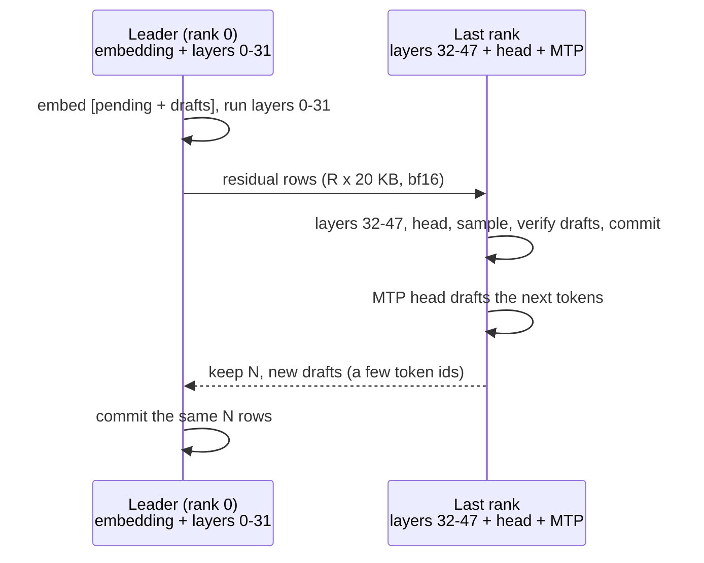

# tfpp: Qwen3.8-Flash-Next on TensorFold 0.6.1

`tfpp` is the first and smallest pipeline in this repository. It runs Qwen3.8-Flash-Next with TensorFold 0.6.1's own
CUDA code, splits the 48 decoder layers into contiguous ranges, one per rank, and sends only the residual stream
between ranks over TCP. On this model it showed the central claim of hive-ram: **over a USB4 cable, a two-machine layer
pipeline ran as fast as one machine** (with KeepWarm; one stream, no speed-up).

> **Status**
>
> - **VERIFIED ON HARDWARE (2026-10-22):** the 2-machine split is **token-identical** to a single node (3/3 prompts,
>   in serial, serial + CUDA graphs and MTP depth 6 + graphs; same MTP acceptance) and, with KeepWarm, **as fast**
>   (33.0–33.8 tok/s serial against 32.3–32.8 on one node). A **3-rank chain on 2 machines** was token-identical too
>   (its speed is not representative: two ranks shared one GPU).
> - **Changed since, not re-run on hardware:** the measured runs used the first, unversioned wire protocol. On
>   2026-10-24 the code moved to protocol `tfpp-flashnext/2` (link handshake, a whole-chain check at start, checked
>   frames, error frames, optional `TFPP_SECRET`). That version passes its CPU tests (`tfpp/tests`) but has not been
>   re-run on the laptops. `tfpp/scripts/flashnext/env.sh` is a reconstruction of the environment of the runs and has
>   not itself been run on hardware.
> - **Scope:** `tfpp_run.py` is a measurement and verification harness: a fixed set of three prompts, greedy decoding,
>   no HTTP API, one request at a time.

Flash-Next at 4 bits fits on one 128 GB node (TensorFold reads its PLE table from the SSD), so you do not need this
pipeline to *run* that model. Use it to check your link and your nodes, to reproduce the measurements, and as the
smallest example of the technique that tfpp-glm and tfpp-ds41 apply to models that do not fit.

## Contents

- [How it works](#how-it-works)
- [Setup](#setup)
- [Run two nodes](#run-two-nodes)
- [More ranks](#more-ranks)
- [Options](#options)
- [Reading the output](#reading-the-output)
- [KeepWarm: the GPU clock problem](#keepwarm-the-gpu-clock-problem)
- [Measured results](#measured-results)
- [Limits](#limits)

## How it works

| File | Role |
|---|---|
| `tfpp/tfpp/load.py` | Loads one rank's layers with TensorFold's own loader. It compiles a copy of the loader's module source in which the single line `chosen = list(range(cfg.layers))` reads this rank's range instead, so every tensor is built by the unchanged code. It refuses to run if that line is not found exactly once. |
| `tfpp/tfpp/part.py` | Cuts TensorFold's `compute()` between layers. At a cut, the pending MoE write-back is applied to the residual first, so the next rank starts from a clean residual (Flash-Next's own n-gram layers do the same). Per row only the residual crosses: 4 streams × 2,560 bf16 = **20 KB**. |
| `tfpp/tfpp/driver.py` | Roles. The **leader** (rank 0) embeds the tokens, runs the first layers and drives requests; **middle** ranks run their layers and pass rows on; the **last** rank applies the head, samples, verifies MTP drafts and drafts the next ones, then replies with "keep N tokens + new drafts". Every rank commits the same number of rows. Prompt chunks are sent without waiting for a reply. |
| `tfpp/tfpp/wire.py`, `proto.py` | One TCP connection per hop. A frame is a 4-byte length, a JSON header and at most one bf16 tensor. A link handshake at connect, a `hello` round trip at start in which the leader checks the whole chain (contiguous ranges from 0 to the last layer, the same checkpoint, capacity, windows and MTP settings), and checks on every frame before anything is allocated. |
| `tfpp/tfpp/warm.py` | KeepWarm (below). |

One decode round with drafts, two ranks:



## Setup

On each node, inside WSL2 (one-time; the full list is the header of `tfpp/scripts/flashnext/env.sh`):

```bash
python3.14 -m venv ~/tf-venv-061 && . ~/tf-venv-061/bin/activate
pip install --index-url https://download.pytorch.org/whl/cu130 "torch==2.14.1"   # a CUDA 13 build (sm_121)
pip install "git+https://github.com/ashhart/TensorFold.git@v0.6.1" ninja "cuda-toolkit[nvcc,cccl]==13.0.*"
```

- TensorFold builds its kernels on first use and needs Python headers: install the distribution's `python3.X-dev`
  package, or extract the headers under `~/pyinc` (`env.sh` adds those folders when they exist).
- Python 3.14 is the only version run on hardware (TensorFold needs 3.11 or later).
- Keep this venv separate from tfpp-glm's and tfpp-ds41's: they use other TensorFold trees and another Triton.
- `env.sh` sets `HF_HUB_OFFLINE=1`: nothing is downloaded at run time.

**Checkpoint.** The runs used `Vontra/Qwen3.8-Flash-Next-MLX-4bit-MTP` (MLX 4-bit, with the MTP head; check its model
card for the licence). Each rank needs `config.json`, the tokenizer and the shards of its own layers; the leader also
needs the shard with the embedding, the last rank the shards with the head and the MTP head. Copying the whole
checkpoint to every node is simplest. For MLX checkpoints the PLE tables are read from the SSD by default
(`--ple-on-ssd`).

**Link.** Set up the USB4 link and the relay first (repository README, "Step 0"). The last rank listens, so its node
(10.77.0.1 in the examples) needs `relay_user.ps1` on its Windows side; the preset forwards port 5201.

## Run two nodes

From the `tfpp` folder of the checkout, on each node:

```bash
cd ~/hive-ram/tfpp && . scripts/flashnext/env.sh

# node 1 (10.77.0.1, behind relay_user.ps1): the last rank, layers 32-47 + head + MTP
python tfpp_run.py --role last --model <dir> --layers 32:48 --listen 5201 --depth 6 --graphs

# node 2: the leader, layers 0-31; it waits for the chain, checks it, runs the prompts, writes the tokens
python tfpp_run.py --role leader --model <dir> --layers 0:32 --peer 10.77.0.1:5201 --depth 6 --graphs --out pp.json
```

Then the reference on one node (the whole model must fit; it does on a 128 GB node) and the comparison:

```bash
python tfpp_run.py --role local --model <dir> --depth 6 --graphs --out ref.json
python compare.py ref.json pp.json      # exit 0: every prompt identical; 1: some differ; 2: not comparable
```

- Ranks may start in any order: a rank links to the rank after it first (retrying for `--connect-timeout`), then
  listens for the rank before it.
- Give every rank the same `--depth` and `--capacity`. With `--depth`, the last rank needs it too (it loads the MTP
  head).
- `--depth 0` (the default) runs serial decoding, one token per round. The verified runs covered serial, serial with
  `--graphs`, and `--depth 6 --graphs`.
- Run both sides with the same `--repeat` or `compare.py` refuses (exit 2).

The split we used: the **128 GB node** ran the leader (layers 0–31, about 52 GiB of GPU memory still free after
loading); the **64 GB node** ran the last rank (layers 32–47, head, MTP; 18.5 GiB free out of the 46 GiB CUDA saw).
Choose the cut by memory: the last rank carries the head and MTP head on top of its layers.

## More ranks

A middle rank takes `--layers`, `--listen` (for the rank before it) and `--peer` (the rank after it). The 3-rank chain
we ran put two ranks on the 128 GB node, linked over localhost:

```bash
# 64 GB node (10.77.0.1): last rank
python tfpp_run.py --role last   --model <dir> --layers 32:48 --listen 5201 --depth 6 --graphs
# 128 GB node: middle rank, then the leader
python tfpp_run.py --role middle --model <dir> --layers 16:32 --listen 5202 --bind 127.0.0.1 --peer 10.77.0.1:5201 --depth 6 --graphs
python tfpp_run.py --role leader --model <dir> --layers 0:16 --peer 127.0.0.1:5202 --depth 6 --graphs --out pp3.json
```

Output matched the single node (3/3, same acceptance). Its speed (24.1 / 62.9 / 30.2 tok/s) only shows the cost of two
processes sharing one GPU (Windows switches GPU contexts between them); three real machines were not available.

## Options

`tfpp_run.py` flags (all ranks unless noted):

| Flag | Default | Meaning |
|---|---|---|
| `--role local\|leader\|middle\|last` | required | `local` runs the whole model in one process (TensorFold's own path), the reference |
| `--model DIR` | required | the checkpoint folder |
| `--layers FIRST:END` | — | this rank's layers `[FIRST, END)` (not for `local`) |
| `--listen PORT` | 5201 | where a middle or last rank listens |
| `--bind ADDR` | `TFPP_BIND` or `0.0.0.0` | the listening address; `0.0.0.0` is what a WSL2-NAT node behind its relay needs, elsewhere use the link address |
| `--peer HOST:PORT` | — | the next rank (leader, middle) |
| `--connect-timeout S` | 3600 | how long to retry the link to the next rank and wait for the chain's `hello` |
| `--depth N` | 0 | MTP drafts per round (0: serial) |
| `--conf X` | 0.6 | the MTP drafter's confidence cut-off, passed to TensorFold |
| `--count N` | 200 | tokens to generate per prompt |
| `--capacity N` | 16384 | KV capacity in tokens |
| `--graphs` | off | CUDA graphs for decode (TensorFold's own on `local`, per-rank graphs in a pipeline) |
| `--ple-on-ssd` / `--no-ple-on-ssd` | on for MLX, off for NVFP4 | read the PLE tables from disk |
| `--repeat N` | 1 | kept passes over the prompts, after one extra warm-up pass that is not kept; `--repeat 0` runs a single pass and keeps it |
| `--out FILE` | — | write the results (tokens, text, speeds) as JSON, rewritten after every prompt |

Environment variables:

| Variable | Default | Meaning |
|---|---|---|
| `TFPP_WARM_MS` | 1.0 | KeepWarm's spin length in ms; `0` turns KeepWarm off |
| `TFPP_TIMING` | off | `1`: time each phase with a device sync (adds overhead); prints ms per round here and at the peer |
| `TFPP_SECRET` | unset | the same value on every node: both ends of each link prove they know it (HMAC-SHA256 over both nonces) |
| `TFPP_BIND` | `0.0.0.0` | default for `--bind` |
| `TFPP_IO_TIMEOUT` | 600 | seconds a request may wait for a frame; `0`: no limit |

**Security.** Without `TFPP_SECRET`, anything that speaks the protocol may link. Frames are JSON plus a tensor and
cannot run code, and every size and token id is checked, but keep the port on the point-to-point cable, admit only the
peer in the firewall, and set `TFPP_SECRET` if anything else can reach the port.

## Reading the output

Each prompt prints one line, for example:

```
[tfpp] pass 1 prompt 1: 200 tokens, prefill <P> tok/s, decode <D> tok/s, rounds <N>, accepted <A>/<B> | '<text>'
```

`rounds` is the number of chain round trips, `accepted/drafted` the MTP acceptance. With `TFPP_TIMING=1` a second line
gives the milliseconds per round spent on this rank and on the peer, which is how the per-round splits in
[benchmarks](../benchmarks.md#qwen38-flash-next-on-tensorfold-and-tfpp) were taken.

## KeepWarm: the GPU clock problem

The first split ran at about 77% of one node. The cause was not the link:

| One rank's step (layers 32–47 + head) | Time |
|---|---|
| back to back, 64 GB node / 128 GB node | 8.7 ms / 9.0 ms |
| after 20–40 ms of idle (either node) | 15–16.5 ms |
| idle gap with the CPU spinning | 15.9 ms |
| idle gap with one spinning GPU block on a side stream | **9.9 ms** |

The GPU lowers its clocks within a few tens of milliseconds of idle. In a pipeline every rank idles while the others
work, so every rank ran at low clocks. The two nodes' raw speed was nearly equal (read bandwidth 263 / 236 GB/s on the
64 GB node, 285 / 258 GB/s on the 128 GB node, for normal / large tensors; 93 bf16 TFLOPS on both).

`tfpp/tfpp/warm.py` fixes it: while a rank waits on the link, a background thread keeps issuing a ~1 ms
`torch.cuda._sleep` on a side stream (one block, one SM) and stops as soon as data arrives. Followers do not spin
between requests. tfpp-glm and tfpp-ds41 reuse it.

To see the effect on your own GPU, time one rank's step with idle gaps:

```bash
python rank_bench.py <dir> 32:48 last 1 --modes sleep@0,sleep@30,cpuspin@30,gpuwarm@30
```

`--modes` takes `MODE@GAP_MS` items: `sleep` (idle), `cpuspin` (busy CPU) or `gpuwarm` (one spinning GPU block);
the positional arguments are the model, the layer range, the role (`first`, `mid`, `last`) and the rows per step (1–8).

## Measured results

Checkpoint `Vontra/Qwen3.8-Flash-Next-MLX-4bit-MTP`; 128 GB node: leader, layers 0–31; 64 GB node: layers 32–47 +
head; greedy; 200 tokens; three prompts (a short Chinese essay, a Python function with tests, a three-point
explanation); USB4 through the user-mode relay; 2026-10-22.

| | One node (TensorFold) | 2 nodes, no KeepWarm | **2 nodes, KeepWarm** |
|---|---|---|---|
| Output tokens | reference | 3/3 identical (all three modes), same acceptance | **3/3 identical** |
| Serial, eager | 32.3–32.8 tok/s | 24.5–25.1 tok/s | **33.0–33.8 tok/s** |
| Serial, graphs | — | 25.1–25.5 tok/s | — |
| MTP 6 + graphs: essay / code / explanation | 31.4 / 77.1 / 38.2 tok/s | 23.3 / 60.3 / 29.4 tok/s | **31.0 / 79.3 / 38.6 tok/s** |
| Per round | — | 19.0 ms (128 GB node, layers 0–31 with embedding and PLE) + 15.5 ms (64 GB node, layers 32–47 + head) + ~2 ms link and Python + ~1.7 ms leader commit | 17.4 ms + 8.8 ms + ~2.5 ms link |

The pipeline's round is the sum of the ranks' times plus about 2.5 ms; there is no overlap for a single stream. With
KeepWarm that sum equals one node's time for the whole model, because each node only reads its own share of the
weights. **The speed limit is the weight bytes each token must read, not the link.** All numbers are in
[benchmarks](../benchmarks.md).

## Limits

- One request at a time, greedy decoding, a fixed prompt set: a harness, not a server.
- A failure anywhere stops the chain. A leader whose request failed part-way refuses further requests (the ranks'
  caches are in an unknown state): restart all ranks.
- Pinned to TensorFold 0.6.1's Flash-Next (`qwen4_exp`) family: `load.py` refuses a loader whose layer-list line has
  changed, and `part.py` follows `compute()` of that version.
- No speed-up for one stream: two nodes are as fast as one, not faster. The gain is memory: a quantization or a
  context that one node cannot hold.
