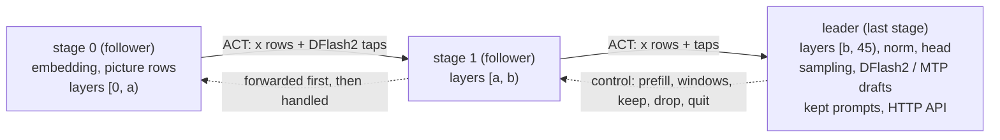

# tfpp-glm: GLM-5.3-Flash as a layer pipeline

tfpp-glm runs GLM-5.3-Flash (EXL3 4 bpw) on the **MIA package**, TensorFold v0.6.0 plus the 107 patches of MiaAI-Lab's
public dual-DGX-Spark recipe, split into contiguous layer ranges across several machines. Every stage runs the
package's own CUDA code at world size 1 (all 64 attention heads, full expert width). The **last** stage is the
leader: it holds the head, the drafters, the scheduler and the OpenAI-style HTTP API.

> **Status**
>
> | Part | Status |
> |---|---|
> | v1 (`PARALLEL=1`) | **VERIFIED ON HARDWARE (2026-10-23), on truncated models:** bit-exact against one process on the 8-layer model (pure, eager and graphs; 2 cut points; kept-prompt pressure; fault abort and kill; cross-machine 19/19); 26 layers across two machines, two cuts, bit-identical; the HTTP path answered. |
> | The full 45-layer model | **NOT RUN.** It needs about 160 GiB of stages and does NOT fit 128 GB + 64 GB. It needs a third node (planned chain 128 → 64 → 128). |
> | v2 (`PARALLEL` 2–8) | **VERIFIED ON ONE GPU (2026-10-24), 8-layer truncated model:** batched-row invariance (T0e); pure and eager against graphs on three lockstep schedules; 2-stage chains at 2 cut points x 3 schedules bit-identical, every stage applying the leader's messages; replies equal to P=1 serial under free timing at 1, 2 and 4 streams. **Not yet run across machines.** |
> | Fixes made after the hardware runs (2026-10-24) | CPU tests only, not re-run on hardware. Every stage of a chain must run the same tree (HELLO compares a digest of the code). |
>
> "Bit-exact" means equal to **one process of the same engine at world size 1**. A pipeline is never bit-identical to
> a tensor-parallel (TP=2) deployment: TP adds partial sums in another order.

## Contents

- [How it works](#how-it-works)
- [What you need](#what-you-need)
- [Install (each node)](#install-each-node)
- [Weights and the optional drafter](#weights-and-the-optional-drafter)
- [Memory: layer sizes, capacity, cuts](#memory-layer-sizes-capacity-cuts)
- [Wiring three nodes](#wiring-three-nodes)
- [Configuration: cluster.env and node.env](#configuration-clusterenv-and-nodeenv)
- [Start, use, stop](#start-use-stop)
- [Testing on one GPU: run_truncated.sh (v1)](#testing-on-one-gpu-run_truncatedsh-v1)
- [Testing across two machines: a shortened model](#testing-across-two-machines-a-shortened-model)
- [v2: several streams (verified on one GPU)](#v2-several-streams-verified-on-one-gpu)
- [Diagnostics](#diagnostics)
- [Measured results](#measured-results)
- [Known limits](#known-limits)

## How it works



- **Data down, control up.** Activations (ACT) flow from stage 0 to the leader; control frames from the leader flow
  hop by hop to stage 0, and each follower forwards a control frame upstream before it handles it. Each hop is one
  full-duplex TCP connection: the earlier stage connects, the later stage listens. So the leader only listens and
  stage 0 only connects.
- **What crosses a hop, per row:** `x`, the 4 hyper-connection residual streams, 4 × 4,096 bf16 = **32 KiB**, plus
  **8 KiB per DFlash2 tap** computed upstream. DFlash2 reads the stream mean after layers 5, 14, 24, 33 and 42 (from
  the drafter's config); taps computed before a cut ride along with `x` to the leader. GLM layers keep no cross-layer
  state, so nothing else crosses: positions, attention chunks, sparse-attention selections, KDA recurrent state and
  MLA latent caches are all computed and kept locally by each stage, which commits the same rows as the leader.
- **One round** (one decode step, or one verify window of pending + draft tokens) is one trip through the chain. With
  one stream only one GPU works at a time: the round time is the sum of the stages plus about 2.3 ms per hop.
- **Startup**, two phases, all compared before any request: `HELLO → GO → CAP → AGREE → READY`. HELLO checks that the
  ranges are contiguous from 0 to 45 (or to `--truncate L`), that every stage has at least one DSA layer and one KDA
  layer, that every tap layer belongs to a stage, and that every stage has the same settings vector, environment
  digest (every `TF_GLM_*` / `TENSORFOLD_*` / `TFPP_*` value and the Triton / cuBLAS / TF32 numerics knobs, minus
  per-node ones), versions, package tree digest, code digest, checkpoint `config.json` / index sha256 and Hugging Face
  revision. Any difference refuses the start. CAP reports each stage's memory budget, AGREE fixes the window and the
  kept-prompt budget from the strictest stage, READY re-checks the memory actually left after weights and CUDA graphs
  and refuses to start when it is less than half the reserve.
- **Fail-stop.** A stage that loses its link or meets an error stops the chain; the stages exit with code 75 and the
  whole chain must be restarted (the systemd unit uses `Restart=no` on purpose). The relays use TCP keepalive and the
  idle leader watches its link, so a node that loses power is noticed without waiting for the next request.
- **KeepWarm** (from the Flash-Next pipeline) keeps each waiting GPU's clocks up.
- **Code layout:** `tfpp/tfpp/glm/` (v1 files, plus `v2*.py` for v2), scripts in `tfpp/scripts/glm/`, design notes and
  every deviation from the spec in [`tfpp/tfpp/glm/IMPLEMENTATION_NOTES.md`](../../tfpp/tfpp/glm/IMPLEMENTATION_NOTES.md).

## What you need

- **Nodes.** The full model needs about 160 GiB of stages: in practice three nodes (two with 128 GB and one with
  64 GB, or larger). Two nodes are enough for the shortened test models.
- **Usable memory per node.** About 92 GiB on a 128 GB N1X (leave 4–6 GB to Windows). On a 64 GB N1X we saw anything
  from about 29 to 46 GiB depending on firmware, WSL's memory limit and what else ran on the GPU. Measure it: the
  preflight of `start_stage.sh --dry-run` prints the free and total GPU memory CUDA reports.
- **Disk.** Each stage keeps only its own shards, inside WSL's ext4 disk (not `/mnt/c`): about 19–83 GB per node for
  the full model (table below).
- **Links.** One USB4 cable per hop, plugged directly between the machines; one subnet per cable. The middle node of
  a three-node chain needs two USB4 ports.
- **Software** inside WSL2 (Ubuntu, aarch64): Python 3.14, a CUDA 13 build of torch 2.13.0, Triton 3.7.x, pip's CUDA
  13.0 `nvcc` with CCCL headers, Python headers for the JIT builds. GPU `sm_121`: `start_stage.sh` refuses other
  compute capabilities.

## Install (each node)

The steps are the header of `tfpp/scripts/glm/toolchain.sh`. This venv is separate from Flash-Next's (`tf-venv-061`,
which `toolchain.sh` refuses to use):

```bash
python3.14 -m venv ~/tf-venv-mia && . ~/tf-venv-mia/bin/activate
pip install --index-url https://download.pytorch.org/whl/cu130 "torch==2.13.0"
pip install "triton==3.7.1" ninja "cuda-toolkit[nvcc,cccl]==13.0.*" numpy safetensors \
    "tokenizers>=0.20" "jinja2>=3.1" "huggingface-hub>=0.24"
python -c 'import torch; print(torch.__version__, torch.version.cuda, (torch.ones(1, device="cuda") + 1).item())'
# the leader only (vision, grammars):
pip install "torchvision==0.28.0" Pillow "av==18.1.0" "xgrammar==0.2.8" "transformers>=5.3,<6"
```

**The MIA package** is not part of this repository. It is TensorFold `v0.6.0` (github.com/ashhart/TensorFold) with the
patches `0001`–`0108` (there is no `0076`) of `MiaAI-Lab/GLM-5.3-Flash-EXL3-2x-DGX-Sparks-TensorFold` at commit
`b5808ac` ("v1.11-pre"), applied in file-name order with `patch -p0`. Put its `tensorfold/` folder into the venv and
check the tree digest:

```bash
rsync -a --delete "$MIA_TREE"/tensorfold/ \
    "$(python -c 'import sysconfig; print(sysconfig.get_paths()["purelib"])')/tensorfold/"
cd ~/hive-ram/tfpp && python -m tfpp.glm.pins --check     # expects 739ce9917c1d75a0...
```

- The pinned digest (`739ce991…`, over the tree's `.py .cu .cuh .cpp .c .h` files) was computed on the package taken
  from the recipe's published container image. Applying the patches to the v0.6.0 tag reproduces it offline (steps in
  [`THIRD_PARTY.md`](../../THIRD_PARTY.md)). A stage refuses to start on any other tree, because tfpp-glm overrides or copies about 56 named functions
  of exactly this tree. `python -m tfpp.glm.pins --diff <tree>` lists the functions that differ in another tree.
- Instead of copying into the venv, `TFPP_GLM_TF_ROOT=<folder holding tensorfold/>` (in `node.env`) puts a copy
  first on `PYTHONPATH`; the digest is checked the same way.
- `toolchain.sh` (sourced by every script) links pip's `libcudart.so.13` inside the venv and puts it first on
  `LIBRARY_PATH`. Without that, the extension builds silently fell back to Ubuntu's CUDA 12 runtime on one of our
  nodes; `start_stage.sh` now refuses extensions linked against CUDA 12. Kernel caches live under
  `~/.cache/tfpp-glm/<tree digest>/`.
- The checkout is found from the script's own location; set `TFPP_DIR` if you copy the scripts elsewhere.

## Weights and the optional drafter

| What | Where | Notes |
|---|---|---|
| Model | Hugging Face `Mia-AiLab/GLM-5.3-Flash-EXL3-4bpw-TensorFold`, revision `76c0b517` | 83 shards, 163.6 GiB. Licence: see the model card. |
| DFlash2 drafter (optional) | `incoai/GLM-5.3-Flash-DFlash2`, revision `bf582e4e` | **CC BY-NC-ND 4.0: non-commercial use, no derivatives.** Not redistributed here, nor any converted version. The leader only. |

- **Without DFlash2:** `NO_DRAFTS=1` in the leader's `node.env` runs serial decoding (one token per round). The
  engine also supports drafting with the checkpoint's own MTP head at `PARALLEL=1` (the leader started without
  `--drafter`, holding layer 45, shard 81); that is the counterpart of MIA's `DRAFTER=mtp`, which MIA reports as roughly
  5–10% slower than DFlash2 and single-stream only. It is **not wired into `start_stage.sh`** (which wants
  `DRAFTER_DIR` or `NO_DRAFTS=1`) and has not run on hardware.
- **Download yourself.** `cluster.env` sets `HF_HUB_OFFLINE=1`: nothing is fetched at run time. Download with
  `hf download --local-dir ...` so that the `.cache/huggingface` metadata stays next to the files: the stages compare
  the revision recorded there (`unknown` on every stage is accepted, with a warning), and `VERIFY_SHARDS=1` checks
  each shard's sha256 against it.
- Each stage needs `config.json`, `model.safetensors.index.json`, `tokenizer.json` and its own shards; the leader also
  `tokenizer_config.json`, `chat_template.jinja` and `generation_config.json`. `start_stage.sh --dry-run` lists any
  shard that is missing for the stage's layers.

## Memory: layer sizes, capacity, cuts

**Layer sizes** (from the safetensors headers of revision `76c0b517`, on disk):

| Part | Layers | GiB each |
|---|---|---|
| KDA attention + dense MLP | 0, 1, 2 | 0.539 |
| DSA (MLA) attention + MoE | 3, 7, 11, …, 43 (11 layers) | 3.668 |
| KDA attention + MoE | the other 31 layers | 3.692 |
| MTP layer | 45 | 3.729 |
| Embedding / head + final norm | — | 1.182 / 1.182 |
| Vision tower | — | 1.050 |

Layers 0–44 hold 156.4 GiB on disk. In memory, MIA's `DENSE=q4` stores the bf16 dense projections in 4 bits, which
brings layers 0–44 to roughly 147 GiB (estimate). With the head, the embedding copies, the drafter, KV caches,
buffers and CUDA graphs, a full chain needs **about 160 GiB of stages**.

**Cut rules** (checked at HELLO):

- ranges are contiguous, start at 0 and end at 45 (the leader's range ends there);
- every stage holds at least one DSA layer (3, 7, …, 43) and one KDA layer: any range of 4 or more layers qualifies;
- the leader carries the head, the final norm, an embedding copy (the drafters need it) and the drafter, so give it
  the most free memory or fewer layers;
- a hop carries `x` plus the taps computed before it: 40 KiB per row after layer 5, 56 KiB per row after layer 24.

**Recommended three-node cuts.** `tfpp/scripts/glm/node.env.example` ships the chain **C → A → B**: the 64 GB node
first, because stage 0 only connects out (no relay on that node) and holds no head, drafter or HTTP side.

| Stage | Node | Layers | Also holds | Design estimate, 256K context, 1 stream / 4 streams | Disk (original shards) |
|---|---|---|---|---|---|
| s0 | C: 64 GB node | [0, 7) | embedding, picture rows, tap 5 | 21.2 / 23.3 GiB | shards 2–10, 19.2 GB |
| s1 | A: 128 GB node, two USB4 ports | [7, 26) | taps 14, 24 | 72.4 / 76.3 GiB | shards 10–45, 77.1 GB |
| leader | B: 128 GB node | [26, 45) | norm, head, embedding, DFlash2, vision, HTTP; taps 33, 42 | 77.0 / 81.1 GiB | shards 1, 2, 45–80, 82: 82.7 GB, plus 83 (vision), 81 (MTP at `PARALLEL=1`) and the drafter's 2.34 GB |

The estimates are the design's sums of weights, buffers and caches including a 2.5 GiB margin, not measurements. Add
0.2–0.45 GiB of pinned staging per link end, and 3.5 GiB on the leader if it loads the MTP head.

**The other order, 128 → 64 → 128**, for example `[0, 19) / [19, 26) / [26, 45)`, is the one the status table names
and the one the v2 memory estimates (69.8 / 33.6 / 84.0 GiB at 4 streams and 256K) and the performance model in the
[roadmap](../roadmap.md) use. Its first two stages are exactly the 26-layer hardware run. It puts the 64 GB node in
the middle, which then needs two USB4 ports and a relay. Neither order has run with the full model; pick the one
your ports allow, and measure each node's budget first.

**Measured stage sizes** (26-layer model, 2026-10-23): stage 0 on the 128 GB node, `[0,19)` 57.3 GiB or `[0,20)`
60.8 GiB; the leader on the 64 GB node, `[19,26)` or `[20,26)` plus head and DFlash2, 26.5 GiB with 10.4 GiB of its
budget still free.

## Wiring three nodes

The three-node wiring is written and statically checked but has **not run on hardware**.

```
  C (64 GB) s0 [0,7)            A (128 GB) s1 [7,26)                         B (128 GB) leader [26,45)
  10.77.0.1 ══ USB4 cable 1 ══► 10.77.0.2  relay_hop :5301 ─► WSL :5301
                                10.78.0.1 ══════════════ USB4 cable 2 ══════► 10.78.0.2  relay_hop :5302 ─► WSL :5302
  stage 0 connects to           s1 listens on 5301, connects to 10.78.0.2:5302      leader listens on 5302; HTTP 8888
  10.77.0.2:5301
```

On the Windows side, in an administrator PowerShell (the addresses are the header example of `setup_usb4_link.ps1`;
it adds a static address and firewall rules that admit only the peer):

```powershell
# C
powershell -ExecutionPolicy Bypass -File setup_usb4_link.ps1 -Address 10.77.0.1 -PeerAddress 10.77.0.2
# A: one call per cable
powershell -ExecutionPolicy Bypass -File setup_usb4_link.ps1 -Address 10.77.0.2 -PeerAddress 10.77.0.1 -AllowTcpPorts 5301 -InterfaceAlias '<A port cabled to C>'
powershell -ExecutionPolicy Bypass -File setup_usb4_link.ps1 -Address 10.78.0.1 -PeerAddress 10.78.0.2 -InterfaceAlias '<A port cabled to B>'
# B
powershell -ExecutionPolicy Bypass -File setup_usb4_link.ps1 -Address 10.78.0.2 -PeerAddress 10.78.0.1 -AllowTcpPorts 5302
```

Then, on each **receiving** node's Windows side (no admin), the per-hop relay into WSL; keep the window open:

```powershell
# A
powershell -ExecutionPolicy Bypass -File tfpp\scripts\glm\relay_hop.ps1 -ListenAddress 10.77.0.2 -Ports 5301
# B
powershell -ExecutionPolicy Bypass -File tfpp\scripts\glm\relay_hop.ps1 -ListenAddress 10.78.0.2 -Ports 5302
```

- The relay finds WSL's address itself (`wsl.exe -e hostname -I`) and looks it up again when a connection into WSL
  times out (WSL's NAT address changes when its VM restarts). Pass `-WslIp <address>` to pin it, or
  `-PortproxyPort N` to read it from an existing `netsh portproxy` rule (when the relay runs under another Windows
  account than the WSL distro's owner). `-ConnectTimeoutMs` (default 5000) bounds a connect into WSL.
- While nothing listens inside WSL yet, the relay closes the incoming connection at once; the stage before retries.
- Both sides of each relayed connection use TCP keepalive (60 s idle, 10 s probes).

## Configuration: cluster.env and node.env

Both files live in `tfpp/scripts/glm/` (or in the folder `TFPP_GLM_CONF` names). The scripts start from a clean
environment: they unset every `TF_GLM_*`, `TENSORFOLD_*`, `TF_ROCE_*`, `NCCL_*`, `TFPP_*`, `TRITON_*`, `CUBLAS*`,
`NVIDIA_TF32_*` and `TORCH_ALLOW_TF32_*` variable, read `cluster.env` as `KEY=value` data (never executed), then source
`node.env`.

**`cluster.env`: identical on every node.** It follows MIA's published recipe (`DENSE=q4`, `KV=fp8`, DFlash2 with the
`fnc7:0.3` policy, copy drafts up to 15, 16-row verify windows, shared prompt prefixes, L2 prefetch, ...) minus what
only tensor parallelism uses (no communicator, no RoCE, no hyper-connection split). MIA documents `DENSE=q4` and
`KV=fp8` as lossy against bf16; the pipeline inherits that. The leader's serve flags are at the end:

```bash
CONTEXT=262144
PARALLEL=1                      # v1; v2 takes 2..8 (verified on one GPU, not across machines)
MAX_TOKENS=16384
THINKING=1
VISION=1
SERVED_NAME=GLM-5.3-Flash-EXL3
HTTP_HOST=0.0.0.0               # serves the API WITHOUT authentication on every interface
HTTP_PORT=8888
```

Set `HTTP_HOST=127.0.0.1` unless the port is firewalled or on a trusted link. Do not add `TF_GLM_COMM`, `TF_ROCE_*`,
`NCCL_*` or `TF_GLM_DRAFT_DUMP`: the stages refuse them.

**`node.env`: one per node.** Copy `node.env.example` to `node.env` and keep exactly one block:

```bash
# C (64 GB node): stage 0
ROLE=follower
LAYERS=0:7
MODEL_DIR=$HOME/models/glm53
DOWN=10.77.0.2:5301             # A's relay
RESERVE_GIB=2.5
PREFETCH_NEXT=0                 # load one layer at a time: less host memory
TFPP_WARM_MS=1.0

# A (128 GB node): stage 1
ROLE=follower
LAYERS=7:26
MODEL_DIR=$HOME/models/glm53
LISTEN=0.0.0.0:5301             # inside WSL; A's relay forwards 10.77.0.2:5301 here
DOWN=10.78.0.2:5302             # B's relay
RESERVE_GIB=3
PREFETCH_NEXT=1
TFPP_WARM_MS=1.0

# B (128 GB node): the leader
ROLE=leader
LAYERS=26:45
MODEL_DIR=$HOME/models/glm53
DRAFTER_DIR=$HOME/models/glm53-dflash2     # or NO_DRAFTS=1
LISTEN=0.0.0.0:5302
RESERVE_GIB=3
TF_GLM_CACHE_GIB=6.2            # kept prompts (only the leader reads it)
TFPP_WARM_MS=1.0
NO_DRAFTS=0
```

| Key | Who | Meaning |
|---|---|---|
| `ROLE` | all | `leader` (the last stage) or `follower` |
| `LAYERS` | all | `A:B`, this stage's layers `[A, B)`; the leader's must end at 45 (or at `TRUNCATE`) |
| `MODEL_DIR` | all | the checkpoint folder with this stage's shards |
| `LISTEN` | stages with `A > 0` | `HOST:PORT` inside WSL where the stage before connects (through the relay) |
| `DOWN` | followers | `HOST:PORT` of the next stage's relay |
| `RESERVE_GIB` | all | memory kept free (`--reserve-gib`, default 3) |
| `BUDGET_GIB` | when stages share a GPU | the caches' budget outright (`--budget-gib`); required when another tfpp-glm stage runs on the node |
| `PREFETCH_NEXT` | followers | `0`: `--no-prefetch-next`, one layer in flight while loading |
| `DRAFTER_DIR`, `NO_DRAFTS` | leader | DFlash2's folder, or `NO_DRAFTS=1` for serial decoding |
| `TF_GLM_CACHE_GIB` | leader | bytes for kept prompt states |
| `TFPP_WARM_MS` | all | KeepWarm spin length (ms), `0` turns it off |
| `GPU_GUARD_PORTS` | any | ports of other GPU servers on this node (space-separated, default none); the start is refused while one listens |
| `ALLOW_GPU_SHARING` | any | `1`: start beside another GPU workload anyway |
| `VERIFY_SHARDS` | any | `1`: check this stage's shards against their sha256 from Hugging Face first (cached; about 1 min per 80 GB) |
| `TRACE` | any | a JSONL trace of every request (tests) |
| `TRUNCATE`, `TAP_LAYERS`, `BENCH`, `BENCH_OUT` | leader | shortened test models and bench runs without HTTP (below) |
| `TFPP_GLM_VENV`, `TFPP_GLM_TF_ROOT` | any | the venv (default `~/tf-venv-mia`) and an optional package folder |
| `PARALLEL`, `POOL_ROWS`, `KEPT_ENTRIES`, `MBENCH`, `TFPP_GLM_TIMING`, `TFPP_GLM_TIME_ROWS`, `TFPP_GLM_FAULT_V2`, `TFPP_GLM_FAULT_FOLLOWER` | leader (timing: any) | v2 only (below) |

## Start, use, stop

Inside WSL on each node, in any order:

```bash
cd ~/hive-ram/tfpp/scripts/glm
./start_stage.sh --dry-run      # checks only, then prints the exact command
./start_stage.sh                # starts in the background and waits until the stage is up
```

- **Checks before anything loads:** the venv and `nvcc`; the package tree digest; GPU capability 12.1; torch built for
  CUDA 13.x and able to run a kernel; Triton 3.7.x; this stage's shards present (and their sha256 with
  `VERIFY_SHARDS=1`); no extension linked against a CUDA 12 runtime; the listen port and the leader's HTTP port free;
  no listener on `GPU_GUARD_PORTS`; `BUDGET_GIB` set if another stage runs on this node. The preflight line shows the
  GPU's free and total memory and the checkpoint revision.
- **Up** means: a follower logged `ready` (the leader's AGREE reached it); the leader serves `/v1/models` and passes a
  smoke test through every stage (one greedy reply with thinking off).
- Through a relay, a follower keeps retrying until the next stage really answers (`--connect-timeout`, default 1 h).
- State, pid and logs: `~/.local/state/tfpp-glm/` (`TFPP_GLM_STATE`), older logs gzipped under `logs/`.
- `--foreground` stays attached and exits with the stage's code: `0` after QUIT, **`75` when the chain broke**
  (restart every stage), `1` otherwise.

Use the API on the leader's node:

```bash
curl -s http://127.0.0.1:8888/v1/models
curl -s http://127.0.0.1:8888/v1/chat/completions -H 'Content-Type: application/json' -d '{
  "model": "GLM-5.3-Flash-EXL3", "max_tokens": 256, "temperature": 0,
  "chat_template_kwargs": {"enable_thinking": false},
  "messages": [{"role": "user", "content": "Explain pipeline parallelism in two sentences."}]}'
curl -s http://127.0.0.1:8888/health
```

Stop the chain **from the leader**: `./stop_stage.sh` (warns if requests are still running). QUIT then travels through
every stage and each follower exits by itself. `stop_stage.sh` on a follower waits for that, then stops it (which
breaks the chain if the leader is still up). `DRY_RUN=1 ./stop_stage.sh` only says what it would stop.

**As a systemd user unit** (inside WSL), with the configuration in `~/tfpp-glm-conf/<name>/` (`cluster.env`,
`node.env`, `toolchain.sh`):

```bash
cp ~/hive-ram/tfpp/scripts/glm/tfpp-glm@.service ~/.config/systemd/user/ && systemctl --user daemon-reload
systemctl --user enable --now tfpp-glm@main
```

The unit assumes the checkout at `~/hive-ram`; edit its paths otherwise. It never restarts a stage on its own: a broken
chain restarts whole.

## Testing on one GPU: run_truncated.sh (v1)

`tfpp/scripts/glm/run_truncated.sh` runs every stage of a chain on one machine (`127.0.0.1`, a declared budget per
stage) on a model shortened to its first `L` layers, and judges bit-equal traces with `python -m tfpp.glm.compare`.
An 8-layer GLM produces gibberish: only equality and speed count. Our hardware runs of these tests used the 64 GB node
(an 8-layer model is about 22 GiB of tensors, plus the drafter, caches and buffers per stage).

```bash
cd ~/hive-ram/tfpp
MODEL_DIR=$HOME/models/glm53 DRAFTER_DIR=$HOME/models/glm53-dflash2 L=8 CONTEXT=2048 \
  scripts/glm/run_truncated.sh all          # T0a, T0b, T1 (two cuts), T1-kept, T1-fault
L=8 CONTEXT=262144 scripts/glm/run_truncated.sh T1      # the long-context pass
L=12 CONTEXT=262144 scripts/glm/run_truncated.sh T1     # three stages
scripts/glm/run_truncated.sh T1-http
```

| Mode | What it compares |
|---|---|
| `T0a` | `--pure` (the package's own `_compute`, one process) against the one-process tfpp reference |
| `T0b` | eager (`--no-graphs`) against CUDA graphs |
| `T1` | chains at every cut of `L` (`L=8`: `0:4 4:8` and `0:5 5:8`; `L=12`: two 3-stage splits; `L=24`: one 3-stage split) against one process |
| `T1-kept` | kept prompts under a 0.5 GiB byte cap; reply tokens compared (`--tokens-only`) |
| `T1-fault` | an exception injected on the leader (request 2 must differ, request 3 must match), then a follower killed mid-run (the leader must exit 75) |
| `T1-http` | the HTTP path: plain, streaming, a JSON-schema grammar, a tool call, and a request after a client disconnect (5/5 must answer; reply contents are not judged) |

Environment: `MODEL_DIR` (layers `[0, L)`, the embedding, the head and norm), `DRAFTER_DIR` (empty: `--no-drafts`),
`L` (8, 12 or 24; default 8), `CONTEXT` (default 2048), `PROMPTS` (default the 19 prompts of
`tfpp/glm/bench_prompts.jsonl`), `OUT` (default `~/tfpp-glm-tests/...`), `BUDGET_GIB` (24), `KEPT_GIB` (8, exported as
`TF_GLM_CACHE_GIB`), `PORT0` (5400), `TF_GLM_MTP=1` for the MTP variant (needs layer 45's shards).

Why `BUDGET_GIB` and `KEPT_GIB` are large: the kept-prompt byte cap is not cut-invariant (each leader counts only its
own layers' snapshot bytes), so the equivalence runs keep it out of play and let only the entry count (32) evict. Each
run checks that the leader's log says `kept in 8.00 GiB` and fails otherwise. On a difference, rerun both sides with
`--no-graphs`, then use the followers' traces (the hashes of `x` in their `act` records) to find the stage where it
starts.

## Testing across two machines: a shortened model

With two nodes you can run a shortened chain through `start_stage.sh` and the real link. This is the shape of the
26-layer hardware run (stage 0 on the 128 GB node at 10.77.0.2, the leader on the 64 GB node at 10.77.0.1). No single
GPU holds 26 layers twice, so instead of a one-process reference, compare **two different cuts** with each other:

```bash
# 128 GB node: stage 0                      # 64 GB node: the leader
ROLE=follower                                ROLE=leader
LAYERS=0:19                                  LAYERS=19:26
MODEL_DIR=$HOME/models/glm53                 MODEL_DIR=$HOME/models/glm53
DOWN=10.77.0.1:5301                          DRAFTER_DIR=$HOME/models/glm53-dflash2
TFPP_WARM_MS=1.0                             LISTEN=0.0.0.0:5301
                                             TRUNCATE=26
                                             TAP_LAYERS=5,9,14,19,24
                                             TF_GLM_CACHE_GIB=8
                                             BENCH=$HOME/hive-ram/tfpp/tfpp/glm/bench_prompts.jsonl
                                             TRACE=$HOME/cut19.jsonl
```

- The 64 GB node needs the relay (`relay_hop.ps1 -ListenAddress 10.77.0.1 -Ports 5301`) and its firewall open to the
  peer for 5301 (`setup_usb4_link.ps1 -Node 1 -AllowTcpPorts 5301`).
- With `BENCH` the leader runs the prompt set without HTTP and sends QUIT at the end. Then run again with
  `LAYERS=0:20` / `LAYERS=20:26` and `TRACE=$HOME/cut20.jsonl`, and compare:
  `python -m tfpp.glm.compare ~/cut19.jsonl ~/cut20.jsonl`.
- `TF_GLM_CACHE_GIB=8` on both runs keeps the kept-prompt byte cap out of play, as in `run_truncated.sh`; the leader's
  budget must have room for it.

## v2: several streams (verified on one GPU)

**VERIFIED ON ONE GPU (2026-10-24), 8-layer truncated model:** batched-row invariance (T0e); pure and eager against graphs on three lockstep schedules; 2-stage chains at 2 cut points x 3 schedules bit-identical, every stage applying the leader's messages; replies equal to P=1 serial under free timing at 1, 2 and 4 streams. **Not yet run across machines.**
Measured on one GPU with both stages in two processes (so slower than two machines): 34.2 / 49.3 / 68.9 tok/s
aggregate at 1 / 2 / 4 streams on the 8-layer model.

v2.0 (`--parallel 2..8`) serves several streams at once. The leader runs MIA's own multi-stream scheduler unchanged;
followers mirror its admissions, fills and rounds; **one round makes one pass through the whole chain** (all streams'
rows batched). v2.1, which would keep several rounds in flight (stream groups) so that all stages work at once, is
not written yet; its protocol fields are already in place (see the [roadmap](../roadmap.md)). With `PARALLEL=1` every
v1 code path runs byte-for-byte as on the hardware runs; `tfpp/glm/tests/test_v2_static.py` proves that statically.

**One GPU** (`scripts/glm/run_v2.sh`; `run_truncated.sh` is v1 only):

```bash
cd ~/hive-ram/tfpp
L=8 CONTEXT=262144 scripts/glm/run_v2.sh T0e         # first: is a stream's row in a batched window bit-identical to its window alone?
MODEL_DIR=$HOME/models/glm53 DRAFTER_DIR=$HOME/models/glm53-dflash2 L=8 CONTEXT=2048 POOL_ROWS=16384 KEPT_ENTRIES=32 \
  scripts/glm/run_v2.sh all                          # T0a-v2 T0b-v2 T1-v2 T1-v2-p1 T1-v2-free
scripts/glm/run_v2.sh T2m                            # smallest end to end: one process against a chain cut at 4
L=12 CONTEXT=262144 scripts/glm/run_v2.sh T1-v2      # three stages
scripts/glm/run_v2.sh T1-v2-fault; scripts/glm/run_v2.sh T1-v2-http
```

| Mode | Criterion |
|---|---|
| `T0a-v2`, `T0b-v2` | `--pure` and `--no-graphs` against the one-process reference (`v2compare strict`) |
| `T1-v2` | every split × every schedule (`SCHEDULES`, default `AS1 AS2 AS5`) against the reference: `strict` + `stages` |
| `T2m` | one split, one schedule: `T2m-solo` against `T2m-chain` |
| `T1-v2-p1`, `T1-v2-free` | level A: the replies of a lockstep schedule, then of free-running `FREE1/2/4`, against the P=1 serial path (`tokens`) |
| `T0e` | bit invariance of batched rows at world size 1 (forward, commit, multi-prompt pieces) |
| `T1-v2-fault` | faults at every protocol point, a follower killed or stopped; each followed by a clean schedule |
| `T1-v2-http` | the HTTP path, eight requests at once, a client leaving, a follower killed while idle (exit 75) |

Lockstep schedules (`tfpp/glm/schedules/AS*.json`) make scheduling deterministic so that a chain's trace can equal a
one-process trace bit for bit. Environment as `run_truncated.sh`, plus `PARALLEL` (4), `POOL_ROWS`, `KEPT_ENTRIES`,
`SCHEDULES`; `L` may also be 26, but then only the one-process modes run (two 26-layer stages do not fit one GPU).
Compare with `python -m tfpp.glm.v2compare strict|stages|streams|tokens|bench ...` (exit 0 equal, 1 different,
2 refused). **Before your first v2 run**, keep the traces of a v1 run: the v1 regression check compares against them.

**Across nodes:** add to the leader's `node.env` only (followers take P and the pool from the leader):

```bash
PARALLEL=4
POOL_ROWS=                  # tests: pin the pool's tokens (a multiple of 2048)
KEPT_ENTRIES=               # tests: pin the kept-prompt count
MBENCH=$HOME/hive-ram/tfpp/tfpp/glm/schedules/AS2.json   # a schedule instead of HTTP
TFPP_GLM_TIMING=1           # any stage: a line every 100 rounds (ms per round, ms waiting for the stage before)
TFPP_GLM_TIME_ROWS=1        # any stage: the verify window's ms for 1..32 rows after graph capture
```

Known v2.0 regressions (by design, until v2.1): no per-request abort (an error in any iteration stops the chain with
75); prompt fill is synchronous (one long prompt runs at about 0.43× of v1's prefetching). The memory estimate for
19/7/19 layers at 4 streams and 256K context is 69.8 / 33.6 / 84.0 GiB (not measured).

## Diagnostics

| Tool | Use |
|---|---|
| `python -m tfpp.glm.compare REF GOT [--tokens-only] [--ignore-taps] [--show N]` | compare two traces record by record (tokens, keep counts, drafts, logits hashes); `INCOMPLETE` or "nothing was compared" fails |
| `python -m tfpp.glm.kernel_check --model DIR --layers 0:4 --out tk.json` | T-K: world-size-1 kernels against the two TP=2 halves, layer by layer (a shape check; diagnostic) |
| `python -m tfpp.glm.pins --check [TREE]` / `--diff TREE` | the package tree digest; the overridden functions that differ in another tree |
| `python -m tfpp.glm.v2pins --check TREE` | the 55 functions v2 depends on |
| `python -m tfpp.glm.v2bench http --url http://127.0.0.1:8888 --prompts tfpp/glm/bench_prompts.jsonl --concurrency 4 --out r.json` | streams the prompt set to any running server and prints aggregate tok/s and time to first token |
| `python -m tfpp.glm.run local\|first\|middle\|leader ...` | the same entry point as `python -m tfpp.glm.serve`, in `tfpp_run.py`'s terms |

## Measured results

Truncated GLM-5.3-Flash, context 262,144, DFlash2, 19 bench prompts; 2026-10-23. Details and conditions in
[benchmarks](../benchmarks.md#glm-53-flash-with-tfpp-glm-v1).

| | Per round | Throughput |
|---|---|---|
| 8 layers, one process (64 GB node), tracing on | 11.7 ms per token | 65.1 tok/s |
| 8 layers, 128 GB node `[0,4)` → USB4 → 64 GB node `[4,8)` + head + DFlash2, tracing on | 14.0 ms per token | 53.6 tok/s |
| 26 layers across machines, one token per round (R=1), tracing off | 32.3 ms | 31 tok/s |
| 26 layers across machines, one draft per round (R=2), tracing off | 44.6 ms | — |

- Each extra layer costs **1.02 ms** at R=1: the memory-bandwidth limit (about 0.3 GB read per layer at about
  263 GB/s). Each extra row in the verify window adds about 0.29 ms per layer (each row reads its own 8 experts).
- The fixed part of a round: 5.9 ms at R=1 (head, sampling, one hop, Python), 10.5 ms at R=2 (with a 4.2 ms DFlash2
  draft). The hop itself costs about 2.3 ms.
- **Projection, not measured:** the full 45-layer model on three nodes would need about 54 ms per serial token
  (~18.6 tok/s) and, with DFlash2 accepting as on a dual DGX Spark, roughly 25–30 tok/s for prose and 35–40 tok/s for
  code, against 45.9 / 68.5 tok/s for that tensor-parallel pair.

## Known limits

- **Capacity, not speed:** one stream runs at roughly 55–65% of a dual-DGX-Spark tensor-parallel pair, because only
  one GPU works at a time. Throughput with several streams needs v2 (and v2.1 to keep all stages busy).
- **Not verified on hardware yet:** the full model, the three-node chain, long contexts on the full model, prefill throughput over the real link, streaming under load, tool calls and grammars beyond the T1-http smoke test (it answered one grammar request, one
  tool call and a request after a client disconnect; contents not judged), pictures through the chain, the memory admission's accuracy under WSL2's unified memory (`free_after`), the relay keepalive after a
  power loss, and every change made after 2026-10-23.
- **Pinned tree:** a new MIA or TensorFold version needs a review of the overridden functions
  (`python -m tfpp.glm.pins --diff`), not just an upgrade.
- **Fail-stop:** any stage's failure ends the chain (exit 75).
- **Security:** the stage links have no authentication or encryption; the API has none either. Keep the links on the
  point-to-point cables and the API on `127.0.0.1` or behind a firewall.
- **Licence:** DFlash2 is non-commercial (CC BY-NC-ND 4.0). Use `NO_DRAFTS=1` if that does not fit your use.
