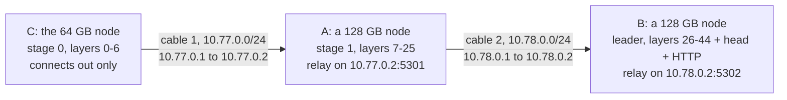

# Hardware setup

This guide takes 2-4 Windows machines from "cable in the box" to "a link a pipeline stage can use": cabling, the
Windows side of a USB4 / Thunderbolt link, getting traffic into WSL2, WSL2 settings, GPU memory on unified-memory
laptops, disk planning, and the numbers to expect. When something goes wrong, see
[troubleshooting.md](troubleshooting.md).

Paths are relative to the repository root. Windows commands run in PowerShell; Linux commands run inside WSL2.

> **What was tested.** Every number in this guide comes from two N1X laptops (a 128 GB node and a 64 GB node) joined
> by one cable, both on Windows 11 with Ubuntu in WSL2 (NAT networking). The three- and four-node layouts below are
> supported by the scripts but have **not run on hardware**. The link measurements were taken with earlier revisions
> of `setup_usb4_link.ps1`, `relay_user.ps1` and `linktest.py`. The revisions in this repository, including
> `tfpp/scripts/glm/relay_hop.ps1`, were reworked afterwards (per-link subnets, scoped firewall rule groups, safer
> relay error handling). They have been tested only in CPU tests and on loopback, not yet across the cable.

Engine status (the project-wide labels):

- **VERIFIED ON HARDWARE:**
  - Flash-Next tfpp 2-machine split token-identical to single node and as fast (KeepWarm), 3-rank chain on 2 machines;
  - tfpp-glm v1 bit-exact vs one process on the truncated 8-layer model (pure/eager/graphs, 2 cut points, kept-prompt
    pressure, fault abort/kill, cross-machine 19/19), 26-layer cross-machine two cuts bit-identical, HTTP path
    answered;
  - llama.cpp RPC Flash-Next Q4 2-node 22.2 tok/s.
- Full 45-layer GLM (~160 GiB) does NOT fit 128+64 GB: needs a third node (planned chain 128->64->128).
- tfpp-glm v2 (PARALLEL 2-8): verified on one GPU (8-layer model, 2-stage chains), not yet across machines.
- **NOT RUN ON HARDWARE:** tfpp-ds41 (static review only, plus its CPU tests;
  nothing has run on a GPU).

## Contents

1. [What you need](#1-what-you-need)
2. [Topology and cabling](#2-topology-and-cabling)
3. [Windows: bring the link up](#3-windows-bring-the-link-up)
4. [Into WSL: the userland relay](#4-into-wsl-the-userland-relay)
5. [WSL2 settings](#5-wsl2-settings)
6. [GPU memory on unified-memory laptops](#6-gpu-memory-on-unified-memory-laptops)
7. [Disk planning](#7-disk-planning)
8. [Expected numbers and how to measure them](#8-expected-numbers-and-how-to-measure-them)
9. [Checklist before every run](#9-checklist-before-every-run)

---

## 1. What you need

| Item | Notes |
|---|---|
| 2-4 machines | Each needs a USB4 or Thunderbolt port, an NVIDIA GPU, and Windows 11 with WSL2. We used N1X laptops: GPU compute capability 12.1 (`sm_121`), with memory shared between CPU and GPU. The tfpp engines are built for `sm_121`, and `tfpp/scripts/glm/start_stage.sh` refuses any other capability. llama.cpp RPC is not tied to it. |
| One cable per link | Thunderbolt 4 / USB4 (40 Gbit/s) is recommended. The link measurements in section 8 were taken with a Thunderbolt 3 cable that negotiated 20 Gbit/s, which is already more than the WSL path can use. |
| Two ports on middle nodes | In a chain of 3 or 4 machines, every node except the two ends carries two cables, one to each neighbour. |
| Disk | Each node holds only the weights of its own layers, plus a few shared files. See [section 7](#7-disk-planning). |
| Power | Keep every machine on AC power. These laptops draw 45-80 W and run warm under sustained load. |

The two nodes we ran:

| | 128 GB node | 64 GB node |
|---|---|---|
| RAM (visible to Windows) | 128 GB (118.5 GB) | 64 GB (54.7 GB at first; 32.2 GB after a firmware update reserved about 32 GB as dedicated GPU memory, see [section 6](#6-gpu-memory-on-unified-memory-laptops)) |
| WSL2 | Ubuntu 26.04 (aarch64), NAT networking, `memory=108GB` | same, `memory=48GB` |
| Memory read bandwidth (measured) | 285 GB/s (258 GB/s on large tensors) | 263 GB/s (236 GB/s) |
| bf16 matmul (measured) | 93 TFLOPS | 93 TFLOPS |
| USB4 host routers | 3 | 3 |

## 2. Topology and cabling

A pipeline is a **chain**: stage 0 → stage 1 → … → the last stage. Each cable joins two neighbours and carries one TCP
connection. The upstream node connects out; the downstream node listens. With WSL2 in NAT mode, every node that
**receives** a connection needs two things on its Windows side:

- an inbound firewall rule for the stage port, and
- a relay that forwards the port into WSL (section 4).

A node that only connects out needs neither.

| Engine | Listening (receiving) side | Connecting side | Port |
|---|---|---|---|
| llama.cpp RPC | `rpc-server` (named `ggml-rpc-server` in newer builds), holding the later layers | `llama-server --rpc 10.77.0.1:50052` | 50052 |
| tfpp, Flash-Next | `tfpp_run.py --role last --listen 5201`, and any middle rank | `tfpp_run.py --role leader --peer 10.77.0.1:5201` | 5201 (`--listen`) |
| tfpp-glm | Every stage after stage 0 (`LISTEN=` in its `node.env`). The leader is the **last** stage. | Each follower, through `DOWN=` | Examples: 5301, 5302 |
| tfpp-ds41 (not run on hardware) | As tfpp-glm | As tfpp-glm | Examples: 5321, 5322 |
| `linktest.py` | `server` | `client` | 5201 |

### Two nodes (what we ran)

```
   node 2 = 10.77.0.2 (sends)                          node 1 = 10.77.0.1 (receives)
  +-----------------------------+                     +--------------------------------------+
  | WSL2 (NAT)                  |                     | Windows                              |
  |  llama-server / leader      |    USB4 cable       |  relay_user.ps1                      |
  |  connects to 10.77.0.1:PORT-+--> Windows ---------+->  listens on 10.77.0.1:50052,5201   |
  +-----------------------------+   (routes it out)   |        | forwards to the same port   |
                                    10.77.0.0/24      |        v                             |
                                                      | WSL2 (NAT): rpc-server / last rank   |
                                                      |   listening on 0.0.0.0:PORT          |
                                                      +--------------------------------------+
```

In the two-node runs only node 1 accepted inbound connections, so data flowed from node 2 to node 1. To run a chain
the other way round, give node 2 a firewall rule for the port and a relay as well.

### Three nodes (planned; not run on hardware)

The example configuration in `tfpp/scripts/glm/node.env.example` cuts GLM-5.3-Flash like this:



The status summary above describes the plan as 128 -> 64 -> 128. The shipped example puts the 64 GB node first
instead (64 -> 128 -> 128). The scripts accept either order. What changes is which node carries two cables (the
middle one) and where the layer cuts fall.

### Four nodes (not run on hardware)

Extend the chain the same way. Each cable gets its own subnet (10.77.0.0/24, 10.78.0.0/24, 10.79.0.0/24). Each of the
two middle nodes carries two cables and runs a relay on the address of its upstream cable.

### Cabling rules

1. **Plug the cable straight into a USB4 / Thunderbolt port on each machine.** Do not route the link through a dock or
   a hub. The cluster has only ever been set up on a direct cable.
2. **Use the same port every time.** Each USB4 port can show up as its own network adapter, and the static address
   stays on the adapter you configured.
3. **One subnet per cable.** The setup script refuses an address that overlaps another interface's subnet.
4. **Build a chain, not a star.** No switch is involved. A middle node routes nothing: its stage receives from
   upstream and sends downstream itself.

## 3. Windows: bring the link up

Keep a Windows-side copy of the repository for the `.ps1` scripts, in a folder that only you and administrators can
change, for example a clone in your user profile. An elevated script in a folder that every user can write to can be
replaced by any local user.

### 3.1 Check that Windows sees the link

On both machines, in an ordinary PowerShell:

```powershell
Get-NetAdapter | Where-Object InterfaceDescription -match 'USB4|P2P' |
  Format-Table Name, InterfaceDescription, Status, LinkSpeed, ifIndex
```

You should see a `USB4(TM) P2P Network Adapter` with status `Up` and a `LinkSpeed` of 20 Gbps (ours, with a
Thunderbolt 3 cable) or 40 Gbps. Until setup runs, it holds a self-assigned 169.254.x.x address. Ours reported an MTU
of 62000 (`Get-NetIPInterface -InterfaceIndex <ifIndex> -AddressFamily IPv4`). If the adapter never appears, see
[troubleshooting.md](troubleshooting.md#link-and-cabling).

### 3.2 `setup_usb4_link.ps1`: address, network category, firewall

Run it in an **administrator** PowerShell on each end of each cable.

Two nodes:

```powershell
# node 1 = 10.77.0.1, the receiving side (rpc-server / last rank); allows TCP 50052 and 5201 from 10.77.0.2
powershell -ExecutionPolicy Bypass -File .\setup_usb4_link.ps1 -Node 1
# node 2 = 10.77.0.2; allows TCP 5201 from 10.77.0.1 (link test in the other direction)
powershell -ExecutionPolicy Bypass -File .\setup_usb4_link.ps1 -Node 2
```

On the chosen adapter only, the script:

- sets a static IPv4 address and turns DHCP off;
- sets the network category to Private, retrying for about 10 s because Windows may not have created the connection
  profile yet;
- adds inbound firewall rules in the group `hive-ram`, named `hive-ram <address> icmp` and
  `hive-ram <address> tcp <port>`. They admit ICMP echo and the listed TCP ports, **only from the peer's address and
  only to this link's address**;
- pings the peer.

Running the script again replaces the rules for that address. It never touches Wi-Fi, VPN or virtual adapters.

| Parameter | Default | Meaning |
|---|---|---|
| `-Node 1\|2` | (preset set) | Two-node preset. `1`: address 10.77.0.1, peer 10.77.0.2, TCP 50052 and 5201. `2`: address 10.77.0.2, peer 10.77.0.1, TCP 5201. |
| `-Address`, `-PeerAddress` | (explicit set, both required) | This end's and the peer's IPv4 addresses for any link. They must be in one subnet. |
| `-PrefixLength` | 24 | Subnet prefix, 8 to 30. |
| `-InterfaceAlias` / `-InterfaceIndex` | auto | Which adapter to configure. Without one, the script considers the USB4 adapters that are `Up`. It takes the only one, else the one already holding `-Address`, else the only one without a static address, and otherwise refuses and lists the candidates. |
| `-AllowTcpPorts` | preset's list, or none | TCP ports to admit from the peer, as a list, `5301,5302` or `"5301 5302"`. Given together with `-Node`, it **replaces** the preset list, so repeat any preset ports you still need. |
| `-PublishPorts` | none | Opt-in, not recommended. Adds a `netsh interface portproxy` from `<Address>:<port>` into WSL. This measured 0.42 Gbit/s, and it holds the port so the relay cannot bind it (section 4). |
| `-PublishTo` | 127.0.0.1 | Target for `-PublishPorts`. 127.0.0.1 depends on WSL's localhost forwarding, which did not work on one of our nodes. |

Adding a stage port to the two-node preset, for example a tfpp-glm leader listening on 5301 on node 1:

```powershell
powershell -ExecutionPolicy Bypass -File .\setup_usb4_link.ps1 -Node 1 -AllowTcpPorts 50052,5201,5301
```

Three nodes, chain C → A → B (not run on hardware). Find the adapter names with the command in 3.1. A runs the script
once per cable:

```powershell
# C (stage 0 only connects out: ping rule only)
powershell -ExecutionPolicy Bypass -File .\setup_usb4_link.ps1 -Address 10.77.0.1 -PeerAddress 10.77.0.2
# A, the cable to C (its relay listens on 5301)
powershell -ExecutionPolicy Bypass -File .\setup_usb4_link.ps1 -Address 10.77.0.2 -PeerAddress 10.77.0.1 `
    -AllowTcpPorts 5301 -InterfaceAlias '<A port cabled to C>'
# A, the cable to B
powershell -ExecutionPolicy Bypass -File .\setup_usb4_link.ps1 -Address 10.78.0.1 -PeerAddress 10.78.0.2 `
    -InterfaceAlias '<A port cabled to B>'
# B (the leader; its relay listens on 5302)
powershell -ExecutionPolicy Bypass -File .\setup_usb4_link.ps1 -Address 10.78.0.2 -PeerAddress 10.78.0.1 -AllowTcpPorts 5302
```

For four nodes, add a third subnet (10.79.0.x) in the same way.

### 3.3 `undo_usb4_link.ps1`

Run in an administrator PowerShell. For one link, it removes:

- that address's `hive-ram` rules;
- relay rules named `tfpp-glm-*` that are scoped to the address;
- its portproxy entries;
- the address itself.

When no static address is left on the adapter, it also turns DHCP back on and sets the category to Public. It reports
each step and exits 1 if any step failed.

```powershell
powershell -ExecutionPolicy Bypass -File .\undo_usb4_link.ps1                     # the one link on this node
powershell -ExecutionPolicy Bypass -File .\undo_usb4_link.ps1 -Address 10.78.0.1  # one link of several
powershell -ExecutionPolicy Bypass -File .\undo_usb4_link.ps1 -All                # every link
```

Without arguments on a node with several links, it refuses and asks for `-Address` or `-All`.

### 3.4 What the firewall does and does not protect

- The rules guard **the link side only**. Two things are reachable by every process on the host and by every WSL
  distro, whatever the firewall says:
  - Windows' own `127.0.0.1:<port>`;
  - the WSL address that a relay forwards to.
- llama.cpp's `rpc-server` has **no authentication and no encryption**; a client can read and write its memory
  buffers. Start it only while benchmarking, on hosts you trust, and stop it afterwards.
- The tfpp stage links are **unauthenticated by default**. For the Flash-Next tfpp:
  - bind the link address with `--bind` / `TFPP_BIND` where you can (0.0.0.0 is what a NAT node behind its relay
    needs);
  - optionally set the same `TFPP_SECRET` on every node, so both ends of each link prove they know it.
- tfpp-glm's leader serves an OpenAI-style HTTP API. `HTTP_HOST=0.0.0.0` in `tfpp/scripts/glm/cluster.env` serves it
  **without authentication on every interface**. Set `HTTP_HOST=127.0.0.1` or keep the port firewalled. The
  tfpp-ds41 leader takes `TF_API_KEY_FILE` (its `node.env.example`).

## 4. Into WSL: the userland relay

In WSL2's default NAT mode, a connection that arrives at `10.77.0.1:PORT` lands on Windows, not in WSL. Something on
the Windows side must forward it to WSL's private address. Windows has a built-in forwarder
(`netsh interface portproxy`, served by the IP Helper service), but on our link it was the bottleneck:

| Path into WSL | Throughput | 64 B round trip |
|---|---|---|
| `netsh interface portproxy` (IP Helper) | **0.42 Gbit/s** | 0.38 ms p50, **20 ms p99** |
| `relay_user.ps1`, one node, Windows to its own WSL | 10.1 Gbit/s | n/a |
| `relay_user.ps1`, WSL → cable → relay → WSL | **5.2 Gbit/s** (615 MiB/s) | 0.49 ms p50, 1.4 ms p99 |

The relay is a short PowerShell loop around .NET's `CopyToAsync`, with Nagle off, 4 MiB socket buffers and 1 MiB copy
chunks. It needs no admin rights and installs nothing. WSL's mirrored networking mode would give WSL the link address
itself and make the relay unnecessary, but we have **not tested** it. The relays are written for NAT mode only.

### 4.1 `relay_user.ps1` (no admin)

```powershell
powershell -ExecutionPolicy Bypass -File .\relay_user.ps1                                  # 10.77.0.1, ports 50052 and 5201
powershell -ExecutionPolicy Bypass -File .\relay_user.ps1 -ListenAddress 10.77.0.2 -Ports 5301
```

| Parameter | Default | Meaning |
|---|---|---|
| `-ListenAddress` | 10.77.0.1 | This node's link address. |
| `-Ports` (alias `-Port`) | 50052, 5201 | Ports to listen on, each forwarded to the **same port** on WSL's address. Accepts a list or `"5301,5302"`. |
| `-WslIp` | auto | WSL's address. Inside WSL, `ip -4 -o addr show eth0` prints it. |
| `-BridgePort` | 0 (off) | Optional: read WSL's address from an existing portproxy entry `0.0.0.0:<BridgePort>` → `<ip>:<port>`. |
| `-Distro` | default distro | Which distro to ask for its address. |

How the relay finds WSL's address: `-WslIp`, then the portproxy entry above, then WSL itself (`eth0`, then
`hostname -I`). The relay prints `relay up: <address>:<ports> -> WSL <ip>`, then one line per connection opened,
closed or failed.

### 4.2 `start_n1x_relay.ps1` (admin wrapper)

This is the same relay with the same parameters. It first deletes any `netsh interface portproxy` entries on that
address and those ports, which an older `-PublishPorts` setup leaves behind. Those entries hold the ports, so the
relay's bind would fail. Once they are gone, `relay_user.ps1` alone is enough.

```powershell
powershell -ExecutionPolicy Bypass -File .\start_n1x_relay.ps1          # admin; 10.77.0.1, ports 50052 and 5201
```

### 4.3 `tfpp/scripts/glm/relay_hop.ps1` (stage ports of tfpp-glm and tfpp-ds41)

This is the same forwarding design for one inbound hop of a tfpp-glm or tfpp-ds41 chain. It adds:

- TCP keepalive on both sockets (60 s idle, 10 s probes), so a peer that lost power is noticed while idle;
- a bounded connect into WSL;
- a fresh lookup of WSL's address when a connect times out or finds no route (at most every 10 s; never with
  `-WslIp`).

Its current revision has run on loopback only.

```powershell
# A in the three-node example:
powershell -ExecutionPolicy Bypass -File .\tfpp\scripts\glm\relay_hop.ps1 -ListenAddress 10.77.0.2 -Ports 5301
# B:
powershell -ExecutionPolicy Bypass -File .\tfpp\scripts\glm\relay_hop.ps1 -ListenAddress 10.78.0.2 -Ports 5302
```

| Parameter | Default | Meaning |
|---|---|---|
| `-ListenAddress` | (required) | This node's address on the upstream cable. |
| `-Ports` (alias `-Port`) | (required) | Stage ports. Each is forwarded to the same port in WSL. |
| `-WslIp` | auto (`wsl.exe -e hostname -I`) | WSL's address. This also pins it: no fresh lookups. |
| `-PortproxyPort` | 0 (off) | Read WSL's address from an existing portproxy rule listening on `0.0.0.0:<N>`. This is for a relay run from a Windows account that does not own the WSL distro, since WSL VMs are per user. |
| `-ConnectTimeoutMs` | 5000 | Upper bound on one connect into WSL. |

The firewall rule for a stage port comes from `setup_usb4_link.ps1 -AllowTcpPorts` (section 3.2), or from a manual
rule like the one in the script's header.

### 4.4 Rules for running relays

- **Keep the window open.** Closing it or pressing Ctrl+C stops the relay.
- **Start it from the local desktop session.** A process started inside a Windows OpenSSH session ends with that
  session, and the relay goes with it.
- **Restart it after WSL restarts.** WSL's NAT address changes after `wsl --shutdown`, a WSL update or a Windows
  reboot. `relay_user.ps1` keeps forwarding to the old address. `relay_hop.ps1` looks the address up again, unless it
  was given `-WslIp`.
- **The WSL side must listen on `0.0.0.0` or on WSL's `eth0` address**, on the same port number. A server bound to
  127.0.0.1 inside WSL is unreachable through the relay.
- **If nothing listens in WSL yet,** the relay closes the incoming connection at once. tfpp stages treat that as "not
  there yet" and retry until `--connect-timeout`, so stages can start in any order. For llama.cpp, start
  `rpc-server` before `llama-server`.

## 5. WSL2 settings

What we ran, and what we recommend:

| Setting | Value | Why |
|---|---|---|
| Distro | Ubuntu 26.04, aarch64 | What every hardware run used. |
| Memory limit (`.wslconfig`) | Set it explicitly: we used `108GB` on the 128 GB node and `48GB` on the 64 GB node | WSL's default is half of the RAM. See section 6 for how this may interact with GPU memory. |
| Networking | Default NAT, with the relays from section 4 | Mirrored mode is untested here. |
| systemd | On (`[boot]` `systemd=true` in `/etc/wsl.conf`) | Needed by `systemd-run` (used to launch llama.cpp) and by the `tfpp-glm@.service` / `tfpp-ds41@.service` user units. |
| GPU driver | The Windows NVIDIA driver only | WSL gets CUDA from the Windows driver (`/usr/lib/wsl/lib`). Do not install a Linux GPU driver inside WSL. |
| CUDA toolkit | pip's CUDA 13 inside each venv (`cuda-toolkit[nvcc,cccl]==13.0.*`) | No system CUDA toolkit is needed; one of our nodes had none. If Ubuntu's CUDA 12 development packages are installed, read the `libcudart.so.12` entry in [troubleshooting.md](troubleshooting.md#toolchain). |
| Python | 3.14, one venv per engine | The engines pin different TensorFold trees and Triton versions: `~/tf-venv-061` (Flash-Next), `~/tf-venv-mia` (GLM), `~/tf-venv-dsv41` (DeepSeek). The tfpp-glm and tfpp-ds41 toolchain scripts refuse another engine's venv. The N1X image had no `python3.14-dev` package, so the scripts look for Python headers under `~/pyinc`. |
| Checkout | Inside WSL's ext4, for example `~/hive-ram` | It needs LF line endings (clone with git inside WSL). The systemd unit files hard-code the checkout path (tfpp-glm's assumes `~/hive-ram`): edit them to match yours. |

`.wslconfig` lives in your Windows profile. Run `wsl --shutdown` after changing it.

```ini
# %UserProfile%\.wslconfig
[wsl2]
memory=108GB        # the 128 GB node; 48GB on the 64 GB node
```

Further notes:

- **Same paths on every node.** A venv can be copied between nodes of the same distro and architecture. The Flash-Next
  venv was built once and copied. llama.cpp was built on one node with CUDA 13.1 and copied to the other, together
  with `libcudart`, `libcublas` and `libcublasLt` (about 0.8 GB). Nothing was installed system-wide on the second
  node.
- **Keep long-running WSL processes detached.**
  - `start_stage.sh` starts a stage with `setsid nohup`, or runs it in the foreground under the systemd unit.
  - For llama.cpp, start the server as a transient unit, for example
    `systemd-run --user --unit=<name> -p MemoryHigh=8G <command>`. It survives a closed terminal, and `MemoryHigh`
    also caps the page cache charged to it (section 7.2).
  - We started ours as a system unit with `--uid`. A `--user` unit needs your systemd user session to be running.
  - Depending on WSL version and settings, WSL can stop a distro when no session is attached. Keeping one WSL terminal
    open per node during a run is the simple guard.
- **Model files belong on the WSL ext4 disk**, not under `/mnt/c`. Section 7 explains why.

## 6. GPU memory on unified-memory laptops

On these laptops the CPU and GPU share one pool of physical RAM. The firmware sets aside a **dedicated carve-out** for
the GPU, which Windows does not count as RAM. Everything else is **shared** among Windows, the WSL2 virtual machine
(including its page cache) and GPU allocations.

```
 physical RAM
 +-----------------+------------------------------------------------------------------+
 | GPU carve-out   | shared: Windows + WSL2 VM (processes and page cache) + GPU memory |
 | ("dedicated")   |                                                                  |
 +-----------------+------------------------------------------------------------------+
   invisible to Windows        the stages, Windows, the page cache and any other GPU program
                               all compete for this part
```

What we observed:

- **The dedicated share can change under you.** On the 64 GB node Windows first saw 54.7 GB. A firmware update
  delivered by Windows Update left Windows seeing only 32.2 GB, with about 32 GB reserved as dedicated GPU memory.
  llama.cpp's `rpc-server` then placed its layers (about 20 GB) in that dedicated memory, without taking Windows
  memory.
- **CUDA inside WSL can use more than the dedicated share.** On the same node, after that update, CUDA in WSL
  reported 46 GiB total. On the 128 GB node, CUDA reported 104,475 MiB free right after setup.
- **Open question:** in both cases the CUDA figure was a little below the WSL memory limit (`memory=48GB` and
  `memory=108GB`). We have **not verified** whether `.wslconfig`'s `memory=` caps what CUDA can use, nor how the
  dedicated and shared parts add up. If you change the limit or the firmware changes, measure again. If `memory=`
  does cap CUDA, WSL's default (half the RAM) would leave far less for the model.

How much a stage can use in practice:

| Node | Observed | Notes |
|---|---|---|
| 128 GB | About 92-95 GiB for weights and caches, keeping at least 4-6 GB free for Windows | llama.cpp held about 80 GB of layers there, with 20-23 GB of Windows memory still free. A tfpp-glm stage of 57.3-60.8 GiB loaded (section 7.2 describes what went wrong around it). |
| 64 GB (about 32 GB dedicated) | CUDA total 46 GiB; about 37 GiB usable by one stage | A 26.5 GiB tfpp-glm leader stage left 10.4 GiB of its budget. A 16-layer Flash-Next stage left 18.5 GiB free. llama.cpp RPC placed about 20 GB of layers here while Windows kept 23-24 GB free. The three-node example plans about 38 GiB for this node. |

What eats the budget:

1. **Windows.** Keep at least 4-6 GB of Windows memory free.
2. **WSL's page cache.** It counts against Windows memory; see 7.2.
3. **Other GPU programs.** Anything else that uses the GPU can take the memory before your stage loads.
   tfpp-glm and tfpp-ds41 measure free GPU memory **once**, at startup (the CAP step). A workload that grows later can
   push a stage out of memory in the middle of a request.
   - `start_stage.sh` refuses to start while one of the ports listed in `GPU_GUARD_PORTS` (`node.env`) is in use,
     unless `ALLOW_GPU_SHARING=1`.
   - Two stages on one GPU need `BUDGET_GIB` each.
4. **The stage's own reserve.** tfpp-glm's `RESERVE_GIB` defaults to 3; the example uses 2.5 on the 64 GB node.

How to look:

```bash
# inside WSL, with the engine's venv active: free and total CUDA memory as this process sees it
python -c 'import torch; f, t = torch.cuda.mem_get_info(); print(f"free {f/2**30:.1f} GiB of {t/2**30:.1f} GiB")'
nvidia-smi
free -g                     # the "buff/cache" column is page cache that Windows is paying for
```

On Windows, open Task Manager:

- **Performance > Memory:** "Committed" against its limit.
- **Performance > GPU:** "Dedicated GPU memory" and "Shared GPU memory".
- **Details:** add the "Dedicated GPU memory" column to see which process holds it. WSL's allocations show up on the
  WSL virtual machine's process.

Note: tfpp-glm's notes list the exact meaning of `mem_get_info` under WSL2 with unified memory as not yet confirmed.

## 7. Disk planning

### 7.1 How the WSL disk grows

WSL2 keeps each distro's ext4 file system in a virtual disk file, `ext4.vhdx`, on C: by default.

- The file **grows on demand and never shrinks by itself.** Deleting files inside WSL leaves free space (slack) inside
  the vhdx.
- **Later writes reuse that slack** before the file grows again, so a download that fits in the slack does not take
  space from C:.
- So the room for new data on a node is about:

  ```
  room ≈ (C: free) + (vhdx file size - ext4 space used)
  ```

  Example: 50 GB free on C:, and a 300 GB vhdx with 200 GB used, gives about 150 GB.

Measuring both sides:

```powershell
# Windows: each distro's vhdx file size
Get-ChildItem HKCU:\Software\Microsoft\Windows\CurrentVersion\Lxss | ForEach-Object { Get-ItemProperty $_.PSPath } |
  ForEach-Object { $v = Join-Path $_.BasePath 'ext4.vhdx'
    if (Test-Path $v) { '{0}: {1:N1} GB' -f $_.DistributionName, ((Get-Item $v).Length / 1e9) } }
Get-PSDrive C        # C: free
```

```bash
df -h /              # inside WSL: "Used" is ext4's space used; "Size" is the vhdx's maximum, not its file size
```

**Guard C:.** Keep at least about 6 GB free on C: at all times. Windows and the pagefile need it, and the pagefile
can grow suddenly (7.2). The tfpp-ds41 download helper `tfpp/scripts/ds41/download_list.sh` enforces this before
printing its download script. It wants 75 GB free both on the WSL disk under `--dir` and on C: (as `/mnt/c`). Pass
`--vhdx-ok` once you know the vhdx file is already large enough, or `--no-disk-check` to skip both checks. The script
has not run on hardware.

To give space back to C:, you can compact the vhdx, but only after `wsl --shutdown` and with a backup. A failed
compaction can leave the disk unable to attach. Moving a distro to a larger drive with `wsl --export` /
`wsl --import` is the other option; we have not tried it here.

**Keep model files inside WSL's ext4**, not under `/mnt/c`. `/mnt/c` goes through WSL's Windows file-sharing layer,
which is much slower, and the loaders were never tested on it. Their O_DIRECT and asynchronous reads (tfpp-glm's
loader, tfpp-ds41's Engram reader) assume a local Linux file system.

### 7.2 The page cache is Windows memory

Inside WSL, Linux caches every file it reads or writes. That cache lives in the WSL virtual machine's memory, and
Windows counts it as committed memory. On a unified-memory laptop it competes directly with GPU allocations.

What happened on the 128 GB node:

- A 91 GB download and a 26 GB `tar` read left 77 GB in WSL's page cache.
- A 57 GiB tfpp-glm stage then loaded on top.
- Windows' commit headroom fell to 1.2 GB, the pagefile grew to 50.7 GB, and **C: dropped to 0.8 GB free**.
- Dropping the cache brought commit back to normal and the test finished. The pagefile only shrinks again after a
  reboot.
- Earlier, while a model downloaded, the WSL VM grew to its 108 GB limit and returned memory to Windows only slowly
  after the cache was dropped.

What protects you:

- **tfpp-glm's loader** calls `load.drop_cached()` before each stage loads (`tfpp/tfpp/glm/load.py`). It sends
  `posix_fadvise(POSIX_FADV_DONTNEED)` for the checkpoint's shards, without root. The loader itself reads with
  O_DIRECT, so loading does not fill the cache again.
- **llama.cpp**: load with `-lm dio` (direct I/O), and do not give `rpc-server` a cache directory (`-c`). The cache
  files land on the WSL disk and in the page cache.
- **By hand**, before a big load, after downloads or copies:

  ```bash
  sync && echo 1 | sudo tee /proc/sys/vm/drop_caches
  ```

- **A memory cap on a service.** `systemd-run -p MemoryHigh=8G ...` limits the page cache charged to that unit.
- **Watch** Task Manager's "Committed" during the first loads on a new node.

### 7.3 Space per engine

Weights are never part of this repository. Every script runs with `HF_HUB_OFFLINE=1`, so nothing downloads by itself.
When you copy a model folder between nodes, copy the hidden `.cache/huggingface` folder too. tfpp-glm and tfpp-ds41
compare the checkpoint revision recorded there; without it, every stage reports `unknown`. Model licences differ: see
each model card.

| Engine and model | What each node stores |
|---|---|
| llama.cpp RPC, Flash-Next UD-Q4_K_XL GGUF (103.7 GiB) | The `llama-server` node holds the whole GGUF. The `rpc-server` node receives its layers over the link into GPU memory and needs no file. |
| tfpp, Flash-Next MLX-4bit-MTP | Each rank holds the shards with its own layers, plus the shards with the embedding, head and MTP head where its role needs them. |
| tfpp-glm, GLM-5.3-Flash EXL3 4bpw (163.6 GiB, 83 shards of about 2 GiB; about 176 GB on disk) | Each stage holds only its own shards. With the example cuts: stage 0 holds shards 2-10, stage 1 shards 10-45, and the leader shards 1, 2, 45-80, 82 and 83 (plus 81 for MTP). The leader may also hold the DFlash2 drafter. It is optional and licensed CC BY-NC-ND 4.0 (non-commercial, no derivatives); `NO_DRAFTS=1` runs without it. `VERIFY_SHARDS=1` checks a stage's shards against their Hub sha256 (the script estimates about a minute per 80 GB; not timed on hardware). |
| tfpp-ds41, DeepSeek-V4.1-Flash EXL3 2.9 bpw (not run on hardware) | 196.1 GiB of weights plus 189 GiB of Engram tables (two shards of about 95 GiB). Only the stage that owns the Engram layers needs the tables, about 273 GiB on that node together with its weights: more than either of our two nodes had. The shortened test model S11 needs 64.3 GB, plus 4.1 GB of test tables. |

## 8. Expected numbers and how to measure them

### 8.1 The link

All measurements: one TCP connection, measured with Python and PowerShell. The Thunderbolt 3 cable negotiated
20 Gbit/s, the USB4 adapter's MTU was 62000, and WSL2 ran in NAT mode.

| Path | Throughput | 64 B round trip |
|---|---|---|
| Windows to Windows across the cable | 7.1 Gbit/s | n/a |
| WSL (sending) to the peer's Windows | 4.8 Gbit/s | 0.15 ms p50 |
| Into WSL through Windows `portproxy` | 0.42 Gbit/s | 0.38 ms p50, 20 ms p99 |
| One node: Windows to its own WSL address, direct | 16.1 Gbit/s | n/a |
| One node: through `relay_user.ps1` | 10.1 Gbit/s | n/a |
| **WSL → cable → relay → WSL (the path in use)** | **5.2 Gbit/s (615 MiB/s)** | **0.49 ms p50, 1.4 ms p99** |

### 8.2 What the link costs a pipeline

Per token, a stage boundary carries very little data:

| Engine | Sent across each cut, per row |
|---|---|
| Flash-Next tfpp | The residual streams, 4 x 2560 bf16 = 20 KB |
| tfpp-glm | The residual, 16384 bf16 = 32 KiB; with DFlash2, also 8 KiB per drafter tap (after layers 5, 14, 24, 33, 42), carried to the leader |
| tfpp-ds41 (not run on hardware) | 40,960 B of hidden state plus small extras, which grow when a cut falls inside a shared-KV group |

At 30 tok/s that is about 1 MB/s. Bandwidth does not matter for decoding; latency and the software around it do.
Measured per round:

- **Flash-Next tfpp, 2 machines, serial decode with KeepWarm:**

  | Part of the round | Time |
  |---|---|
  | 128 GB node: layers 0-31, with embedding and PLE | 17.4 ms |
  | 64 GB node: layers 32-47 and the head | 8.8 ms |
  | Network and Python | about 2.5 ms |
  | **Total speed** | **33.0-33.8 tok/s** (one node: 32.3-32.8 tok/s, eager) |

  With MTP drafts (depth 6) and CUDA graphs, the split ran 31.0 / 79.3 / 38.6 tok/s on prose / code / explanation
  prompts, against 31.4 / 77.1 / 38.2 on one node. Output was token-identical to the single node in every mode.
- **tfpp-glm, truncated 8-layer model:** 14.0 ms per token across machines against 11.7 ms in one process, so the hop
  adds about 2.3 ms. In the 26-layer cross-machine run, each extra layer cost 1.02 ms. That is the memory-bandwidth
  limit: a layer reads about 0.3 GB at about 263 GB/s.
- **Prefill** sends whole chunks: a 2,048-row GLM chunk is 64 MiB, about 0.1 s per hop at 615 MiB/s (estimate). GLM
  prefill throughput over the cable has not been measured. llama.cpp RPC prefilled a 9,014-token prompt at
  760 tok/s across two nodes.

**The real trap is the GPU clock, not the link.** A GPU that idles for 20-40 ms lowers its clocks:

- A 16-layer decode step (layers 32–47 + head) took 8.7–9.0 ms back to back and 15–16.5 ms after an idle gap.
- Spinning the CPU during the gap did not help (15.9 ms).
- One spinning GPU block on a side stream did help (9.9 ms).

In a pipeline every stage idles while the others work, so without a fix every stage runs slow. The Flash-Next split
ran 24.5-25.1 tok/s (eager; 25.1-25.5 with CUDA graphs) before the fix and 33.0-33.8 tok/s after.

The fix is `tfpp/tfpp/warm.py` (KeepWarm), used by every tfpp engine. While a stage waits on the link, it launches
about 1 ms GPU spins on a side stream, occupying one SM, and stops as soon as data arrives. `TFPP_WARM_MS` sets the
spin length (default 1.0); `0` turns it off. Its power and thermal cost on long idle stretches has not been measured.
llama.cpp RPC probably suffers the same downclocking; we did not measure that.

### 8.3 How to measure

**Ping** (the firewall rules admit ICMP from the peer):

```powershell
ping -n 20 10.77.0.1
```

**`linktest.py`** measures the real path: WSL on one node → cable → relay → WSL on the other. It uses only the
standard library.

- The server serves one client, then exits. It ignores connections whose first message is not a valid request
  (port probes); `LINKTEST_HELLO_S` (default 10 s) is how long it waits for that first message.
- The client sends 1 GiB, then 4 GiB, and times 2,000 round trips each of 64 B, 16 KiB and 64 KiB.
- There is no authentication: run it only on the link, only while testing.

```powershell
# node 1, Windows (keep open): forward the link-test port into WSL
powershell -ExecutionPolicy Bypass -File .\relay_user.ps1 -Ports 5201
```

```bash
# node 1, WSL
python3 linktest.py server                 # usage: server [port] [host]; port 5201, host 0.0.0.0
# node 2, WSL
python3 linktest.py client 10.77.0.1       # usage: client HOST [port]
```

The client prints lines of this form:

```
bulk 1 GiB: <seconds> s = <Gbit/s> Gbit/s (<MiB/s> MiB/s)
round trip     64 B: p50 <ms> ms  p90 <ms> ms  p99 <ms> ms
```

Our link gave about 5.2 Gbit/s bulk and 0.49 ms p50 / 1.4 ms p99 for 64 B.

- **The other direction:** give node 2 a relay (`relay_user.ps1 -ListenAddress 10.77.0.2 -Ports 5201`; the `-Node 2`
  preset already admits 5201) and swap the roles.
- **The cable alone, without WSL:** stop the relay, then run the same script with Windows' Python on both ends. Use
  `python linktest.py server 5201 10.77.0.1` on node 1 and `python linktest.py client 10.77.0.1 5201` on node 2.

**Inside a pipeline.**

- Flash-Next tfpp: set `TFPP_TIMING=1` on every rank. The leader prints `ms/round here {...} | peer {...}` after each
  prompt. The timing adds a device sync per phase, so the run is slightly slower.
- tfpp-glm v2 has `TFPP_GLM_TIMING=1`; v2 has run on one GPU only, so its timings across machines are not measured yet.

**GPU clock behaviour** (Flash-Next checkpoint, inside WSL, from `tfpp/`):

```bash
. scripts/flashnext/env.sh
MODEL_DIR=$HOME/models/flashnext-mlx4-mtp      # your Flash-Next MLX-4bit-MTP checkpoint folder
python rank_bench.py "$MODEL_DIR" 32:48 last --modes sleep@0,sleep@30,cpuspin@30,gpuwarm@30
```

`scripts/flashnext/env.sh` reconstructs the environment the hardware runs used (the venv itself was copied between
the nodes); the script file has not itself been run on hardware.

`rank_bench.py` times one stage's decode step with no link. Before each step it idles for the given gap by sleeping,
spinning the CPU, or running one GPU block on a side stream. It prints the median and the 10th percentile per mode.
Expect `sleep@30` and `cpuspin@30` to be clearly slower than `sleep@0`, and `gpuwarm@30` to be close to it.

**Memory and disk:** see the commands in sections 6 and 7.

## 9. Checklist before every run

After any reboot, WSL restart or Windows update, go through it again.

1. The cable is in the same ports, the adapter is `Up` (3.1), and `ping` reaches the peer. The static addresses and
   firewall rules survive reboots; the relays do not.
2. Every receiving node runs its relay in an open window, started **after** WSL came up (4.4).
3. No other GPU program is running, or it is listed in `GPU_GUARD_PORTS`. Check free GPU memory with
   `torch.cuda.mem_get_info()` right before starting (section 6).
4. The page cache is dropped, Windows "Committed" has headroom, and C: has at least about 6 GB free (section 7).
5. Automatic driver updates and Windows updates are paused for the session. On our nodes, an automatic driver update
   and a firmware update delivered by Windows Update each rebooted a machine around or during the experiments, and
   the firmware update also changed the GPU carve-out.
6. Every node runs the same repository revision and the same toolchain. tfpp-glm and tfpp-ds41 compare a digest of
   the code (`tfpp_sha`), the settings and the package tree at startup, and refuse a mismatch.
7. Servers without authentication (`rpc-server`, tfpp links, an HTTP front on 0.0.0.0) run only while you are
   testing (3.4).
