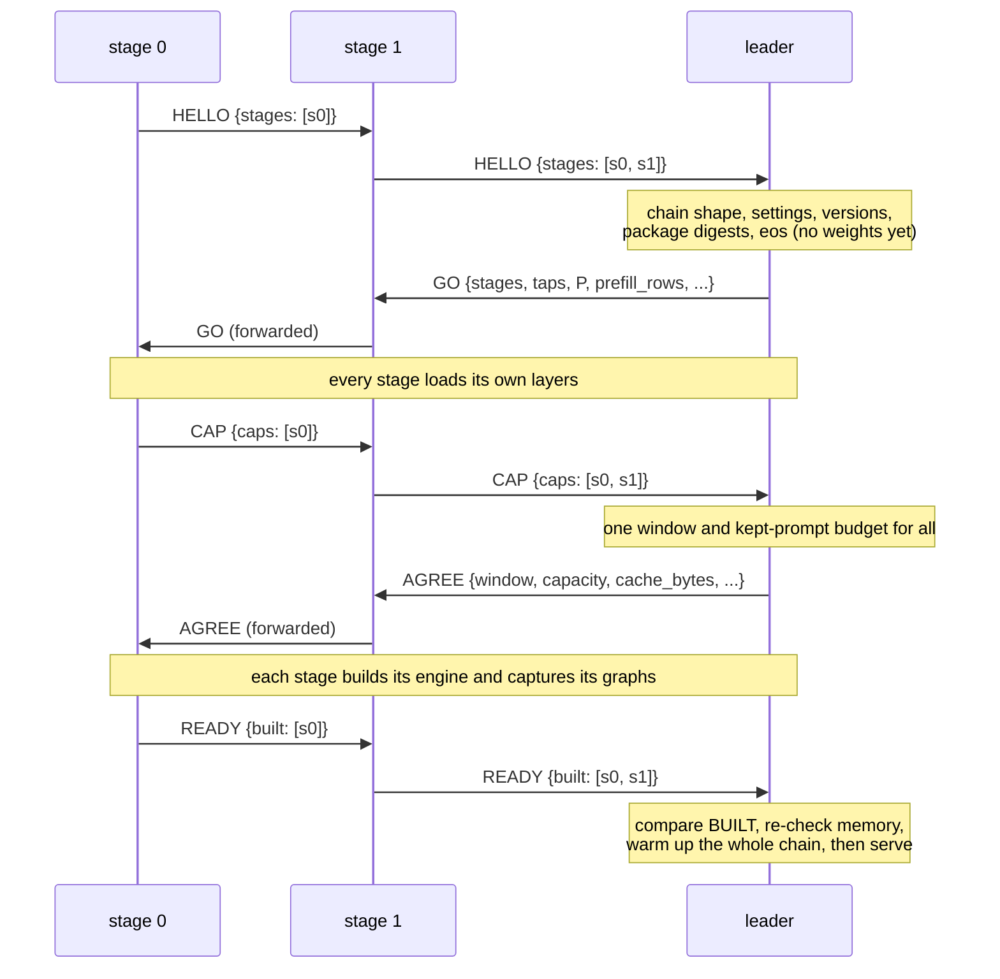

# Protocol

How the stages of a hive-ram chain talk to each other: transport, frame format, the startup handshake, the parity
checks that refuse mismatched stages, the runtime ops, failure handling, and the traces used to prove bit-exactness.
The design behind it is in [architecture.md](architecture.md); the tests that use the traces are in
[testing.md](testing.md).

## Verification status

| Status | Component |
|---|---|
| **VERIFIED ON HARDWARE** | Flash-Next tfpp 2-machine split token-identical to single node and as fast (KeepWarm), 3-rank chain on 2 machines |
| **VERIFIED ON HARDWARE** | tfpp-glm v1 bit-exact vs one process on the truncated 8-layer model (pure/eager/graphs, 2 cut points, kept-prompt pressure, fault abort/kill, cross-machine 19/19), 26-layer cross-machine two cuts bit-identical, HTTP path answered |
| **VERIFIED ON HARDWARE** | llama.cpp RPC Flash-Next Q4 2-node 22.2 tok/s |
| **DOES NOT FIT** | Full 45-layer GLM (~160 GiB) does NOT fit 128+64 GB: needs a third node (planned chain 128->64->128) |
| **NOT RUN ON HARDWARE** | tfpp-glm v2 (PARALLEL 2-8) |
| **NOT RUN ON HARDWARE** | tfpp-ds41 (static review only, plus its CPU tests; nothing has run on a GPU) |

Protocol details that changed after the hardware runs have CPU tests only:

- the Flash-Next wire `tfpp-flashnext/2` (the hardware runs used the first, unversioned wire, without the link
  handshake, HELLO or error frames);
- tfpp-glm's post-run fixes, among them a listener that drops strangers until a real stage exchanges `LINK`, and a
  `LINK` reader that refuses a non-tfpp peer at once. These change the tfpp-glm source digest (`tfpp_sha`), so
  every stage of a chain must run the same checkout.

## 1. Three wires

| Wire | Used by | LINK protocol string | Code |
|---|---|---|---|
| `tfpp-flashnext/2` | tfpp for Qwen3.8-Flash-Next (leader = first rank) | `tfpp-flashnext/2` | `tfpp/tfpp/proto.py`, `wire.py`, `driver.py` |
| tfpp-glm protocol 1 (v1 ops, plus v2 ops at `--parallel` > 1) | tfpp-glm (leader = last stage) | `1` | `tfpp/tfpp/glm/proto.py`, `wire.py`, `startup.py`, `v2proto.py` |
| `tfpp-ds41/1` | tfpp-ds41 (leader = last stage), not run | `tfpp-ds41/1` | `tfpp/tfpp/ds41/proto.py` (tfpp-glm's frame codec) |

The wires never connect to each other: each refuses a `LINK` of another protocol at once. Most of this page describes
tfpp-glm, the most complete of the three; section 9 covers the Flash-Next wire and section 10 tfpp-ds41.

## 2. Transport

- **One TCP connection per hop**, full duplex, over a point-to-point USB4 / Thunderbolt cable (any TCP path works).
  `TCP_NODELAY` is on. Socket buffers are left to the kernel's autotuning: on Linux, setting `SO_SNDBUF` / `SO_RCVBUF`
  caps them at `net.core.[wr]mem_max` (about 416 KiB by default) and turns autotuning off; the sizes are logged at
  connect.
- **Keepalive** on every link: 60 s idle, 10 s between probes, 6 probes (where the OS offers the options), so a peer
  that lost power is noticed while idle.
- **WSL2 NAT.** A node whose WSL2 uses NAT networking runs a userland TCP relay on its Windows side that listens on the
  USB4 address and forwards into WSL (`tfpp/scripts/glm/relay_hop.ps1 -ListenAddress 10.77.0.2 -Ports 5301`, or
  `relay_user.ps1`). Measured: 5.2 Gbit/s and 0.49 ms p50 WSL to WSL through such a relay, against 0.42 Gbit/s through
  Windows' built-in portproxy. When nothing listens in WSL yet, `relay_hop.ps1` closes the incoming connection at once,
  and the connecting stage retries.
- **Trust.** The links are meant for a private point-to-point cable. Headers are JSON (nothing in a frame can run
  code) and every size, shape and token id is checked before anything is allocated or launched, but tfpp-glm and
  tfpp-ds41 links have **no authentication and no encryption**. Allow the stage ports only from the peer's link address
  (`setup_usb4_link.ps1` installs such firewall rules) and keep them off LANs and Wi-Fi. The Flash-Next wire can
  require a shared secret (`TFPP_SECRET`, section 9).
- **Default addresses and ports** in the examples: `10.77.0.1` / `10.77.0.2` on the first cable, `10.78.0.1` /
  `10.78.0.2` on the second; tfpp-glm stage ports 5301 and 5302 (one-GPU tests use `127.0.0.1` from 5400 up); Flash-Next
  rank port 5201.

## 3. Frame format (tfpp-glm, tfpp-ds41)

```
 0               4                     4+n
 +---------------+---------------------+-----------+-----------+-- ... --+
 | n: u32, LE    | header: n bytes,    | part 0    | part 1    |         |
 |               | UTF-8 JSON object   | raw bytes | raw bytes |         |
 +---------------+---------------------+-----------+-----------+-- ... --+

 header = {"op": "ACT", "seq": 41, "kind": "step", "pos": 1234, "R": 3,
           "parts": [["x", "bf16", [3, 16384]], ["tap:0", "bf16", [3, 4096]]]}
```

- `op`: the operation (section 5). `seq`: the sender's frame number on this link and direction, from 0; a gap is a
  broken chain. The `LINK` frame carries `seq` -1, outside the count.
- `parts`: the payload, in order, as `[name, dtype, shape]`; each part is exactly `prod(shape) x itemsize` bytes,
  with no padding on the wire. Dtypes: `bf16` (2 bytes), `f32` (4), `i32` (4), `i64` (8), `u8` (1).
- Every other key is a field of the op. The header is at most 64 MiB. During the `LINK` exchange a header over 64 KiB,
  or a first frame with parts, marks a peer that does not speak the protocol (an SSH or TLS server, for example): a
  connecting stage gives up on it at once instead of retrying, and a listening stage drops the connection and keeps
  listening.
- **Control frames are forwarded byte for byte.** A follower re-sends the leader's control frame upstream unchanged
  (header and parts) before handling it, so on the control direction every hop sees the leader's numbering.
- **Activations** (`ACT` parts) leave from and arrive in one pinned host staging buffer per link end and direction,
  sized once after `AGREE` for a full prompt chunk (`proto.link_staging`: `align(rows x 4 x 4096 x 2) + taps x
  align(rows x 4096 x 2)`, 256-byte aligned; 80 MiB for 2,048 rows and one tap). Sending copies the GPU rows into it
  (the copy waits for the producing kernels) and sends from it with scatter-gather `sendmsg` on Linux; receiving reads
  into it and queues a non-blocking copy into the destination GPU view. Token ids and image rows arrive as host bytes.

## 4. Linking and the startup handshake

### Who connects

```
 stage 0                     stage 1                       leader (last stage)
 connect down (retry)  --->  listen up / connect down ---> listen
         <------ LINK ------>        <------ LINK ------->
```

Every follower connects towards the leader (`--down HOST:PORT`) and, if it is not stage 0, listens for the stage before
it (`--listen HOST:PORT`); the leader listens if the chain has more than one stage. Both ends of a connection send a
`LINK` frame (`{"proto": 1, "from": ..., "to": ...}`) and read the other's.

- The connecting side (`startup.connect_down`) retries every second until `--connect-timeout` (default 3,600 s). A
  connection that is accepted but gives no `LINK` within 15 s, or closes, counts as "not there yet" (a relay with
  nothing behind it); a peer speaking another protocol is refused at once.
- The listening side (`wire.Link.accept_linked`) keeps listening until a connection completes the `LINK` exchange.
  Anything else (a port probe, a health check, a scanner, a silent client) gets 5 s, is closed and logged, and cannot
  take the stage's one link. A `LINK` of another protocol version fails the stage at once.
- So **stages may start in any order**.

### Startup handshake

Startup has two phases: settings are checked before any weight loads, memory is planned after.



| Op | Direction | Fields | What happens |
|---|---|---|---|
| `HELLO` | stage 0 -> leader, each stage appending itself | `stages`: a list of stage records: `layers`, `role`, `host`, `pid`, `settings`, `versions`, `eos`, `gpu`, `mem_total` | the leader runs the chain checks and parity checks (below) before any stage loads a weight |
| `GO` | leader -> stage 0 | `P` (streams), `context`, `explicit`, `prefill_rows`, `max_rows`, `graph_rows`, `graphs`, `taps`, `stages` (every range), `fp8` (prompt precision), `end` | each follower finds its index in `stages`, works out which DFlash2 taps it receives and sends on, sets the prompt precision, loads its layers |
| `CAP` | stage 0 -> leader | `caps`: per stage `budget` (free GPU memory - `--reserve-gib` - staging still to come, or `--budget-gib` outright), `free`, `total`, `reserve`, `staging`, `allocated`, `declared`, `layers` | the leader sizes every stage's caches with the package's own geometry restricted to that stage, and picks one context window all stages can hold; a refusal names each stage's budget, its need at the requested window and the stage that binds |
| `AGREE` | leader -> stage 0 | `window`, `capacity` (cache slots), `long_context`, `cache_bytes` (kept-prompt bytes, in the leader's terms), `entries`, `scale` (each stage's kept-prompt scale), `pool_rows`, `parallel`, `max_rows`, `prefill_rows`, `graph_rows`, `graphs`, `taps`, `grid`, `kv` | every stage allocates its staging and builds its engine with exactly these values (graphs captured with a scrubbed input, [architecture.md](architecture.md#8-cuda-graphs-per-stage)) |
| `READY` | stage 0 -> leader | `built`: per stage the kernel paths its build took (`prompt_scores_cuda`, `onepass_cuda`, `seg_chunks_cuda`, `seg_scores_cuda`, `triton_ptx`), its graph counts, `max_allocated`, `allocated`, and `free_after` (free GPU memory after the build, the captures and `empty_cache`) | the leader refuses a chain whose stages took different kernel paths (a CUDA port that failed to build falls back to Triton silently) or captured different graph counts, then tightens the kept-prompt budget to what each stage really has left, keeping half of each reserve free; a stage with less than half its reserve left refuses the start (stages given `--budget-gib`, several on one GPU, are not checked) |

After `READY` the leader **warms up the whole chain**: a 64-token random prompt (fixed seed) decoded serially for 8
tokens (`PREFILL`, `STEP`, `KEEP`, `END`), the same prompt again with drafting (`SNAP`), then every kept state dropped
(`DROP`). The two replies must be identical, or the leader refuses to start (`--no-warmup` skips this, for debugging
only). Then it serves HTTP, or runs `--bench`.

## 5. Parity checks

A chain is one model computed one way, or nothing. These checks run at `HELLO` (before any weight loads) unless noted.

| Check | Rule | Where |
|---|---|---|
| chain shape | ranges contiguous from 0 to the end layer, none empty; every stage holds a DSA (sparse-attention) layer and a KDA (linear-attention) layer; every DFlash2 tap layer inside the chain | `proto.check_chain` |
| environment, enforced | the values tfpp-glm needs are set where unset and refused where different: `TF_GLM_HC_SPLIT=0`, `TF_GLM_PREFILL_OVERLAP=0`, `TF_GLM_FILL_BUDGET_MS=0`, `TF_GLM_MULTI_LONE=0`, `TF_GLM_MULTI_VERIFY=batched`, `TF_GLM_MULTI_ASYNC=0`, `TF_GLM_MULTI_DEPTH=policy`, `TF_GLM_MULTI_PROFILE=0`, `TF_GLM_DISPLAY_KV_MIB=0`, `TF_GLM_KEPT_BYTES_GIB=0` | `env.check_env`, at process start |
| environment, absent | `TF_GLM_COMM`, `TF_GLM_DRAFT_DUMP`, `TF_ROCE_*`, `NCCL_*` must be unset: pipeline stages share no communicator | `env.check_env` |
| import order | no GLM module of the package may be imported before the check (several read their settings once, at import) | `env.check_env` |
| Triton | 3.7.x, the release the package's CUDA ports reproduce; otherwise every port silently falls back to Triton and prompt numerics change (`TFPP_ALLOW_TRITON=1` overrides) | `env.check_env` |
| GPU | compute capability 12.1 (sm_121) | `env.check_device` |
| package tree | the sha256 digest of the installed `tensorfold` package's sources (`*.py *.cu *.cuh *.cpp *.c *.h`, each file's relative path and sha256, sorted, hashed as `path\0digest\n` lines) must equal `pins.EXPECT_PKG_SHA` (`739ce991...`, the MIA package tfpp-glm was written against); a stage on another tree exits 1 before linking | `pins.check_tree`, at process start |
| settings vector | what the imported modules actually took, not the env strings: latent and KV kinds, dense kind, prompt rows and grid, copy-draft and split settings, draft quantisation and ring, shared prefix, multi-stream settings, graph widths, CUDA-port and L2-prefetch switches, the DFlash2 policy, the env digest (below), the sha256 of `config.json` and of `model.safetensors.index.json`, the checkpoint's Hub `revision`, quantisation and layer count | `env.settings_vector`, compared by `proto.compare_stages` |
| env digest | sha256 of every `TF_GLM_*`, `TENSORFOLD_*`, `TFPP_*`, `TRITON_*`, `CUBLAS*`, `NVIDIA_TF32_*`, `TORCH_ALLOW_TF32` variable, except each node's own (`TF_GLM_CACHE_GIB`, `TFPP_WARM_MS`, `TFPP_TRACE`, `TFPP_TIMING`, `TENSORFOLD_MEMORY_RESERVE_GIB`, `TFPP_ALLOW_TRITON`, `TFPP_FAULT`, `TFPP_RESERVE_GIB`, `TFPP_GLM_*`, and `TRITON_*` names ending in `_DIR`, `_PATH`, `_HOME`) | `env.env_digest` |
| versions | Python, torch, torch's CUDA, Triton, TensorFold version, compute capability, the package digest, and `tfpp_sha` (the digest of tfpp-glm's own sources, `tfpp/tfpp/glm/*.py` plus `tfpp/tfpp/warm.py`) | `env.versions` |
| end tokens | every stage's `eos` list equals the leader's | `proto.compare_stages` |
| kernel paths, graphs, memory | see `READY` above | `startup.compare_built`, `capacity.kept_room` |

How to get parity in practice: `tfpp/scripts/glm/start_stage.sh` (and the test scripts) clear every variable of those
prefixes, read `cluster.env` as `KEY=value` lines (never executing it), then source the node's own `node.env`. Put the
values every stage shares in `cluster.env` and copy it unchanged to every node. Other useful commands:

```
cd tfpp
python -m tfpp.glm.pins --check [TREE]      # TREE's digest (default: the importable tensorfold) against EXPECT_PKG_SHA
python -m tfpp.glm.pins --diff TREE         # after a package upgrade: which of the pinned seams changed
scripts/glm/start_stage.sh --dry-run        # run every preflight check and print the command, start nothing
```

`start_stage.sh` adds preflight checks of its own: torch built for CUDA 13.x and able to run a kernel on this GPU,
Triton 3.7.x, the package imported from the intended venv, this stage's shards present (and, with `VERIFY_SHARDS=1`,
their sha256 equal to the Hub's), no extension linked against a CUDA 12 runtime, no other GPU server on a guarded port.

## 6. Runtime ops (tfpp-glm v1)

Control ops travel from the leader towards stage 0; each follower forwards a control frame upstream first, then
handles it. Data ops travel from stage 0 towards the leader.

| Op | Direction | Fields | Parts | Meaning |
|---|---|---|---|---|
| `PREFILL` | control | `req`, `mode` (`fresh` or `resume`), `sid` (the kept state to resume from), `begin`, `end`, `rows` (chunk size), `img_pos` | `ids` i32 [end - begin]; `img` bf16 [rows, hidden] when the prompt has pictures (stage 0 injects them) | reset (or restore snapshot `sid`) and run the prompt `[begin, end)` in chunks of `rows`; each chunk's activations come back as `ACT chunk` |
| `STEP` | control | `req`, `pos`, `R` | `ids` i32 [R] | compute one verify window of R rows at position `pos`; stage 0 embeds `ids`; the activations come back as `ACT step` |
| `KEEP` | control | `req`, `pos` (the position after the keep) | | `commit(R, pos - current position)` on the window just computed (1 to R rows) |
| `SNAP` | control | `sid`, `n` | | take a kept-prompt snapshot of the first `n` tokens under id `sid` |
| `SAVE` / `LOAD` | control | `sid` | | the package's `save_rows` / `load_rows` on snapshot `sid` (its cache rows set aside, or made live again) |
| `DROP` | control | `sid` | | forget snapshot `sid` |
| `END` | control | `req`, `pos`, `abort`, `live` | | the request is over; with `abort`, drop the uncommitted window; `live` lists the snapshot ids the leader still holds (a follower drops any other) |
| `QUIT` | control | | | stop: each follower forwards it and exits 0 |
| `ACT` | data | `kind` (`chunk` or `step`), `pos`, `R` | `x` bf16 [R, 16384]; `tap:<slot>` bf16 [R, 4096] for each DFlash2 tap carried on this hop | a stage's output rows; the receiver checks kind, R, `pos` against its own position and the set of parts before using them |
| `ERROR` | either | `stage`, `where`, `msg` | | a stage failed and the chain stops (section 8) |

A drafted request on a two-stage chain, as seen on the link (`->` towards stage 0, `<-` towards the leader):

```
-> PREFILL {mode: fresh, begin: 0, end: 5000, rows: 2048} ids[5000]
<- ACT chunk {pos: 0, R: 2048}      x [2048, 16384] (+ taps)
<- ACT chunk {pos: 2048, R: 2048}   ...
<- ACT chunk {pos: 4096, R: 904}
-> SNAP {sid: 7, n: 5000}           if the leader keeps this prompt's state (n = the current position)
-> STEP {pos: 5000, R: 4} ids[4]    pending token + 3 drafts
<- ACT step {pos: 5000, R: 4}
-> KEEP {pos: 5003}                 3 of 4 rows kept
-> STEP {pos: 5003, R: 6} ...
   ...
-> END {pos: 5212, abort: false, live: [7]}
```

Followers check every step against their own state: `STEP` at their own position, no `STEP` or `PREFILL` while a
window is uncommitted, `KEEP` of 1 to R rows, `END` at the same position, a `PREFILL` resume of a snapshot they hold.

## 7. Multi-stream ops (tfpp-glm v2, verified on one GPU)

With `--parallel 2..8` the leader runs the package's `GlmScheduler` / `MultiDecoder` unchanged; GO's `P` > 1 switches
every follower to the v2 loop, which refuses v1's per-request ops (`PREFILL`, `STEP`, `KEEP`, `SNAP`, `SAVE`, `LOAD`,
`DROP`, `END`). v2 keeps the frame format, `LINK`, `QUIT` and `ERROR`, and adds:

| Op | Direction | Fields | Parts | Meaning |
|---|---|---|---|---|
| `MULTI` | control | `g`, `mseq` (the seal's sequence number), `n` | `ints` i32 [n]: one sealed `MultiDecoder` message (ADMIT, FILL, MFILL, ROUND, FINISH and the rest of its op list); `img:<sid>` bf16 rows for an admitted request's pictures | apply the iteration's message exactly as the leader did |
| `WINDOWS` | control | `g`, `rid` (the `MULTI` that carried the round), `segs` `[[slot, pos, rows], ...]` | `ids` i32 [sum of rows] | a batched verify window, one segment per stream |
| `KEEPS` | control | `g`, `rid`, `keeps` (per segment), `end` (positions after the keep) | | commit each segment |
| `ACT` | data | `kind`: `chunk` {`g`, `slot`, `pos`, `R`}, `pieces` {`g`, `R`, `segs`}, `round` {`g`, `rid`, `R`} | as v1 | a stream's prompt chunk, a multi-prompt chunk, a batched window |

`g` is the group of the op: always 0 in v2.0, reserved for overlapping rounds (v2.1, not built). In v2.0 any exception
in an iteration stops the whole chain with exit 75 (there is no per-request abort). Fault injection for tests:
`TFPP_GLM_FAULT_V2=POINT:N` on the leader (`round.windows`, `round.act`, `round.keeps`, `fill.sent`, `admit.after`) and
`TFPP_GLM_FAULT_FOLLOWER=POINT:N[:stop]` on a follower (`windows`, `act`; kill, or `SIGSTOP` with `:stop`).

## 8. Failure semantics

tfpp-glm is **fail-stop**: a stage never rejoins a running chain, as the package's own tensor-parallel ranks do not.
When anything is in doubt the whole chain stops and is restarted whole.

| Exit code | Meaning | What to do |
|---|---|---|
| 0 | `QUIT` (the leader was stopped, or a `--bench` run finished) | nothing |
| **75** | the chain broke | restart **every** stage (any order); never one stage alone |
| 1 | anything else: refused arguments, environment or package tree before linking, a leader's own startup failure | fix what the log says |

| Event | What happens |
|---|---|
| a follower raises anything (a link error, a check, out of memory) | it sends `ERROR {stage, where, msg}` towards the leader (best effort) and exits 75 |
| the leader receives `ERROR`, a closed link or an out-of-sequence frame during a request | the request in flight fails (an HTTP 500), and the leader exits 75 a second later |
| the same while no request runs | the leader's idle watch thread reads it and exits 75 at once, rather than failing the next user's request |
| a follower's upstream link breaks while it is idle | an idle follower watches both links; it sends `ERROR` towards the leader and exits 75 |
| a request fails on the leader itself (grammar, sampling, a bad request) with windows or chunks in flight | **not fatal**: the leader reads the activation frames still owed, sends `END {abort: true}`, every follower drops its uncommitted window, and the chain serves the next request |
| an error after every prompt chunk was read | the request's alone: `END` abort, as in decode |
| chunks still in flight, a link error, or the leader's commit failing after `KEEP` went out | fatal: exit 75 |
| startup fails anywhere | the leader sends `ERROR` upstream (the control direction); followers forward it and exit 75 |
| a peer loses power (half-open connection) | TCP keepalive on the stages and on `relay_hop.ps1` closes the pair; the stage behind it sees EOF and stops the chain |
| a frame stops arriving mid-request | after `--io-timeout` (default 600 s) the link raises and the chain stops |

Timeouts: `--io-timeout` (600 s) bounds waits inside a request; `--connect-timeout` (3,600 s) bounds linking and each
startup step. A busy follower waits for the next control frame within `--io-timeout`, so a hung leader does not hold the
followers' GPU memory forever; an idle follower waits indefinitely. The systemd unit (`tfpp-glm@.service`) uses
`Restart=no` on purpose: a broken chain must restart whole, in order. Stop a chain by stopping the leader
(`stop_stage.sh` on the leader's node); `QUIT` travels to stage 0.

## 9. The Flash-Next wire (`tfpp-flashnext/2`)

The Flash-Next tfpp (leader = rank 0) uses a simpler wire: `[u32 LE header length][JSON header][payload]`, where the
payload is one bf16 tensor or nothing; a tensor's header adds `shape` and `nbytes` (= 2 x prod(shape)), checked against
the receiver's cap before a buffer is allocated. Headers are at most 1 MiB; a rank caps tensors at its largest prompt
chunk or window, and replies carry no tensor. Frames under 1 MiB go out in one `sendall`.

**Link handshake.** The listening rank sends `{"op": "ready", "proto", "nonce"}` as soon as it accepts; the connecting
rank answers `{"op": "link", "proto", "nonce", "mac"}`; the listener confirms with `{"op": "linked", "mac"}` or
`{"op": "refused", "msg"}`. With the same `TFPP_SECRET` set on every node, both ends prove it with HMAC-SHA256 over the
protocol name and both nonces; a peer that does not is refused. The connecting side retries every second until
`--connect-timeout`; a listener drops anything that is not a rank of this protocol and keeps listening. Bind the
listening address with `--bind` / `TFPP_BIND` (default 0.0.0.0, which a WSL2-NAT node behind its relay needs).

| Op | Direction | Fields | Tensor | Reply (upstream) |
|---|---|---|---|---|
| `hello` | leader -> down | `proto` | | `{"op": "hello", "ranks": [...]}`: every rank's record, collected down the chain |
| `reset` | down | | | `{"ok": 1}` |
| `prefill` | down | `tokens`, `next` (the tokens after them, for the MTP head), `final`, `depth`, `conf`, `remaining` | streams [R, 4 x 2560] | only for the final chunk: `{"first", "drafts", "done"}` |
| `step` | down | `tokens` (pending + drafts), `remaining`, `depth`, `conf` | streams [R, 4 x 2560] | `{"keep", "sampled", "drafts", "done"}` (+ `timing` with `TFPP_TIMING=1`) |
| `quit` | down | | | none |
| `error` | both ways | `where`, `msg` (at most 4,000 characters) | | |

A rank's `hello` record: `proto`, `role`, `first`, `end`, `total`, `capacity`, `prefill_rows`, `rows`, `depth`, `mtp`,
`around_one` (the norm convention), `config` (sha256 of the canonical `config.json`), `tensorfold` (version), `graphs`.
The leader checks the chain (`proto.check_chain`): leader first, last rank last, middle ranks between; ranges contiguous
from 0 to the last layer; the same protocol, layer count, prompt chunk, checkpoint, norm convention and TensorFold
version everywhere; every follower's cache at least the leader's; every rank's windows at least `--depth` + 1 rows; an
MTP head on the last rank when the leader drafts. Give every rank the same `--depth` and `--capacity`.

Every frame is checked before use (op, token ids within the vocabulary, row counts, the tensor's shape). A failing rank
sends `error` to both neighbours and stops; the leader raises it naming the rank, and refuses further requests because
the ranks' caches are in an unknown state; `tfpp_run.py` then exits 1. Restart every rank. A follower waits between
requests without KeepWarm and without a timeout, and inside a request within `TFPP_IO_TIMEOUT` (default 600 s, 0 for
none).

## 10. tfpp-ds41 (`tfpp-ds41/1`, not run on hardware)

tfpp-ds41 reuses tfpp-glm's frame codec, link and startup shape (`HELLO -> GO -> CAP -> AGREE -> READY`) with its own
protocol string, so the two never connect. Control ops: `GO`, `AGREE`, `ADMIT`, `FILL`, `STEP`, `FINISH`, `DROP`,
`QUIT`, `ERROR`; data ops: `HELLO`, `CAP`, `READY`, `ACT` (kinds `chunk`, `kv`, `round`), `ERROR`. Each stage's
`HELLO` record carries an `extra` field for its own values (the identity of the Engram tables it opens, the token
map's digest). Every op checks a digest of the fork's message, and a follower watches upstream while idle. The package
tree is pinned to the fork's commit (`python -m tfpp.ds41.pins --check`). Exit code 75 means the same as in tfpp-glm.

## 11. Tracing and comparison

Bit-exactness is proven by comparing traces of exact device hashes, not texts.

**What is hashed.** `part.devhash(t)` views a tensor's raw words as integers and returns `[sum, weighted sum]` (weights
`i mod 65521 + 1`), computed on the GPU: equal bits give equal hashes, and different bits give different hashes with
overwhelming likelihood. No tensor is copied to the host. Hashing synchronises the GPU, so traced runs are slower.

**Records** (one JSON object per line, written with `--trace OUT.jsonl` on any stage):

| Record | Written by | Holds |
|---|---|---|
| `meta` | every stage | role, layers |
| `req` | leader | request number, prompt length and hash, `max_tokens`, draft on/off, policy, sampling (seed, temperature, top-k, top-p, min-p), constraint, vision |
| `chunk` | every stage | a prompt chunk: start, rows, the head row's hash (leader), the taps' hashes |
| `step` | leader | a verify window: position, rows, the window's tokens (pending + drafts), every logits row's hash, the taps' hashes |
| `keep` | leader | rows kept of each window |
| `done` / `fail` | leader | the reply's tokens and its non-timing stats, or the error |
| `act` | followers | the `x` and carried taps' hashes each stage sends on |

The hooks wrap the forward and prompt-chunk functions outside everything else, so a CUDA graph replay is traced as
well as an eager window.

**Comparing two leader traces:**

```
cd tfpp
python -m tfpp.glm.compare ref.jsonl got.jsonl [--ignore-taps] [--tokens-only] [--show N]
```

Request by request it compares every record but timings and prints `IDENTICAL` or the first differing record with the
`N` records before it (default 3). Exit 0: every request identical. Exit 1: a difference, a request that did not end in
either trace (a run that stopped mid-request never passes), different request counts, or nothing to compare.
`--tokens-only` compares each request's reply tokens alone, for runs under kept-prompt pressure (which snapshots a byte
cap evicts depends on the cut, so one run may resume a prompt the other prefills; the package's resume-equals-fresh
invariant keeps the tokens equal either way). To find where two runs part: rerun both with `--no-graphs`, then compare the followers' `act` records stage
by stage; the first stage whose `x` hash differs is where to look.

Other comparers:

| Command | Compares | Exit codes |
|---|---|---|
| `python compare.py ref.json pp.json` (Flash-Next, from `tfpp/`) | `tfpp_run.py` outputs token by token, with speeds and MTP acceptance | 0 identical, 1 some differ, 2 not comparable |
| `python -m tfpp.glm.v2compare strict REF GOT` | v2: two leader traces of the same lockstep schedule and pool plan, record by record | 0 / 1 / 2 (2: other pinned parameters) |
| `python -m tfpp.glm.v2compare stages LEADER FOLLOWER...` | v2: every stage applied the same messages and held the same pool at every idle point | 0 / 1 / 2 |
| `python -m tfpp.glm.v2compare streams REF GOT [--rows]`, `tokens`, `bench P1.json V2.json` | v2: replies (and committed rows) by request tag; v1 bench output against v2 | 0 / 1 / 2 |
| `python -m tfpp.ds41.compare ref.jsonl got.jsonl [--tokens-only] [--by-position]` | tfpp-ds41 traces; the runs' settings are compared first (`--allow KEY,...`, `--ignore-meta`) | 0 / 1 / 2 (2: different settings) |

## 12. Environment knobs

| Variable | Default | Meaning |
|---|---|---|
| `TFPP_WARM_MS` | 1.0 | KeepWarm spin length in ms; 0 turns KeepWarm off (per node) |
| `TFPP_RESERVE_GIB` | 3 | default of `--reserve-gib` (per node) |
| `TF_GLM_CACHE_GIB` | 3 | kept-prompt budget in the leader's bytes (leader only) |
| `TFPP_ALLOW_TRITON` | unset | 1: start with a Triton other than 3.7.x (numerics may differ) |
| `TFPP_FAULT` | unset | tests: `REQ:STEP`, the leader raises in that request after sending that window |
| `TFPP_GLM_TIMING`, `TFPP_GLM_TIME_ROWS` | unset | v2 measurements: round times, verify-window time by rows |
| `TFPP_BIND`, `TFPP_SECRET`, `TFPP_IO_TIMEOUT` | 0.0.0.0, unset, 600 | Flash-Next wire: listen address, shared secret, wait inside a request (s) |
| `TFPP_TIMING` | unset | Flash-Next: per-phase ms per round (adds a device sync per phase) |
| `HF_HUB_OFFLINE` | 1 in `cluster.env` | nothing downloads at run time |
