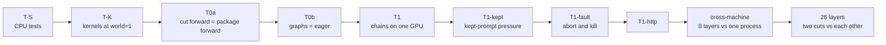

# Testing

A hive-ram chain is correct when it computes **exactly** what one process holding every layer computes: the same
logits bits in every verify window, the same kept rows, the same drafts, the same reply tokens. "The text looks
similar" is not a pass. This page describes the test ladder that proves it, how to run each rung, how to build the
shortened models the tests run on, and how traces are compared.

The trace format and the hash are specified in [protocol.md](protocol.md#11-tracing-and-comparison); the design being
tested is in [architecture.md](architecture.md).

## Verification status

| Status | Component |
|---|---|
| **VERIFIED ON HARDWARE** | Flash-Next tfpp 2-machine split token-identical to single node and as fast (KeepWarm), 3-rank chain on 2 machines |
| **VERIFIED ON HARDWARE** | tfpp-glm v1 bit-exact vs one process on the truncated 8-layer model (pure/eager/graphs, 2 cut points, kept-prompt pressure, fault abort/kill, cross-machine 19/19), 26-layer cross-machine two cuts bit-identical, HTTP path answered |
| **VERIFIED ON HARDWARE** | llama.cpp RPC Flash-Next Q4 2-node 22.2 tok/s |
| **DOES NOT FIT** | Full 45-layer GLM (~160 GiB) does NOT fit 128+64 GB: needs a third node (planned chain 128->64->128) |
| **NOT RUN ON HARDWARE** | tfpp-glm v2 (PARALLEL 2-8) |
| **NOT RUN ON HARDWARE** | tfpp-ds41 (static review only, plus its CPU tests; nothing has run on a GPU) |

Fixes made after the hardware runs (the Flash-Next wire's version 2, tfpp-glm's post-run fixes) have CPU tests only.
They change tfpp-glm's source digest, so re-run the ladder below before trusting a new checkout on hardware.

## The principle

- **The reference is one process at world=1.** For tfpp-glm that is the leader with `--layers 0:L` and no followers
  (the same `PipeGlmEngine`, with tfpp's cut forward), and `--pure` for the package's own forward. For Flash-Next it is
  TensorFold's own single-GPU path (`tfpp_run.py --role local`). For tfpp-ds41 it is the unmodified fork in one
  process (`python -m tfpp.ds41.ref`). World=1 is not bit-identical to two-way tensor parallelism (TP sums the halves'
  fp32 partials in rank order), so a TP run is never the reference.
- **What is compared is a trace, not text.** Every stage can write a JSONL trace (`--trace OUT.jsonl`). The leader
  records each request, each prompt chunk, each verify window (position, rows, the window's tokens, a hash of every
  logits row, the DFlash2 taps' hashes), the rows kept and the reply. Followers record a hash of the `x` and taps they
  send on. The hash (`devhash`) is computed on the GPU from the tensor's raw words: equal bits give equal hashes.
- **Shortened models.** The full GLM-5.3-Flash does not fit one GPU twice (or at all on these laptops), and a chain
  of several processes on one GPU needs room for every stage. The tests therefore run on a model cut after its first
  `L` layers. An 8-layer GLM writes nonsense text by construction; only equality (and speed) count.
- **Every rung must say IDENTICAL before the next one runs.** A difference found at T0 is cheaper to chase than one
  found across two machines.

## The ladder at a glance



tfpp-glm v1, as run on hardware:

| Rung | Compares | Judge | Result |
|---|---|---|---|
| T-S | protocol, checks, scripts, frozen-file pins (no GPU, no torch) | pytest | passes (CPU only, not a hardware test) |
| T-K | world=1 kernels against the two TP=2 halves, layers 0-3 | `kernel_check` | passed on both nodes (81 comparisons) |
| T0a | tfpp's cut forward (`_compute_pp`) against the package's own forward (`--pure`), one process | `compare` | bit-identical |
| T0b | CUDA graphs against eager (`--no-graphs`), one process | `compare` | bit-identical |
| T1 | two-stage chains `[0,4)+[4,8)` and `[0,5)+[5,8)` on one GPU against one process | `compare` | bit-identical at both cuts |
| T1-kept | the same chains with the kept-prompt cap at 0.5 GiB | `compare --tokens-only` | replies identical at both cuts |
| T1-fault | an exception injected on the leader; a follower killed | exit codes + `compare` | aborted request isolated, next request identical; leader exited 75 |
| T1-http | the HTTP front through a chain | 5 requests answered | answered |
| cross-machine | 128 GB node `[0,4)` over USB4 to the 64 GB node `[4,8)` + head + DFlash2, against that node's one-process run | `compare` | **19/19 requests bit-identical** |
| 26 layers | cut at 19 against cut at 20, across the two machines | `compare` | 19/19 requests bit-identical |

The hardware runs used the GLM checkpoint truncated to 8 layers at `CONTEXT=262144` with DFlash2 and the 19-prompt
bench set. The 8-layer rungs (T-K through the cross-machine run) were run a second time after the CUDA extensions
were rebuilt against CUDA 13, with the same results; the 26-layer run took place once, after the rebuild.

## T-S: the CPU tests (any machine)

No GPU, no torch, no TensorFold needed. From the `tfpp` folder of the checkout:

```bash
cd tfpp
python -m pytest -q -p no:cacheprovider tests                         # Flash-Next tfpp: wire, driver against a fake engine, compare
python -m pytest -q -p no:cacheprovider tfpp/glm/tests tfpp/ds41/tests  # tfpp-glm v1 + v2, tfpp-ds41
python -m pytest -q -p no:cacheprovider scripts/tests                 # link tools: linktest.py, relay and link-setup scripts
```

Some tests skip where the platform lacks what they need (symbolic links on Windows, Windows PowerShell elsewhere),
and the tests that read a third-party tree (the MIA package, the DeepSeek fork) skip when it is not installed.
Some socket tests are timing-sensitive under heavy load; rerun a lone failure on its own before chasing it.

The package-tree pins are checked separately, against the third-party tree you fetched:

```bash
python -m tfpp.glm.pins --check [TREE]     # tfpp-glm: the MIA package's digest must equal EXPECT_PKG_SHA (739ce991...)
python -m tfpp.ds41.pins --check ...       # tfpp-ds41: the fork at its pinned commit (see scripts/ds41/toolchain.sh)
```

## Building shortened models

### GLM-5.3-Flash: truncation, no new files

tfpp-glm needs no rebuilt checkpoint. The leader's `--truncate L` makes the chain end after layer `L - 1`: the final
norm and the head are applied there, exactly as they would be after layer 44. The leader's layers must end at `L`
(`--layers A:L`), and the DFlash2 taps (normally after layers 5, 14, 24, 33, 42) are moved inside the shortened model
with `--tap-layers` (five layer numbers).

You only need the checkpoint's small files (`config.json`, `model.safetensors.index.json`, the tokenizer files) and
the shards holding layers `[0, L)`, the token embedding, the final norm and the head. To list those shards without
torch (from `tfpp/`, with the small files already in `MODEL_DIR`):

```bash
python -c "import sys; from tfpp.glm.load import needed_shards as n; f, miss, unk = n(sys.argv[1], 0, int(sys.argv[2]), is_first=True, is_last=True, mtp=False, drafter=True); print(*f)" "$HOME/models/glm53" 8
```

Download them into the same folder with your Hugging Face client and keep the `.cache/huggingface` folder that
`hf download --local-dir` leaves: the stages compare the checkpoint's Hub revision at `HELLO`, and `VERIFY_SHARDS=1`
checks each shard's sha256 against it. `start_stage.sh --dry-run` also names any shard a stage is missing.
An 8-layer model with its embedding and head is about 22 GiB of tensors (layer sizes in
[architecture.md](architecture.md#glm-53-flash-exl3-4-bpw-numbers)).

The test scripts know three shortened shapes:

| `L` | DFlash2 taps (`--tap-layers`) | Chains `run_truncated.sh T1` runs |
|---|---|---|
| 8 (default) | `1,2,4,5,7` | `0:4 4:8` and `0:5 5:8` |
| 12 | `1,4,6,9,10` | `0:4 4:8 8:12` and `0:6 6:9 9:12` (three stages) |
| 24 | `5,9,14,18,22` | `0:8 8:16 16:24` |

Every stage must hold at least one sparse-attention (DSA, layers 3, 7, 11, ...) and one linear-attention (KDA) layer,
so a stage of fewer than four layers may be refused before it loads anything. `CONTEXT=2048` (the script's default)
keeps attention on the dense path; `CONTEXT=262144`, as in the hardware runs, also exercises the sparse path and its
graphs.
`TF_GLM_MTP=1` adds the MTP layer to the leader and needs layer 45's shards.

### DeepSeek-V4.1-Flash: the S11 model (not run on hardware)

tfpp-ds41's tests run on S11, an 11-layer model built from selected original layers (0, 1, 2, 3, 14, 20, 21, 24, 37,
38, 39, renumbered 0-10; 11 shards, 59.9 GiB). The selection covers cuts at and inside the shared-KV groups, both
Engram layers (original 1 and 14, S11's 1 and 4), the replay layer and the DSpark taps.

```bash
cd tfpp
scripts/ds41/download_list.sh                       # prints the hf commands only; edit its REV line first
SRC=$HOME/models/ds41-src scripts/ds41/make_testmodel.sh   # on EACH node: builds ~/models/ds41-s11 and ~/engram-d/{L1,L4,both}
```

- The Engram tables are made on each node, never copied: deterministic pseudo-random values ("Mode D", 2.03 GB each,
  on WSL's ext4 disk). All-zero tables would hide addressing errors; `--zero` adds them for smoke tests only.
  `make_testmodel.sh` prints their sha256: it must be the same on every node.
- Set `REVISION` (the source's full Hub commit) when `SRC` was copied without its `.cache/huggingface` folder, so
  `tfpp_selection.json` is byte-identical across nodes.

### Flash-Next: no shortened model

The whole Qwen3.8-Flash-Next MLX 4-bit + MTP checkpoint fits a 128 GB node, so the reference is the full model on one
node and the chain is the full model on two.

## tfpp-glm v1: running the ladder

All of these run from the `tfpp` folder inside WSL/Linux, with the venv from `scripts/glm/toolchain.sh`.

### T-K: kernels at world=1

```bash
python -m tfpp.glm.kernel_check --model $HOME/models/glm53 --layers 0:4 --out tk.json
```

World=1 runs every head and the full expert width in one process, shapes the package was never run with (its ranks
each held half). `kernel_check` loads layers 0-3 three times (world=1, and the two TP=2 halves), feeds all three the
same normed rows, and compares what each block writes: on the prompt path the KDA outputs and states, DSA head
outputs, latent rows, the indexer's inputs, MoE routing and expert activations must be equal bit for bit; at a decode
window of 8 rows the expert activations bit for bit and attention within a tolerance (a split-K difference by shape).
It also checks the EXL3 decode switch at a half's expert width (K2) and records first-call compile times and the
kernel paths taken (K4). Run it on every node.

### T0 and T1 on one GPU: run_truncated.sh

`scripts/glm/run_truncated.sh` starts every stage of a chain on one machine (`127.0.0.1`, ports from `PORT0`, a
declared budget per stage), runs the bench set through the leader without HTTP (`--bench`), and judges the traces with
`python -m tfpp.glm.compare`. It reads `cluster.env` as every stage would and then restores its own `CONTEXT` and
HTTP port (the serve values in `cluster.env` are the production leader's).

```bash
cd tfpp
MODEL_DIR=$HOME/models/glm53 DRAFTER_DIR=$HOME/models/glm53-dflash2 L=8 CONTEXT=262144 \
  scripts/glm/run_truncated.sh all          # T0a, T0b, T1, T1-kept, T1-fault
MODEL_DIR=... DRAFTER_DIR=... L=12 CONTEXT=262144 scripts/glm/run_truncated.sh T1   # three-stage chains
MODEL_DIR=... DRAFTER_DIR=... scripts/glm/run_truncated.sh T1-http
```

`DRAFTER_DIR` is optional: left empty, every run uses `--no-drafts` (the DFlash2 drafter is CC BY-NC-ND 4.0,
non-commercial; see [engines/tfpp-glm.md](engines/tfpp-glm.md)). Other variables: `PROMPTS` (default
`tfpp/glm/bench_prompts.jsonl`), `OUT` (default `~/tfpp-glm-tests/L<L>-ctx<CONTEXT>-<time>`), `BUDGET_GIB` (24),
`KEPT_GIB` (8), `PORT0` (5400), `TFPP_GLM_CONF` (the folder holding `cluster.env` and `toolchain.sh`).

| Mode | Runs | Passes when |
|---|---|---|
| `T0a` | `pure`: one process with `--pure` (the package's own forward); `solo`: one process with tfpp's cut forward | `compare pure solo` is IDENTICAL |
| `T0b` | `solo` (graphs) and `eager` (`--no-graphs`) | IDENTICAL |
| `T1` | every chain of the `L` row above, against `solo` | IDENTICAL for each chain |
| `T1-kept` | a one-process run and each chain with `TF_GLM_CACHE_GIB=0.5` | `compare --tokens-only` IDENTICAL for each chain |
| `T1-fault` | (1) `TFPP_FAULT=2:3`: the leader raises in request 2 after sending its third window; (2) stage 0 killed about 20 s into the run | (1) leader exits 0, request 2 DIFFERS, request 3 IDENTICAL; (2) leader exits 75 |
| `T1-http` | the last chain of the `L` row, serving `127.0.0.1:8890`: plain, streaming, a JSON-schema grammar, a tool call, a client that disconnects mid-stream, then one more request | 5 of 5 answered |

**The bench set** (`tfpp/glm/bench_prompts.jsonl`, 19 requests) covers short Chinese prose, code, a ~6k-token
prompt, multi-turn chats that share a long system prompt (so kept prompts are saved, resumed and resent), copy-heavy
text for copy drafts, seeded sampling (temperature 0.8, top-k, top-p), the same prompts without drafting, three
DFlash2 depth policies, an early stop and a one-token reply. Pictures and grammars go through HTTP only (`T1-http`).

**Why `BUDGET_GIB=24` and `KEPT_GIB=8`.** The kept-prompt byte cap is not cut-invariant: each leader counts only its
own layers' snapshot bytes, so a one-process run and a chain under the same byte cap evict different snapshots, and
later prompt records differ even though the tokens do not. The equivalence runs keep the byte cap out of play, so only
the entry count (32) evicts: every run checks that the leader's log says `prompts kept in 8.00 GiB` and fails
otherwise (raise `BUDGET_GIB` if the budget's room clamped it). `T1-kept` is the pressure test that does let the byte
cap bind, and therefore compares reply tokens only. MIA's invariant that a resumed prompt equals a fresh prefill keeps
the tokens equal either way.

**Why the fault test looks the way it does.** A failure on the leader inside a request must cost only that request:
the leader drains the activation frames still in flight, sends `END` with `abort`, and every follower drops its
uncommitted window (request 3 proves the caches were left clean). A follower that dies must stop the whole chain
with exit code 75, never leave the leader serving on stale caches. If the kill lands after the bench has finished, the
kill test fails with a hint; rerun it.

### Cross-machine: 8 layers against one process

Run the same shortened model across the cable and compare with a one-process trace made on the leader's node. Both
runs go through `start_stage.sh`, so the leader's flags are the same in both; only its layers, listen address and
trace file differ. The hardware run
put stage 0 on the 128 GB node and the leader (with the head and DFlash2) on the 64 GB node at `10.77.0.1`:

```bash
# 64 GB node: node.env for the one-process reference (run 1)
ROLE=leader
LAYERS=0:8
MODEL_DIR=$HOME/models/glm53
DRAFTER_DIR=$HOME/models/glm53-dflash2
TRUNCATE=8
TAP_LAYERS=1,2,4,5,7
TF_GLM_CACHE_GIB=8
VISION=0                                                 # the bench sends no pictures
BENCH=$HOME/hive-ram/tfpp/tfpp/glm/bench_prompts.jsonl   # your checkout's path
TRACE=$HOME/solo8.jsonl
```

For the chain (run 2), change three lines of that file and start stage 0 on the other node:

```bash
# 64 GB node: the leader                     # 128 GB node: node.env for stage 0
LAYERS=4:8                                   ROLE=follower
LISTEN=0.0.0.0:5301                          LAYERS=0:4
TRACE=$HOME/chain8.jsonl                     MODEL_DIR=$HOME/models/glm53
                                             DOWN=10.77.0.1:5301
                                             TFPP_WARM_MS=1.0
```

- On the 64 GB node's Windows side run the relay into WSL
  (`powershell -ExecutionPolicy Bypass -File relay_hop.ps1 -ListenAddress 10.77.0.1 -Ports 5301`) and allow port 5301
  from the peer only (`setup_usb4_link.ps1`; see [hardware-setup.md](hardware-setup.md)).
- `scripts/glm/start_stage.sh` on each node, in any order. With `BENCH` set, the leader runs the prompt set without
  HTTP and sends `QUIT` down the chain when it is done.
- Then `python -m tfpp.glm.compare ~/solo8.jsonl ~/chain8.jsonl`. Check that both leader logs say
  `prompts kept in 8.00 GiB`, for the reason given above.
- Use the same checkout on both nodes: `HELLO` compares tfpp-glm's own source digest (`tfpp_sha`), the package
  tree, the settings vector, the env digest and the checkpoint's revision, and refuses any difference before a weight
  loads.

Result on hardware: 19 of 19 requests bit-identical.

### 26 layers: two cuts against each other

No GPU here holds 26 GLM layers twice, and two 26-layer processes do not fit one GPU, so there is no one-process
reference. The test compares **two different cuts** of the same chain instead: if the split were wrong anywhere, the
two traces would part. With the node.env blocks above, set `TRUNCATE=26` and five tap layers below 26 on the leader,
then run twice:

| Run | Stage 0 (128 GB node) | Leader (64 GB node) | Trace |
|---|---|---|---|
| A | `LAYERS=0:19` | `LAYERS=19:26` | `TRACE=$HOME/cut19.jsonl` |
| B | `LAYERS=0:20` | `LAYERS=20:26` | `TRACE=$HOME/cut20.jsonl` |

```bash
python -m tfpp.glm.compare ~/cut19.jsonl ~/cut20.jsonl
```

Measured: stage 0 loaded 57.3 GiB (`[0, 19)`) and 60.8 GiB (`[0, 20)`); the leader with the head and DFlash2 needed
26.5 GiB with 10.4 GiB of its budget left. Result on hardware: the two cuts' 19 requests bit-identical.

### Speed with the same scripts

Tracing hashes every logits row and synchronises the GPU, so traced runs are slower. For speed, run the bench without
`TRACE` (or `--trace`) and read the leader's bench output. Measured with these shortened models (two machines, tracing
off): 14.0 ms per serial token at 8 layers and 32.3 ms at 26 layers, i.e. about 1.02 ms per extra layer plus a fixed
5.9 ms (head, sampling, one hop, Python). See [architecture.md](architecture.md#11-speed).

## Comparing traces

```bash
python -m tfpp.glm.compare REF.jsonl GOT.jsonl [--ignore-taps] [--tokens-only] [--show N]
```

- Request by request it compares the request record, every prompt chunk (rows and hashes), every verify window
  (position, rows, the window's tokens, every logits row's hash, the taps' hashes), the rows kept and the reply's
  tokens and non-timing stats. Timings are never compared.
- It prints `request N: IDENTICAL` or `request N: DIFFERS` with the first differing record and the `N` records before
  it (default 3).
- Exit 0: every request identical. Exit 1: a difference, a request that did not end in one of the traces (a run
  that stopped mid-request never passes), different request counts, or nothing to compare.
- `--tokens-only`: each request's reply tokens alone (kept-prompt pressure runs). `--ignore-taps`: leave the DFlash2
  tap hashes out of the comparison.
- In scripts, write the comparison to a file first and `grep` the file: `compare ... | grep -q` under `pipefail`
  can fail on the comparer's broken pipe when `grep` stops reading early (the first hardware run of `T1-fault` was
  misjudged this way; the scripts now do it right).

**Finding where two runs part.** Rerun both sides with `--no-graphs`, so that a difference cannot come from a graph
capture. Then compare the followers' traces (`OUT/<name>.s0.jsonl`, `.s1.jsonl`, ...): their `act` records hold the
hash of the `x` and taps each stage sent on, window by window. The first stage whose `x` hash differs from the
reference's is the stage to look at; if every stage agrees and only the leader's logits differ, look at the leader's
own layers, head or sampling.

Other comparers, for the other engines:

| Command (from `tfpp/`) | Compares | Exit codes |
|---|---|---|
| `python compare.py ref.json pp.json` | Flash-Next `tfpp_run.py` outputs, token by token, with speeds and MTP acceptance | 0 identical, 1 some differ, 2 not comparable |
| `python -m tfpp.glm.v2compare strict\|stages\|streams\|tokens\|bench ...` | tfpp-glm v2 traces and bench outputs | 0 / 1 / 2 |
| `python -m tfpp.ds41.compare ref.jsonl got.jsonl [--tokens-only \| --by-position] [--allow KEY,...] [--ignore-meta]` | tfpp-ds41 traces; the runs' recorded settings are compared first and a mismatch is refused (exit 2) | 0 / 1 / 2 |

## Flash-Next tfpp

Verified on hardware: token-identical to one node and as fast with KeepWarm; the 3-rank chain on two machines.

```bash
cd tfpp && . scripts/flashnext/env.sh
# reference, on a 128 GB node (the whole model fits)
python tfpp_run.py --role local --model DIR --depth 6 --graphs --out ref.json
# chain: the last rank on the node at 10.77.0.1, then the leader on the other node
python tfpp_run.py --role last   --model DIR --layers 32:48 --listen 5201 --depth 6 --graphs
python tfpp_run.py --role leader --model DIR --layers 0:32 --peer 10.77.0.1:5201 --depth 6 --graphs --out pp.json
python compare.py ref.json pp.json
```

- `tfpp_run.py` runs three fixed prompts (Chinese prose, Python code, a Chinese explanation), greedy, 200 tokens each
  (`--count`). Run both sides with the same `--depth`, `--capacity` and `--repeat`, or `compare.py` refuses (exit 2).
- The hardware runs covered serial eager (`--depth 0`), serial with `--graphs`, and `--depth 6 --graphs` (MTP
  drafting): 3 of 3 prompts token-identical in each, with the same MTP acceptance.
- The 3-rank chain: two ranks on the 128 GB node (`0:16` as leader, `16:32` as `--role middle` with `--listen` and
  `--peer`), the last rank `32:48` on the 64 GB node; 3 of 3 identical with the same acceptance. Its speed (24.1 / 62.9
  / 30.2 tok/s) is not representative: two processes shared one GPU.
- `TFPP_TIMING=1` prints per-phase milliseconds per round; that is how the idle-GPU downclock was found.

To reproduce the downclock measurement on one rank alone (no link):

```bash
python rank_bench.py DIR 32:48 last 1 --modes sleep@0,sleep@30,cpuspin@30,gpuwarm@30
```

`sleep@30` idles 30 ms before each step; `gpuwarm@30` idles with one spinning GPU block on a side stream, which is
what KeepWarm does. Measured: 8.7-9.0 ms back to back, 15-16.5 ms after an idle gap, 15.9 ms with the CPU spinning,
9.9 ms with the GPU kept warm.

## llama.cpp RPC

Measured on hardware for speed only: Flash-Next UD-Q4_K_XL over two nodes at 22.2 tok/s, with a short spot check of
the answers. There is no bit-level comparison for llama.cpp RPC in this repository. See
[engines/llamacpp-rpc.md](engines/llamacpp-rpc.md).

## tfpp-glm v2 (verified on one GPU)

**VERIFIED ON ONE GPU (2026-10-24), 8-layer truncated model:** batched-row invariance (T0e); pure and eager against graphs on three lockstep schedules; 2-stage chains at 2 cut points x 3 schedules bit-identical, every stage applying the leader's messages; replies equal to P=1 serial under free timing at 1, 2 and 4 streams. **Not yet run across machines.**

v2 (`--parallel 2..8`) has its own runner, `scripts/glm/run_v2.sh`, next to `run_truncated.sh` (which stays as v1
ran it). The judgement is bit-equal leader traces of a deterministic **lockstep schedule**
(`tfpp/glm/schedules/AS*.json`), with the pool plan pinned (`POOL_ROWS`, `KEPT_ENTRIES`) so every cut and the
reference admit, evict and move alike.

| Mode | Compares | Judge |
|---|---|---|
| `T0a-v2` | `--pure` against the one-process reference | `v2compare strict` |
| `T0b-v2` | `--no-graphs` against the reference | `strict` |
| `T1-v2` | every split x every schedule (`SCHEDULES`, default `AS1 AS2 AS5`) against the reference | `strict` + `stages` |
| `T2m` | the smallest end to end: one split, one schedule, solo against chain | `strict` + `stages` |
| `T1-v2-p1` | the replies of `AS1` over the chain against P=1 `--no-drafts` (the v1 path) | `bench` (tokens) |
| `T1-v2-free` | free-running schedules `FREE1 / FREE2 / FREE4` against the same P=1 replies | `bench` (tokens) |
| `T0e` | one process: a stream's row in a batched window equals that stream's window alone | bits |
| `T1-v2-fault` | faults at every protocol point, a follower killed or stopped; each followed by a clean `AS1` | exit 75, nothing left running |
| `T1-v2-http` | the v1 HTTP requests, eight at once, a client leaving | answered |

```bash
MODEL_DIR=... DRAFTER_DIR=... L=8 CONTEXT=262144 scripts/glm/run_v2.sh T0e   # first: batched-row bit invariance
MODEL_DIR=... DRAFTER_DIR=... scripts/glm/run_v2.sh all                      # T0a-v2 T0b-v2 T1-v2 T1-v2-p1 T1-v2-free
```

`T0e` has no verdict yet: that batched rows keep their bits at world=1 is the package's claim, not yet measured here.
If it fails, equal logits across schedules cannot hold and only the token-level checks remain meaningful. At `L=26`
only the one-process modes run (two 26-layer stages do not fit one GPU); the cross-machine 26-layer cuts go through
`start_stage.sh` as for v1. Fault injection: `TFPP_GLM_FAULT_V2=POINT:N` on the leader, `TFPP_GLM_FAULT_FOLLOWER=POINT:N[:stop]`
on a follower ([protocol.md](protocol.md#7-multi-stream-ops-tfpp-glm-v2-not-run-on-hardware)).

## tfpp-ds41 (not run on hardware)

Written and statically reviewed only. The planned ladder, on S11 (see above), one GPU first:

```bash
cd tfpp
MODEL_DIR=$HOME/models/ds41-s11 scripts/ds41/run_shortened.sh T-ref
python -m tfpp.ds41.kernel_check --hc --model $HOME/models/ds41-s11 --out tk.json   # T-K'
python -m tfpp.ds41.kernel_check --model $HOME/models/ds41-s11 --layer 5             # T-K (diagnostic)
scripts/ds41/run_shortened.sh T0a    # then T0b, T0c, T1-oracle, T1-exact, T1-long, T1-multi, T1-fault, T1-http
```

| Mode | Compares |
|---|---|
| `T-ref` | the fork's one-process reference twice (it must repeat itself), and with graphs off |
| `T-K'` | the one kernel change a cut makes (the last sublayer's post done alone before the cut instead of fused into the next layer's mixes), bit for bit at world=1; on failure set `TFPP_DS41_CUT_POST=carry` on every stage and rerun everything |
| `T-K` | world=1 MoE and attention output projections against the two TP=2 halves summed in rank order (a tolerance, diagnostic) |
| `T0a` | tfpp-ds41 as one stage `0:11` against the reference |
| `T0b` | `--no-graphs` against the reference |
| `T0c` | every two-stage cut the taps allow (S11: 1-8) and four 3- and 4-stage splits, on one GPU |
| `T1-oracle` | planted drafts (`--oracle`, fixed depth policy) at cuts 3 and 6; planted drafts change no reply |
| `T1-exact` | exact prefill (`TF_DS_REPLAY=0`, prompts up to 4,500 tokens) at cuts 3, 6, 7 |
| `T1-long` | `CONTEXT=32768` with long prompts at cuts 6 and 7 |
| `T1-multi` | concurrent requests at cut 6: `--tokens-only` and `--by-position` (every computed row keyed by its whole input) |
| `T1-fault` | a leader fault with an activation in flight (one request fails, the rest match); stage 0 killed mid-bench (leader exits 75); a follower's own fault at its 40th step (exit 75) |
| `T1-http` | 4 HTTP requests and the fork's `parallel_check` |
| `T-X0` | the same 16-expert reference on each node, then the two traces compared: do the machines compute alike |

Across machines (`T1-c6`, `T1-c3`, `T1-3`, `T-X`): each node's `node.env` takes the matching test block of
`scripts/ds41/node.env.example`, the receiving node runs `relay_hop.ps1 -ListenAddress <10.77.0.x> -Ports 5321`,
`start_stage.sh` runs on every node, and the leader's trace is compared with the one-GPU `ref.jsonl`. None of this has
run yet; the first hardware run may well meet problems in the fork's own world=1 round graphs before any in the split.

## Pitfalls we hit

- **Stop other GPU workloads first.** A stage measures free memory once, at `CAP`; anything that grows later runs it
  out of memory mid-request. The scripts refuse to start beside a listener on `GPU_GUARD_PORTS` unless
  `ALLOW_GPU_SHARING=1`.
- **The WSL2 page cache counts as Windows commit.** After copying or downloading tens of GB, drop the cache before a
  big stage loads (tfpp-glm's loader reads with O_DIRECT and drops the shards' cached pages itself).
- **Production values leaking into tests.** `cluster.env` holds the serving leader's `CONTEXT` and HTTP port; the test
  scripts read it and then restore their own values. If you write your own runner, do the same.
- **Mixed CUDA runtimes.** Extensions built against a CUDA 12 runtime beside torch's CUDA 13 load but are a different
  build; `start_stage.sh` refuses them. After a rebuild, run T-K again.
- **Every node on the same checkout.** A follower on an older checkout is refused at `HELLO` (`tfpp_sha`), not
  silently mixed in.
